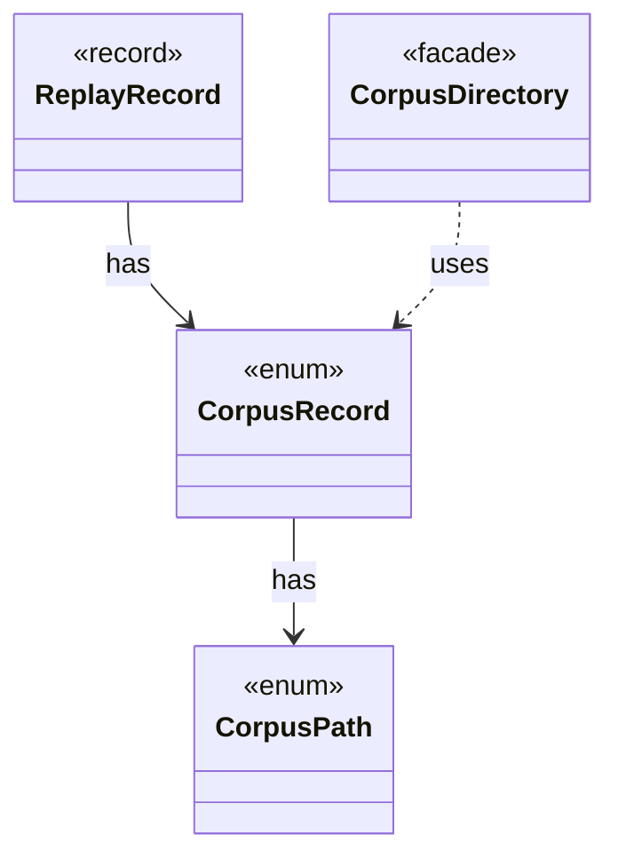

# `CorpusRecord`

`io.github.tlaplus.hardening.corpus` · enum · other · [source](https://github.com/tlaplus/model-checker-hardening/blob/b96eff75a5bbf8a60b15ad020d6e84735c75a47c/src/main/java/io/github/tlaplus/hardening/corpus/CorpusRecord.java#L7) · module [corpus](../modules/corpus.md)

A small corpus file that pins how the corpus's entries replay.

The diagram draws 3 of 5 relations; the table lists them all.

| Direction | Relation | Type | Summary |
|---|---|---|---|
| → | has | [CorpusPath](io.github.tlaplus.hardening.corpus.CorpusPath.md) | A fixed path in the on-disk corpus layout. |
| ← | has | [ReplayRecord](io.github.tlaplus.hardening.workflow.ReplayRecord.md) | Replay policy for one corpus record: a run may proceed only when the record says what the run would write. |
| ← | uses | [CorpusDirectory](io.github.tlaplus.hardening.corpus.CorpusDirectory.md) | Owns the on-disk layout and integrity checks for one FuzzTLA corpus. |
| ← | depends | [CorpusRecords](io.github.tlaplus.hardening.workflow.CorpusRecords.md) | The corpus records that pin how entries replay (ADR 0017 §6), and the technique record of a corpus from before ADR 0025, whose configuration must now repeat it. |
| ← | depends | [LibraryManifest](io.github.tlaplus.hardening.workflow.library.LibraryManifest.md) | Replay policy for external source snapshots. |
