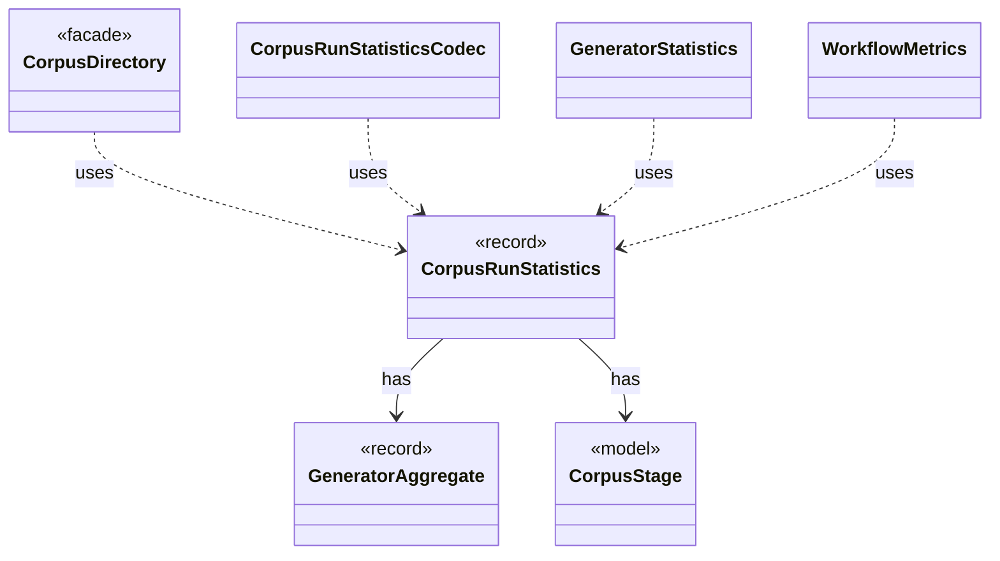

# `CorpusRunStatistics`

`io.github.tlaplus.hardening.corpus` · record · other · [source](https://github.com/tlaplus/model-checker-hardening/blob/5b16596dd480095d323ac67ff0f85eb85227b4b5/src/main/java/io/github/tlaplus/hardening/corpus/CorpusRunStatistics.java#L15) · module [corpus](../modules/corpus.md)

Durable cumulative statistics that cannot be recovered cheaply from corpus entries.

The diagram draws 6 of 9 relations; the table lists them all.

| Direction | Relation | Type | Summary |
|---|---|---|---|
| → | has | [GeneratorAggregate](io.github.tlaplus.hardening.common.GeneratorAggregate.md) | Immutable generation counters shared by persisted statistics and invocation summaries. |
| → | has | [CorpusStage](io.github.tlaplus.hardening.corpus.CorpusStage.md) | One implemented stage of the fuzzing pipeline, and the corpus directories it owns. |
| ← | uses | [CorpusDirectory](io.github.tlaplus.hardening.corpus.CorpusDirectory.md) | Owns the on-disk layout and integrity checks for one FuzzTLA corpus. |
| ← | uses | [CorpusRunStatisticsCodec](io.github.tlaplus.hardening.corpus.CorpusRunStatisticsCodec.md) | Encodes and decodes the aggregate workflow-statistics CBOR document. |
| ← | uses | [GeneratorStatistics](io.github.tlaplus.hardening.workflow.execution.GeneratorStatistics.md) | Cumulative input-generation counters shared by the generator workers. |
| ← | uses | [WorkflowMetrics](io.github.tlaplus.hardening.workflow.execution.WorkflowMetrics.md) | The cumulative statistics of one workflow invocation: how long each stage has been busy, what input generation has produced, and the total elapsed time carried over from earlier runs. |
| → | depends | [Preconditions](io.github.tlaplus.hardening.common.Preconditions.md) | Shared validation of method and constructor arguments. |
| ← | depends | [RunStatisticsOnExit](io.github.tlaplus.hardening.workflow.RunStatisticsOnExit.md) | Stops the invocation clock and saves its aggregate while the corpus lock is still held. |
| ← | depends | [WorkflowRunner](io.github.tlaplus.hardening.workflow.WorkflowRunner.md) | Runs generation, parsing, TLC, Apalache, conformance aggregation and the quality gate under one CPU budget. |
