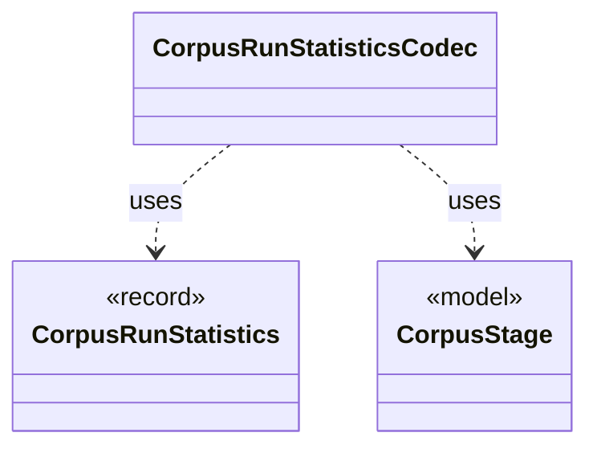

# `CorpusRunStatisticsCodec`

`io.github.tlaplus.hardening.corpus` · class · other · [source](https://github.com/tlaplus/model-checker-hardening/blob/3b201567990514c2a43b90dca521dbe32af37023/src/main/java/io/github/tlaplus/hardening/corpus/CorpusRunStatisticsCodec.java#L12) · module [corpus](../modules/corpus.md)

Encodes and decodes the aggregate workflow-statistics CBOR document.

The diagram draws 2 of 8 relations; the table lists them all.

| Direction | Relation | Type | Summary |
|---|---|---|---|
| → | uses | [CorpusRunStatistics](io.github.tlaplus.hardening.corpus.CorpusRunStatistics.md) | Durable cumulative statistics that cannot be recovered cheaply from corpus entries. |
| → | uses | [CorpusStage](io.github.tlaplus.hardening.corpus.CorpusStage.md) | One implemented stage of the fuzzing pipeline, and the corpus directories it owns. |
| → | depends | [Diagnostics](io.github.tlaplus.hardening.common.Diagnostics.md) | Human-readable diagnostic formatting for failures. |
| → | depends | [GeneratorAggregate](io.github.tlaplus.hardening.common.GeneratorAggregate.md) | Immutable generation counters shared by persisted statistics and invocation summaries. |
| → | depends | [CborMapWriter](io.github.tlaplus.hardening.corpus.CborMapWriter.md) | Collects the fields of one CBOR map so that its definite length is derived from what is written rather than maintained beside it. |
| → | depends | [CborReader](io.github.tlaplus.hardening.corpus.CborReader.md) | Reads one CBOR document of a corpus, checking its shape as it goes. |
| → | depends | [CorpusFormatException](io.github.tlaplus.hardening.corpus.CorpusFormatException.md) | Reports stored corpus data that does not follow the documented CBOR format. |
| ← | depends | [CorpusDirectory](io.github.tlaplus.hardening.corpus.CorpusDirectory.md) | Owns the on-disk layout and integrity checks for one FuzzTLA corpus. |
