# `CorpusStage`

`io.github.tlaplus.hardening.corpus` · enum · model · key · [source](https://github.com/tlaplus/model-checker-hardening/blob/fd29bdb142d5d87538f91aeddca09d5ac3d7d0a7/src/main/java/io/github/tlaplus/hardening/corpus/CorpusStage.java#L22) · module [corpus](../modules/corpus.md)

One implemented stage of the fuzzing pipeline, and the corpus directories it owns.

```mermaid
classDiagram
  class CorpusStage {
    <<model>>
  }
  class CheckerSet {
    <<record>>
  }
  class CorpusVerdict {
    <<model>>
  }
  class RunView {
    <<view>>
  }
  class CheckerProfile {
    <<config>>
  }
  class WorkflowConfig {
    <<config>>
  }
  class AggregationInput {
    <<record>>
  }
  class CorpusInventory {
    <<record>>
  }
  class CorpusRunStatistics {
    <<record>>
  }
  class EntryProgress {
    <<record>>
  }
  class StageScratchSet
  class GenerationProgress {
    <<model>>
  }
  class StageGraph {
    <<process>>
  }
  class WorkflowProgress {
    <<record>>
  }
  class WorkflowRunSummary {
    <<record>>
  }
  class AggregatorStage {
    <<process>>
  }
  class StageClocks
  class ParserRouting {
    <<policy>>
  }
  class TlcCheckerBackend {
    <<adapter>>
  }
  class CorpusPath {
    <<enum>>
  }
  class StageResult {
    <<record>>
  }
  class RunMetric {
    <<interface>>
  }
  class RunPalette {
    <<record>>
  }
  class RunText {
    <<record>>
  }
  class ConfigSchema {
    <<config>>
  }
  class AggregationRecovery
  class AggregationTransition
  class CorpusDirectory {
    <<facade>>
  }
  class CorpusEntries
  class CorpusEnvelope {
    <<record>>
  }
  class CorpusLayout {
    <<store>>
  }
  CorpusStage <|.. CheckerSet
  CorpusStage --> CorpusVerdict : has
  RunView --> CorpusStage : has
  CheckerProfile --> CorpusStage : has
  WorkflowConfig --> CorpusStage : has
  AggregationInput --> CorpusStage : has
  CorpusInventory --> CorpusStage : has
  CorpusRunStatistics --> CorpusStage : has
  EntryProgress --> CorpusStage : has
  StageScratchSet --> CorpusStage : has
  GenerationProgress --> CorpusStage : has
  StageGraph --> CorpusStage : has
  WorkflowProgress --> CorpusStage : has
  WorkflowRunSummary --> CorpusStage : has
  AggregatorStage --> CorpusStage : has
  StageClocks --> CorpusStage : has
  ParserRouting --> CorpusStage : has
  TlcCheckerBackend --> CorpusStage : has
  CorpusStage ..> CorpusPath : uses
  CorpusStage ..> StageResult : uses
  RunMetric ..> CorpusStage : uses
  RunPalette ..> CorpusStage : uses
  RunText ..> CorpusStage : uses
  ConfigSchema ..> CorpusStage : uses
  AggregationRecovery ..> CorpusStage : uses
  AggregationTransition ..> CorpusStage : uses
  CorpusDirectory ..> CorpusStage : uses
  CorpusEntries ..> CorpusStage : uses
  CorpusEnvelope ..> CorpusStage : uses
  CorpusLayout ..> CorpusStage : uses
```

The diagram draws 30 of 58 relations; the table lists them all.

| Direction | Relation | Type | Summary |
|---|---|---|---|
| ← | implements | [CheckerSet](io.github.tlaplus.hardening.corpus.CheckerSet.md) | The checker branches a corpus runs: a non-empty set of checking stages, in stage order. |
| → | has | [CorpusVerdict](io.github.tlaplus.hardening.corpus.CorpusVerdict.md) | A verdict supported by the implemented corpus stages. |
| ← | has | [RunView](io.github.tlaplus.hardening.cli.RunView.md) | The statistics shared by live and final reports, without layout or terminal state. |
| ← | has | [CheckerProfile](io.github.tlaplus.hardening.config.CheckerProfile.md) | What differs between the configured model checkers: the defaults of their resource settings and the documentation of the settings whose meaning follows from the worker lifecycle. |
| ← | has | [WorkflowConfig](io.github.tlaplus.hardening.config.WorkflowConfig.md) | Global and per-stage limits for the implemented fuzzing workflow. |
| ← | has | [AggregationInput](io.github.tlaplus.hardening.corpus.AggregationInput.md) | A logical corpus entry whose non-crash checker results are ready for aggregation. |
| ← | has | [CorpusInventory](io.github.tlaplus.hardening.corpus.CorpusInventory.md) | Immutable startup inventory used to seed stage queues and capacities. |
| ← | has | [CorpusRunStatistics](io.github.tlaplus.hardening.corpus.CorpusRunStatistics.md) | Durable cumulative statistics that cannot be recovered cheaply from corpus entries. |
| ← | has | [EntryProgress](io.github.tlaplus.hardening.corpus.EntryProgress.md) | How far one logical entry has moved through the pipeline, and the single definition of the two questions generation scheduling asks of it (ADR 0010). |
| ← | has | [StageScratchSet](io.github.tlaplus.hardening.corpus.StageScratchSet.md) | The transient scratch directories of every stage that needs one, created and removed together. |
| ← | has | [GenerationProgress](io.github.tlaplus.hardening.workflow.GenerationProgress.md) | Where every generation of a run stands, tracked from stage events instead of a corpus rescan (ADR 0010). |
| ← | has | [StageGraph](io.github.tlaplus.hardening.workflow.StageGraph.md) | The stages that run one workflow invocation, wired to their queues, result capacities, and shared collaborators, and the order in which they start and stop. |
| ← | has | [WorkflowProgress](io.github.tlaplus.hardening.workflow.WorkflowProgress.md) | Best-effort snapshot of cumulative corpus statistics and current pending work. |
| ← | has | [WorkflowRunSummary](io.github.tlaplus.hardening.workflow.WorkflowRunSummary.md) | Cumulative corpus statistics and stopping reason after one complete workflow invocation. |
| ← | has | [AggregatorStage](io.github.tlaplus.hardening.workflow.aggregator.AggregatorStage.md) | Joins completed TLC and Apalache results with one in-process worker. |
| ← | has | [StageClocks](io.github.tlaplus.hardening.workflow.execution.StageClocks.md) | One elapsed-time accumulator per corpus stage, seeded from the corpus's durable statistics. |
| ← | has | [ParserRouting](io.github.tlaplus.hardening.workflow.parser.ParserRouting.md) | Routes parser results. |
| ← | has | [TlcCheckerBackend](io.github.tlaplus.hardening.workflow.tlc.TlcCheckerBackend.md) | Adapts fresh isolated TLC invocations to the shared tool stage. |
| → | uses | [CorpusPath](io.github.tlaplus.hardening.corpus.CorpusPath.md) | A fixed path in the on-disk corpus layout. |
| → | uses | [StageResult](io.github.tlaplus.hardening.corpus.StageResult.md) | What one stage decided about one input, and the tool output kept for triage. |
| ← | uses | [RunMetric](io.github.tlaplus.hardening.cli.RunMetric.md) | Stable field identity, independent of screen coordinates or formatted text. |
| ← | uses | [RunPalette](io.github.tlaplus.hardening.cli.RunPalette.md) | Capability-aware styles on the terminal's own palette and default background. |
| ← | uses | [RunText](io.github.tlaplus.hardening.cli.RunText.md) | Shared field formatting; attributed text keeps terminal escapes out of width arithmetic. |
| ← | uses | [ConfigSchema](io.github.tlaplus.hardening.config.ConfigSchema.md) | The declaration of every key in `config.toml`: where it lives, what it means, how its value is read, and how it is written back. |
| ← | uses | [AggregationRecovery](io.github.tlaplus.hardening.corpus.AggregationRecovery.md) | Recovers aggregate commits and inventories the aggregator's result directories. |
| ← | uses | [AggregationTransition](io.github.tlaplus.hardening.corpus.AggregationTransition.md) | Joins the checker copies of one logical input into one durable aggregator result. |
| ← | uses | [CorpusDirectory](io.github.tlaplus.hardening.corpus.CorpusDirectory.md) | Owns the on-disk layout and integrity checks for one FuzzTLA corpus. |
| ← | uses | [CorpusEntries](io.github.tlaplus.hardening.corpus.CorpusEntries.md) | Reads corpus entries and states what makes one valid: a decodable CBOR envelope holding an expression, a name that matches its payload digest, a payload the caller's validator accepts, and stage metadata consistent with the directory the entry sits in. |
| ← | uses | [CorpusEnvelope](io.github.tlaplus.hardening.corpus.CorpusEnvelope.md) | Supported fields decoded from one corpus input envelope. |
| ← | uses | [CorpusLayout](io.github.tlaplus.hardening.corpus.CorpusLayout.md) | Where one corpus keeps its files, how an entry is named, and how a file is written into it. |
| ← | uses | [CorpusRunStatisticsCodec](io.github.tlaplus.hardening.corpus.CorpusRunStatisticsCodec.md) | Encodes and decodes the aggregate workflow-statistics CBOR document. |
| ← | uses | [ExpectedOutcome](io.github.tlaplus.hardening.corpus.ExpectedOutcome.md) | The checker verdict an input predicts, independently of any checker (ADR 0023 §4): a graph input predicts a counterexample of known length when its target is reachable within the step bound, and a pass otherwise. |
| ← | uses | [InventoryScan](io.github.tlaplus.hardening.corpus.InventoryScan.md) | The second pass of startup recovery: validates every entry of a corpus in which no transition is half-finished, and reports what it holds. |
| ← | uses | [Oracle](io.github.tlaplus.hardening.corpus.Oracle.md) | How the aggregator judges the checker results of one entry (fuzzing-workflows.md §1.3, ADR 0016 §4, ADR 0019, ADR 0023 §5). |
| ← | uses | [StageResult](io.github.tlaplus.hardening.corpus.StageResult.md) | What one stage decided about one input, and the tool output kept for triage. |
| ← | uses | [StageTransition](io.github.tlaplus.hardening.corpus.StageTransition.md) | Moves one entry from a stage's input directory to the directory its verdict names. |
| ← | uses | [CheckerBackends](io.github.tlaplus.hardening.workflow.CheckerBackends.md) | How each model-checker stage builds its backend for one invocation. |
| ← | uses | [WorkflowRunner](io.github.tlaplus.hardening.workflow.WorkflowRunner.md) | Runs generation, parsing, TLC, Apalache, conformance aggregation and the quality gate under one CPU budget. |
| ← | uses | [ApalacheCheckerBackend](io.github.tlaplus.hardening.workflow.apalache.ApalacheCheckerBackend.md) | Adapts persistent Apalache tool workers to the shared tool stage. |
| ← | uses | [WorkflowEvents](io.github.tlaplus.hardening.workflow.execution.WorkflowEvents.md) | Durable admission and stage transitions, reported to whatever schedules generations (ADR 0010). |
| ← | uses | [ParserBackend](io.github.tlaplus.hardening.workflow.parser.ParserBackend.md) | Runs SANY in persistent isolated JVMs, one per stage worker, each replaced after a crash. |
| ← | uses | [ToolBackend](io.github.tlaplus.hardening.workflow.tool.ToolBackend.md) | Tool-specific behavior injected into the shared `ToolStage`. |
| → | depends | [CorpusException](io.github.tlaplus.hardening.corpus.CorpusException.md) | Reports an invalid corpus layout or corpus entry. |
| ← | depends | [ProgressLayout](io.github.tlaplus.hardening.cli.ProgressLayout.md) | Pure, size-bounded flow and table layouts for the same statistics and styles. |
| ← | depends | [RunTable](io.github.tlaplus.hardening.cli.RunTable.md) | Complete, exact statistics grouped by stage; suitable for scrollback and redirected output. |
| ← | depends | [ConfigValueType](io.github.tlaplus.hardening.config.ConfigValueType.md) | How the value of one configuration key is read from TOML and written back as TOML syntax. |
| ← | depends | [TomlConfig](io.github.tlaplus.hardening.config.TomlConfig.md) | Reads and writes the strict `config.toml` format used by a corpus. |
| ← | depends | [TransitionRecovery](io.github.tlaplus.hardening.corpus.TransitionRecovery.md) | The first pass of startup recovery: finishes the durable transitions an interrupted run left behind. |
| ← | depends | [CorpusDatabaseSchema](io.github.tlaplus.hardening.database.CorpusDatabaseSchema.md) | The schema of the corpus database, as the corpus-database manual documents it. |
| ← | depends | [CorpusRecords](io.github.tlaplus.hardening.workflow.CorpusRecords.md) | The corpus records a run repeats on every later run (ADR 0016 §1, §5, ADR 0017 §6): the technique, the checker set and the rewrite rules. |
| ← | depends | [GenerationLoop](io.github.tlaplus.hardening.workflow.GenerationLoop.md) | Runs the generations of one workflow invocation over a single stage graph (ADR 0010). |
| ← | depends | [MetamorphicShrinker](io.github.tlaplus.hardening.workflow.MetamorphicShrinker.md) | Reduces a metamorphic counterexample for triage (ADR 0016 §8). |
| ← | depends | [OccupancyLimits](io.github.tlaplus.hardening.workflow.OccupancyLimits.md) | Checks an invocation and a recovered corpus against the configured capacity limits. |
| ← | depends | [ParentPool](io.github.tlaplus.hardening.workflow.input.ParentPool.md) | The entries of `04quality-pass` that a generation mutates or adopts: those of the kind the run generates, read once when the generation starts. |
| ← | depends | [LibraryPreparation](io.github.tlaplus.hardening.workflow.library.LibraryPreparation.md) | Prepares custom libraries once before decoding; no importer/typechecker Maven dependency. |
| ← | depends | [QualityGate](io.github.tlaplus.hardening.workflow.quality.QualityGate.md) | Selects the parents of the next generation from one settled generation (ADR 0010, ADR 0013). |
| ← | depends | [SpecDecoders](io.github.tlaplus.hardening.workflow.spec.SpecDecoders.md) | Immutable registry of the decoders that turn stored payloads into checkable modules. |
| ← | depends | [ToolStage](io.github.tlaplus.hardening.workflow.tool.ToolStage.md) | One stage that runs an external tool over corpus entries: the parser, TLC, or Apalache. |
