# `CorpusVerdict`

`io.github.tlaplus.hardening.corpus` · enum · model · key · [source](https://github.com/tlaplus/model-checker-hardening/blob/3df8c8564b58e946b95079b671788c8315f98831/src/main/java/io/github/tlaplus/hardening/corpus/CorpusVerdict.java#L8) · module [corpus](../modules/corpus.md)

A verdict supported by the implemented corpus stages.

```mermaid
classDiagram
  class CorpusVerdict {
    <<model>>
  }
  class CorpusStage {
    <<model>>
  }
  class EntryProgress {
    <<record>>
  }
  class ShallowPattern {
    <<enum>>
  }
  class StageEntryCounts {
    <<record>>
  }
  class StageRecord {
    <<model>>
  }
  class VerdictTally
  class StageCounters
  class QualityCell {
    <<record>>
  }
  class StageOutcome {
    <<enum>>
  }
  class RunMetric {
    <<interface>>
  }
  class RunText {
    <<record>>
  }
  class AggregationInput {
    <<record>>
  }
  class AggregationTransition
  class CorpusDirectory {
    <<facade>>
  }
  class CorpusEntries
  class InventoryScan
  class Oracle {
    <<policy>>
  }
  class StageMetadata {
    <<record>>
  }
  class StageResult {
    <<record>>
  }
  class GenerationProgress {
    <<model>>
  }
  class CheckerRouting {
    <<policy>>
  }
  class StageVerdictSummary {
    <<record>>
  }
  class WorkflowEvents {
    <<contract>>
  }
  class ParserRouting {
    <<policy>>
  }
  class StageRouting {
    <<contract>>
  }
  CorpusStage --> CorpusVerdict : has
  EntryProgress --> CorpusVerdict : has
  ShallowPattern --> CorpusVerdict : has
  StageEntryCounts --> CorpusVerdict : has
  StageRecord --> CorpusVerdict : has
  VerdictTally --> CorpusVerdict : has
  StageCounters --> CorpusVerdict : has
  QualityCell --> CorpusVerdict : has
  StageOutcome --> CorpusVerdict : has
  RunMetric ..> CorpusVerdict : uses
  RunText ..> CorpusVerdict : uses
  AggregationInput ..> CorpusVerdict : uses
  AggregationTransition ..> CorpusVerdict : uses
  CorpusDirectory ..> CorpusVerdict : uses
  CorpusEntries ..> CorpusVerdict : uses
  InventoryScan ..> CorpusVerdict : uses
  Oracle ..> CorpusVerdict : uses
  StageMetadata ..> CorpusVerdict : uses
  StageResult ..> CorpusVerdict : uses
  GenerationProgress ..> CorpusVerdict : uses
  CheckerRouting ..> CorpusVerdict : uses
  StageVerdictSummary ..> CorpusVerdict : uses
  WorkflowEvents ..> CorpusVerdict : uses
  ParserRouting ..> CorpusVerdict : uses
  StageRouting ..> CorpusVerdict : uses
```

The diagram draws 25 of 40 relations; the table lists them all.

| Direction | Relation | Type | Summary |
|---|---|---|---|
| ← | has | [CorpusStage](io.github.tlaplus.hardening.corpus.CorpusStage.md) | One implemented stage of the fuzzing pipeline, and the corpus directories it owns. |
| ← | has | [EntryProgress](io.github.tlaplus.hardening.corpus.EntryProgress.md) | How far one logical entry has moved through the pipeline, and the single definition of the two questions generation scheduling asks of it (ADR 0010). |
| ← | has | [ShallowPattern](io.github.tlaplus.hardening.corpus.ShallowPattern.md) | A way in which a TLC run explored almost nothing, as the calibration table of ADR 0008 defines it. |
| ← | has | [StageEntryCounts](io.github.tlaplus.hardening.corpus.StageEntryCounts.md) | How many entries one stage has produced under each verdict. |
| ← | has | [StageRecord](io.github.tlaplus.hardening.corpus.StageRecord.md) | What a stage records about one input: its verdict, when it worked on the input, its failure classification when it classifies failures, and what it explored when it measures exploration. |
| ← | has | [VerdictTally](io.github.tlaplus.hardening.corpus.VerdictTally.md) | A mutable per-verdict count, built up while scanning a corpus and read as `StageEntryCounts`. |
| ← | has | [StageCounters](io.github.tlaplus.hardening.workflow.execution.StageCounters.md) | Verdict counters for one stage, seeded from the corpus and updated by its workers. |
| ← | has | [QualityCell](io.github.tlaplus.hardening.workflow.quality.QualityCell.md) | The behaviour cell of an admissible entry (ADR 0013): its TLC verdict and the components of its `QualityKey`, each after its bucket. |
| ← | has | [StageOutcome](io.github.tlaplus.hardening.workflow.worker.StageOutcome.md) | Common result of processing one input in a checking stage. |
| ← | uses | [RunMetric](io.github.tlaplus.hardening.cli.RunMetric.md) | Stable field identity, independent of screen coordinates or formatted text. |
| ← | uses | [RunText](io.github.tlaplus.hardening.cli.RunText.md) | Shared field formatting; attributed text keeps terminal escapes out of width arithmetic. |
| ← | uses | [AggregationInput](io.github.tlaplus.hardening.corpus.AggregationInput.md) | A logical corpus entry whose non-crash checker results are ready for aggregation. |
| ← | uses | [AggregationTransition](io.github.tlaplus.hardening.corpus.AggregationTransition.md) | Joins the checker copies of one logical input into one durable aggregator result. |
| ← | uses | [CorpusDirectory](io.github.tlaplus.hardening.corpus.CorpusDirectory.md) | Owns the on-disk layout and integrity checks for one FuzzTLA corpus. |
| ← | uses | [CorpusEntries](io.github.tlaplus.hardening.corpus.CorpusEntries.md) | Reads corpus entries and states what makes one valid: a decodable CBOR envelope holding an expression, a name that matches its payload digest, a payload the caller's validator accepts, and stage metadata consistent with the directory the entry sits in. |
| ← | uses | [InventoryScan](io.github.tlaplus.hardening.corpus.InventoryScan.md) | The second pass of startup recovery: validates every entry of a corpus in which no transition is half-finished, and reports what it holds. |
| ← | uses | [Oracle](io.github.tlaplus.hardening.corpus.Oracle.md) | How the aggregator judges the checker results of one entry (fuzzing-workflows.md §1.3, ADR 0016 §4, ADR 0019). |
| ← | uses | [StageMetadata](io.github.tlaplus.hardening.corpus.StageMetadata.md) | Metadata recorded when one workflow stage finishes processing an input. |
| ← | uses | [StageResult](io.github.tlaplus.hardening.corpus.StageResult.md) | What one stage decided about one input, and the tool output kept for triage. |
| ← | uses | [GenerationProgress](io.github.tlaplus.hardening.workflow.GenerationProgress.md) | Where every generation of a run stands, tracked from stage events instead of a corpus rescan (ADR 0010). |
| ← | uses | [CheckerRouting](io.github.tlaplus.hardening.workflow.checker.CheckerRouting.md) | Routes a model checker's results. |
| ← | uses | [StageVerdictSummary](io.github.tlaplus.hardening.workflow.execution.StageVerdictSummary.md) | Cumulative verdict counters and summed worker elapsed time for one stage. |
| ← | uses | [WorkflowEvents](io.github.tlaplus.hardening.workflow.execution.WorkflowEvents.md) | Durable admission and stage transitions, reported to whatever schedules generations (ADR 0010). |
| ← | uses | [ParserRouting](io.github.tlaplus.hardening.workflow.parser.ParserRouting.md) | Routes parser results. |
| ← | uses | [StageRouting](io.github.tlaplus.hardening.workflow.tool.StageRouting.md) | Where a `ToolStage` takes its inputs from, how it bounds its result directories, and where a recorded result goes next. |
| ← | depends | [EnvelopeReport](io.github.tlaplus.hardening.cli.EnvelopeReport.md) | Renders a decoded corpus envelope and its expression as plain text. |
| ← | depends | [ProgressLayout](io.github.tlaplus.hardening.cli.ProgressLayout.md) | Pure, size-bounded flow and table layouts for the same statistics and styles. |
| ← | depends | [RunPalette](io.github.tlaplus.hardening.cli.RunPalette.md) | Capability-aware styles on the terminal's own palette and default background. |
| ← | depends | [RunTable](io.github.tlaplus.hardening.cli.RunTable.md) | Complete, exact statistics grouped by stage; suitable for scrollback and redirected output. |
| ← | depends | [RunView](io.github.tlaplus.hardening.cli.RunView.md) | The statistics shared by live and final reports, without layout or terminal state. |
| ← | depends | [AggregationRecovery](io.github.tlaplus.hardening.corpus.AggregationRecovery.md) | Recovers aggregate commits and inventories the aggregator's result directories. |
| ← | depends | [CorpusEnvelopeCodec](io.github.tlaplus.hardening.corpus.CorpusEnvelopeCodec.md) | Reads and rewrites the `stages` metadata of a corpus envelope. |
| ← | depends | [CorpusInventory](io.github.tlaplus.hardening.corpus.CorpusInventory.md) | Immutable startup inventory used to seed stage queues and capacities. |
| ← | depends | [StageTransition](io.github.tlaplus.hardening.corpus.StageTransition.md) | Moves one entry from a stage's input directory to the directory its verdict names. |
| ← | depends | [TransitionRecovery](io.github.tlaplus.hardening.corpus.TransitionRecovery.md) | The first pass of startup recovery: finishes the durable transitions an interrupted run left behind. |
| ← | depends | [EntryRows](io.github.tlaplus.hardening.database.EntryRows.md) | The rows that one decoded corpus entry contributes: its `entry` row, followed by the rows that reference it: one `knownDefect` row per signature, one `mutationOperator` row per operator, one `stage` row per stage record, one `expr` row per expression construct of its replayed input and one `exprEdge` row per edge between constructs. |
| ← | depends | [AggregatorStage](io.github.tlaplus.hardening.workflow.aggregator.AggregatorStage.md) | Joins completed TLC and Apalache results with one in-process worker. |
| ← | depends | [ParentPool](io.github.tlaplus.hardening.workflow.input.ParentPool.md) | The entries of `04quality-pass` that a generation mutates or adopts: those of the kind the run generates, read once when the generation starts. |
| ← | depends | [QualityGate](io.github.tlaplus.hardening.workflow.quality.QualityGate.md) | Selects the parents of the next generation from one settled generation (ADR 0010, ADR 0013). |
| ← | depends | [ToolStage](io.github.tlaplus.hardening.workflow.tool.ToolStage.md) | One stage that runs an external tool over corpus entries: the parser, TLC, or Apalache. |
