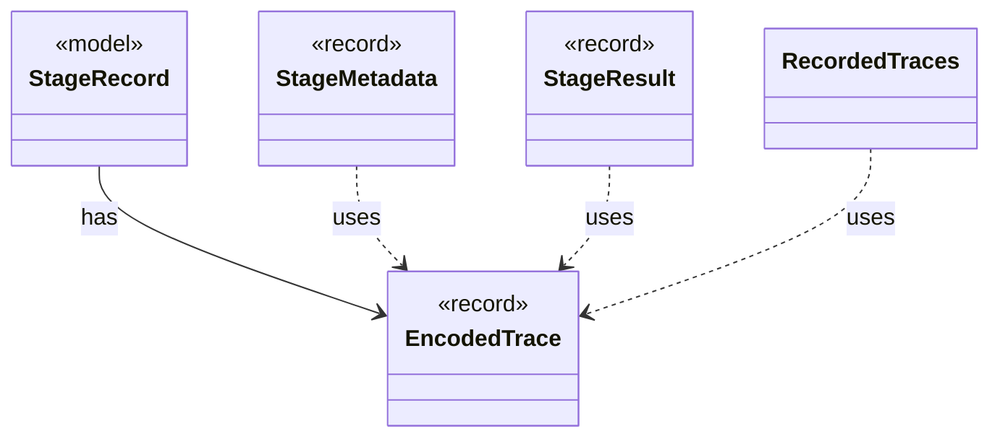

# `EncodedTrace`

`io.github.tlaplus.hardening.corpus` · record · other · [source](https://github.com/tlaplus/model-checker-hardening/blob/6fa04b06239faa249744652fc9a20140aed0d561/src/main/java/io/github/tlaplus/hardening/corpus/EncodedTrace.java#L12) · module [corpus](../modules/corpus.md)

The counterexample a checker stage recorded (ADR 0034 §5), stored under ` stages.&lt;checker&gt;.trace`.

**Decisions:** [ADR 0034: Replaying counterexamples as corpus inputs](https://github.com/tlaplus/model-checker-hardening/blob/6fa04b06239faa249744652fc9a20140aed0d561/docs/decisions/0034-counterexample-replay.md)

The diagram draws 4 of 6 relations; the table lists them all.

| Direction | Relation | Type | Summary |
|---|---|---|---|
| ← | has | [StageRecord](io.github.tlaplus.hardening.corpus.StageRecord.md) | What a stage records about one input: its verdict, when it worked on the input, its failure classification when it classifies failures, what it explored when it measures exploration, and the counterexample's trace when the run replays them (ADR 0034 §5). |
| ← | uses | [StageMetadata](io.github.tlaplus.hardening.corpus.StageMetadata.md) | Metadata recorded when one workflow stage finishes processing an input. |
| ← | uses | [StageResult](io.github.tlaplus.hardening.corpus.StageResult.md) | What one stage decided about one input, and the tool output kept for triage. |
| ← | uses | [RecordedTraces](io.github.tlaplus.hardening.workflow.tool.RecordedTraces.md) | Turns the trace a checker worker recorded into what its stage stores (ADR 0034 §5): read at the types of the module's variables, then encoded canonically. |
| ← | depends | [CorpusEnvelopeCodec](io.github.tlaplus.hardening.corpus.CorpusEnvelopeCodec.md) | Reads and rewrites the `stages` metadata of a corpus envelope. |
| ← | depends | [ReplayCandidates](io.github.tlaplus.hardening.workflow.input.ReplayCandidates.md) | Replays one recorded counterexample (ADR 0034 §6): the single candidate of its target is the `trace` payload of a parent's trace. |
