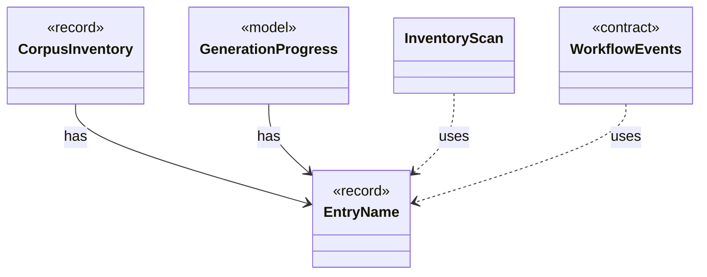

# `EntryName`

`io.github.tlaplus.hardening.corpus` · record · other · [source](https://github.com/tlaplus/model-checker-hardening/blob/918f7db91890f302587d25c76dc7ac189db3d023/src/main/java/io/github/tlaplus/hardening/corpus/EntryName.java#L15) · module [corpus](../modules/corpus.md)

The identity of one logical corpus entry: the file name it keeps in every stage directory it passes through.

The diagram draws 4 of 9 relations; the table lists them all.

| Direction | Relation | Type | Summary |
|---|---|---|---|
| ← | has | [CorpusInventory](io.github.tlaplus.hardening.corpus.CorpusInventory.md) | Immutable startup inventory used to seed stage queues and capacities. |
| ← | has | [GenerationProgress](io.github.tlaplus.hardening.workflow.GenerationProgress.md) | Where every generation of a run stands, tracked from stage events instead of a corpus rescan (ADR 0010). |
| ← | uses | [InventoryScan](io.github.tlaplus.hardening.corpus.InventoryScan.md) | The second pass of startup recovery: validates every entry of a corpus in which no transition is half-finished, and reports what it holds. |
| ← | uses | [WorkflowEvents](io.github.tlaplus.hardening.workflow.execution.WorkflowEvents.md) | Durable admission and stage transitions, reported to whatever schedules generations (ADR 0010). |
| → | depends | [Preconditions](io.github.tlaplus.hardening.common.Preconditions.md) | Shared validation of method and constructor arguments. |
| ← | depends | [StageGraph](io.github.tlaplus.hardening.workflow.StageGraph.md) | The stages that run one workflow invocation, wired to their queues, result capacities, and shared collaborators, and the order in which they start and stop. |
| ← | depends | [AggregatorStage](io.github.tlaplus.hardening.workflow.aggregator.AggregatorStage.md) | Joins completed TLC and Apalache results with one in-process worker. |
| ← | depends | [InputStage](io.github.tlaplus.hardening.workflow.input.InputStage.md) | Concurrent input stage: admits reserved target ranges from adjacent generations. |
| ← | depends | [ToolStage](io.github.tlaplus.hardening.workflow.tool.ToolStage.md) | One stage that runs an external tool over corpus entries: the parser, TLC, or Apalache. |
