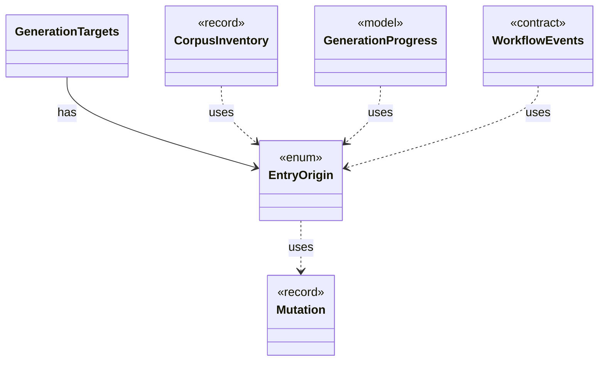

# `EntryOrigin`

`io.github.tlaplus.hardening.corpus` · enum · other · [source](https://github.com/tlaplus/model-checker-hardening/blob/4df6a11e5b4bf93609393935c4cbeceec08cce0c/src/main/java/io/github/tlaplus/hardening/corpus/EntryOrigin.java#L12) · module [corpus](../modules/corpus.md)

Which candidate source admitted an entry, as its generation metadata records it (ADR 0010, ADR 0016 §6).

**Decisions:** [ADR 0010: Generational mutation](https://github.com/tlaplus/model-checker-hardening/blob/4df6a11e5b4bf93609393935c4cbeceec08cce0c/docs/decisions/0010-mutation.md), [ADR 0016: Metamorphic testing](https://github.com/tlaplus/model-checker-hardening/blob/4df6a11e5b4bf93609393935c4cbeceec08cce0c/docs/decisions/0016-metamorphic-testing.md)

The diagram draws 5 of 9 relations; the table lists them all.

| Direction | Relation | Type | Summary |
|---|---|---|---|
| ← | has | [GenerationTargets](io.github.tlaplus.hardening.workflow.GenerationTargets.md) | Which target ordinals of one generation are already spoken for, and which source fills the rest (ADR 0010, ADR 0016 §6). |
| → | uses | [Mutation](io.github.tlaplus.hardening.corpus.Mutation.md) | How a mutated input was derived: the digest of the parent it was mutated from and the operators applied to the parent, in order. |
| ← | uses | [CorpusInventory](io.github.tlaplus.hardening.corpus.CorpusInventory.md) | Immutable startup inventory used to seed stage queues and capacities. |
| ← | uses | [GenerationProgress](io.github.tlaplus.hardening.workflow.GenerationProgress.md) | Where every generation of a run stands, tracked from stage events instead of a corpus rescan (ADR 0010). |
| ← | uses | [WorkflowEvents](io.github.tlaplus.hardening.workflow.execution.WorkflowEvents.md) | Durable admission and stage transitions, reported to whatever schedules generations (ADR 0010). |
| → | depends | [MutationOperator](io.github.tlaplus.hardening.mutation.MutationOperator.md) | One byte-level edit of a generator input, as ADR 0010 defines it. |
| ← | depends | [InventoryScan](io.github.tlaplus.hardening.corpus.InventoryScan.md) | The second pass of startup recovery: validates every entry of a corpus in which no transition is half-finished, and reports what it holds. |
| ← | depends | [GenerationLoop](io.github.tlaplus.hardening.workflow.GenerationLoop.md) | Runs the generations of one workflow invocation over a single stage graph (ADR 0010). |
| ← | depends | [InputStage](io.github.tlaplus.hardening.workflow.input.InputStage.md) | Concurrent input stage: admits reserved target ranges from adjacent generations. |
