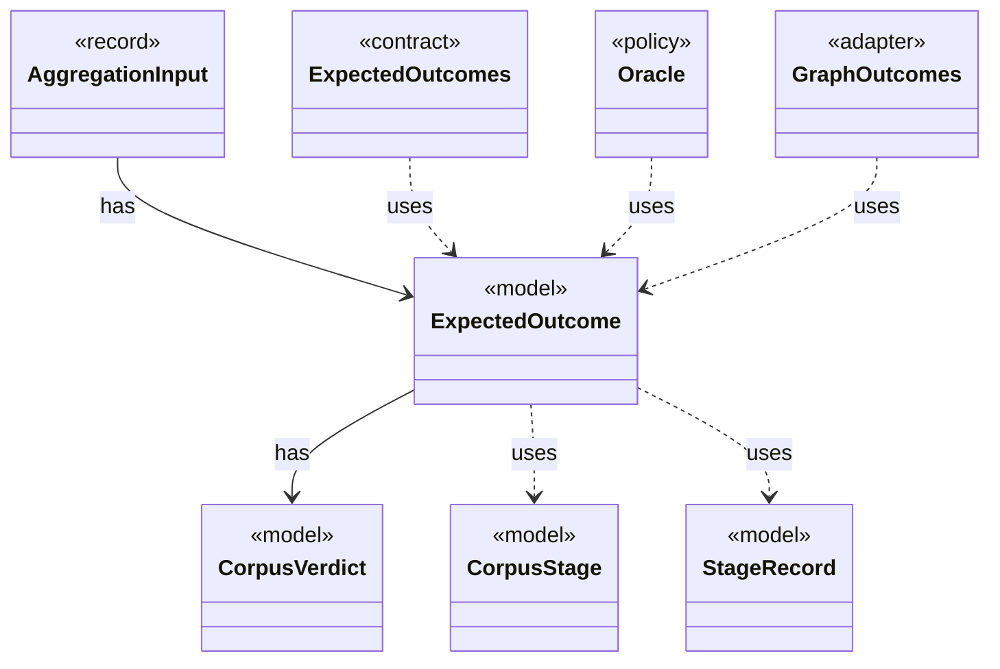

# `ExpectedOutcome`

`io.github.tlaplus.hardening.corpus` · record · model · key · [source](https://github.com/tlaplus/model-checker-hardening/blob/af09a9e32eb710979ef0c76f29507ce1ffe85a15/src/main/java/io/github/tlaplus/hardening/corpus/ExpectedOutcome.java#L21) · module [corpus](../modules/corpus.md)

The checker verdict an input predicts, independently of any checker (ADR 0023 §4): a graph input predicts a counterexample of known length when its target is reachable within the step bound, and a pass otherwise.

**Decisions:** [ADR 0023: Graph-based testing](https://github.com/tlaplus/model-checker-hardening/blob/af09a9e32eb710979ef0c76f29507ce1ffe85a15/docs/decisions/0023-graph-based-testing.md)

The diagram draws 7 of 11 relations; the table lists them all.

| Direction | Relation | Type | Summary |
|---|---|---|---|
| → | has | [CorpusVerdict](io.github.tlaplus.hardening.corpus.CorpusVerdict.md) | A verdict supported by the implemented corpus stages. |
| ← | has | [AggregationInput](io.github.tlaplus.hardening.corpus.AggregationInput.md) | A logical corpus entry whose non-crash checker results are ready for aggregation. |
| → | uses | [CorpusStage](io.github.tlaplus.hardening.corpus.CorpusStage.md) | One implemented stage of the fuzzing pipeline, and the corpus directories it owns. |
| → | uses | [StageRecord](io.github.tlaplus.hardening.corpus.StageRecord.md) | What a stage records about one input: its verdict, when it worked on the input, its failure classification when it classifies failures, and what it explored when it measures exploration. |
| ← | uses | [ExpectedOutcomes](io.github.tlaplus.hardening.corpus.ExpectedOutcomes.md) | Predicts the outcome of one stored input, typically by replaying it through the generator (ADR 0023 §5). |
| ← | uses | [Oracle](io.github.tlaplus.hardening.corpus.Oracle.md) | How the aggregator judges the checker results of one entry (fuzzing-workflows.md §1.3, ADR 0016 §4, ADR 0019, ADR 0023 §5). |
| ← | uses | [GraphOutcomes](io.github.tlaplus.hardening.workflow.spec.GraphOutcomes.md) | Predicts the outcome of a graph entry by replaying it through the decoders (ADR 0023 §4): a counterexample of the target's distance when a behaviour reaches the target within the step bound, and a pass otherwise. |
| → | depends | [ExplorationCount](io.github.tlaplus.hardening.checker.ExplorationCount.md) | A counted exploration metric. |
| → | depends | [ExplorationMetrics](io.github.tlaplus.hardening.checker.ExplorationMetrics.md) | What a model checker explored to reach its verdict, as ADR 0008 defines it. |
| → | depends | [Preconditions](io.github.tlaplus.hardening.common.Preconditions.md) | Shared validation of method and constructor arguments. |
| ← | depends | [GraphReport](io.github.tlaplus.hardening.cli.GraphReport.md) | Renders a graph module for triage (ADR 0023): the control graph, the target, the outcome the graph predicts, and the module the checkers see. |
