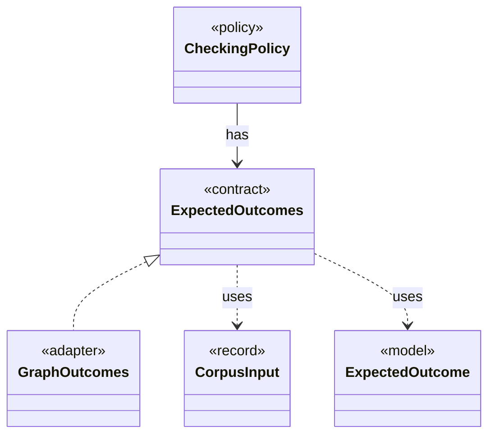

# `ExpectedOutcomes`

`io.github.tlaplus.hardening.corpus` · interface · contract · [source](https://github.com/tlaplus/model-checker-hardening/blob/6bbf8b66c375696d1798f7b7a061b81573a3f42a/src/main/java/io/github/tlaplus/hardening/corpus/ExpectedOutcomes.java#L16) · module [corpus](../modules/corpus.md)

Predicts the outcome of one stored input, typically by replaying it through the generator (ADR 0023 §5).

**Decisions:** [ADR 0023: Graph-based testing](https://github.com/tlaplus/model-checker-hardening/blob/6bbf8b66c375696d1798f7b7a061b81573a3f42a/docs/decisions/0023-graph-based-testing.md)

The diagram draws 4 of 6 relations; the table lists them all.

| Direction | Relation | Type | Summary |
|---|---|---|---|
| ← | implements | [GraphOutcomes](io.github.tlaplus.hardening.workflow.spec.GraphOutcomes.md) | Predicts the outcome of a graph entry by replaying it through the decoders (ADR 0023 §4): a counterexample of the target's distance when a behaviour reaches the target within the step bound, and a pass otherwise. |
| ← | has | [CheckingPolicy](io.github.tlaplus.hardening.corpus.CheckingPolicy.md) | Which checkers a workflow run feeds and how the aggregator judges their verdicts. |
| → | uses | [CorpusInput](io.github.tlaplus.hardening.corpus.CorpusInput.md) | The required fields of one encoded corpus input. |
| → | uses | [ExpectedOutcome](io.github.tlaplus.hardening.corpus.ExpectedOutcome.md) | The checker verdict an input predicts, independently of any checker (ADR 0023 §4): a graph input predicts a counterexample of known length when its target is reachable within the step bound, and a pass otherwise. |
| ← | depends | [AggregationInput](io.github.tlaplus.hardening.corpus.AggregationInput.md) | A logical corpus entry whose non-crash checker results are ready for aggregation. |
| ← | depends | [WorkflowRunner](io.github.tlaplus.hardening.workflow.WorkflowRunner.md) | Runs generation, parsing, TLC, Apalache, conformance aggregation and the quality gate under one CPU budget. |
