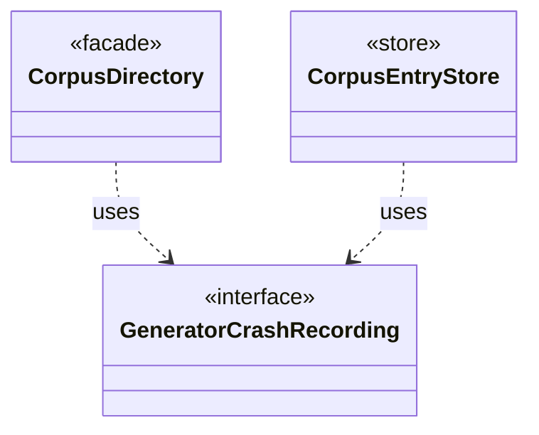

# `GeneratorCrashRecording`

`io.github.tlaplus.hardening.corpus` · interface · other · [source](https://github.com/tlaplus/model-checker-hardening/blob/a304ba37155136c3ba79e4f2fb414cbb47d01606/src/main/java/io/github/tlaplus/hardening/corpus/GeneratorCrashRecording.java#L8) · module [corpus](../modules/corpus.md)

Result of trying to preserve a payload that crashed its generator.

The diagram draws 2 of 5 relations; the table lists them all.

| Direction | Relation | Type | Summary |
|---|---|---|---|
| ← | uses | [CorpusDirectory](io.github.tlaplus.hardening.corpus.CorpusDirectory.md) | Owns the on-disk layout and integrity checks for one FuzzTLA corpus. |
| ← | uses | [CorpusEntryStore](io.github.tlaplus.hardening.corpus.CorpusEntryStore.md) | Admits generated payloads to the input stage and preserves the ones that broke the generator. |
| → | depends | [Diagnostics](io.github.tlaplus.hardening.common.Diagnostics.md) | Human-readable diagnostic formatting for failures. |
| ← | depends | [InputStage](io.github.tlaplus.hardening.workflow.input.InputStage.md) | Concurrent input stage: admits reserved target ranges from adjacent generations. |
| ← | depends | [GeneratedInputPreparation](io.github.tlaplus.hardening.workflow.spec.GeneratedInputPreparation.md) | Regenerates and renders one tool input while preserving generator-crash artifacts. |
