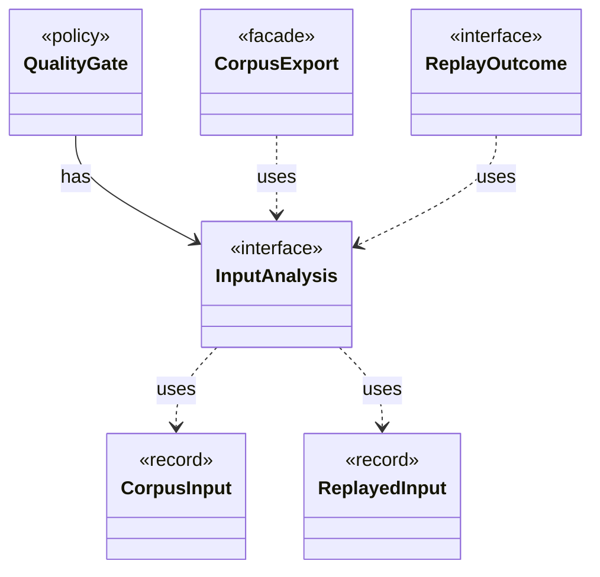

# `InputAnalysis`

`io.github.tlaplus.hardening.corpus` · interface · other · [source](https://github.com/tlaplus/model-checker-hardening/blob/fd29bdb142d5d87538f91aeddca09d5ac3d7d0a7/src/main/java/io/github/tlaplus/hardening/corpus/InputAnalysis.java#L11) · module [corpus](../modules/corpus.md)

Counts the evaluated nodes, expression constructs and construct edges of one stored input, and names the rewrite rules it applied, typically by replaying it through the generator.

The diagram draws 5 of 8 relations; the table lists them all.

| Direction | Relation | Type | Summary |
|---|---|---|---|
| ← | has | [QualityGate](io.github.tlaplus.hardening.workflow.quality.QualityGate.md) | Selects the parents of the next generation from one settled generation (ADR 0010, ADR 0013). |
| → | uses | [CorpusInput](io.github.tlaplus.hardening.corpus.CorpusInput.md) | The required fields of one encoded corpus input. |
| → | uses | [ReplayedInput](io.github.tlaplus.hardening.corpus.ReplayedInput.md) | What replaying one stored input shows beyond its envelope. |
| ← | uses | [CorpusExport](io.github.tlaplus.hardening.database.CorpusExport.md) | Exports a corpus to a new SQLite database, as ADR 0009 defines it. |
| ← | uses | [ReplayOutcome](io.github.tlaplus.hardening.database.ReplayOutcome.md) | The result of analysing one input: what its replay shows, or why it could not be replayed. |
| ← | depends | [ExportDbCommand](io.github.tlaplus.hardening.cli.ExportDbCommand.md) | `fuzztla export-db`: exports a corpus with `CorpusExport` (ADR 0009). |
| ← | depends | [EntryBatchExporter](io.github.tlaplus.hardening.database.EntryBatchExporter.md) | Exports listed entry files in chunks. |
| ← | depends | [GenerationLoop](io.github.tlaplus.hardening.workflow.GenerationLoop.md) | Runs the generations of one workflow invocation over a single stage graph (ADR 0010). |
