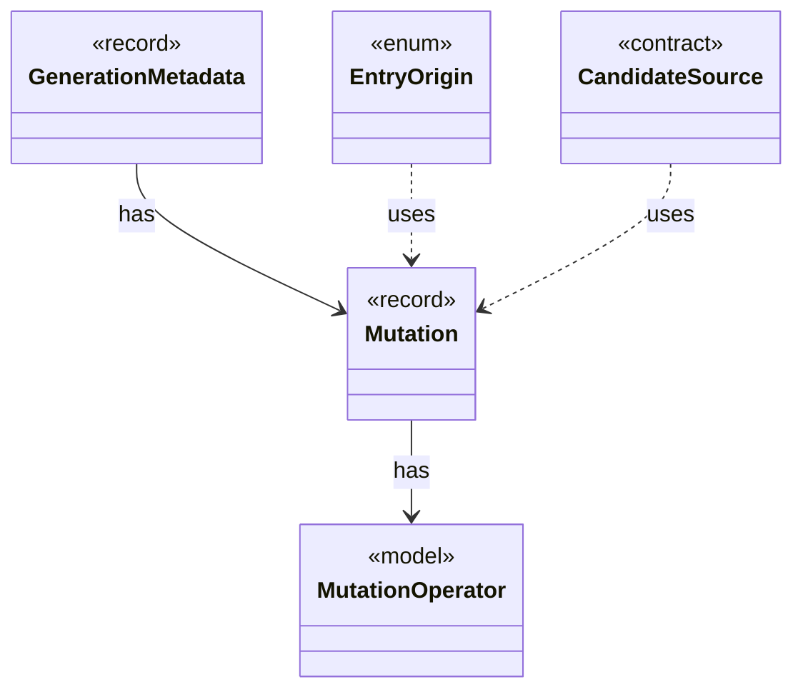

# `Mutation`

`io.github.tlaplus.hardening.corpus` · record · other · [source](https://github.com/tlaplus/model-checker-hardening/blob/6bbf8b66c375696d1798f7b7a061b81573a3f42a/src/main/java/io/github/tlaplus/hardening/corpus/Mutation.java#L12) · module [corpus](../modules/corpus.md)

How a mutated input was derived: the digest of the parent it was mutated from and the operators applied to the parent, in order.

The diagram draws 4 of 11 relations; the table lists them all.

| Direction | Relation | Type | Summary |
|---|---|---|---|
| → | has | [MutationOperator](io.github.tlaplus.hardening.mutation.MutationOperator.md) | One byte-level edit of a generator input, as ADR 0010 defines it. |
| ← | has | [GenerationMetadata](io.github.tlaplus.hardening.corpus.GenerationMetadata.md) | Admission-time facts about one corpus input: the generation that admitted it, its PBT cohort and collection-richness score, and, for a mutant, the parent and operators it was derived from. |
| ← | uses | [EntryOrigin](io.github.tlaplus.hardening.corpus.EntryOrigin.md) | Which candidate source admitted an entry, as its generation metadata records it (ADR 0010, ADR 0016 §6). |
| ← | uses | [CandidateSource](io.github.tlaplus.hardening.workflow.input.CandidateSource.md) | Where the candidates for a target entry of the input stage come from: property-based generation or mutation of a selected parent (ADR 0010). |
| → | depends | [Preconditions](io.github.tlaplus.hardening.common.Preconditions.md) | Shared validation of method and constructor arguments. |
| → | depends | [CorpusLayout](io.github.tlaplus.hardening.corpus.CorpusLayout.md) | Where one corpus keeps its files, how an entry is named, and how a file is written into it. |
| ← | depends | [EnvelopeReport](io.github.tlaplus.hardening.cli.EnvelopeReport.md) | Renders a decoded corpus envelope and its expression as plain text. |
| ← | depends | [CorpusInputCodec](io.github.tlaplus.hardening.corpus.CorpusInputCodec.md) | Encodes and decodes an input's kind, generator payload, and admission metadata. |
| ← | depends | [EntryRows](io.github.tlaplus.hardening.database.EntryRows.md) | The rows that one decoded corpus entry contributes: its `entry` row, followed by the rows that reference it: one `knownDefect` row per signature, one `mutationOperator` row per operator, one `stage` row per stage record, one `expr` row per expression construct of its replayed input and one `exprEdge` row per edge between constructs. |
| ← | depends | [MetamorphicCandidates](io.github.tlaplus.hardening.workflow.input.MetamorphicCandidates.md) | Adopts elite conformance entries (ADR 0016 §6): every candidate is the payload of a uniformly drawn parent of a pbt corpus behind the metamorphic header, followed by random rewrite bytes. |
| ← | depends | [MutantCandidates](io.github.tlaplus.hardening.workflow.input.MutantCandidates.md) | Mutants of the parent pool (ADR 0010): every candidate mutates a uniformly drawn parent, keeps its cohort, and is rejected as a clone when it renders to the parent's module. |
