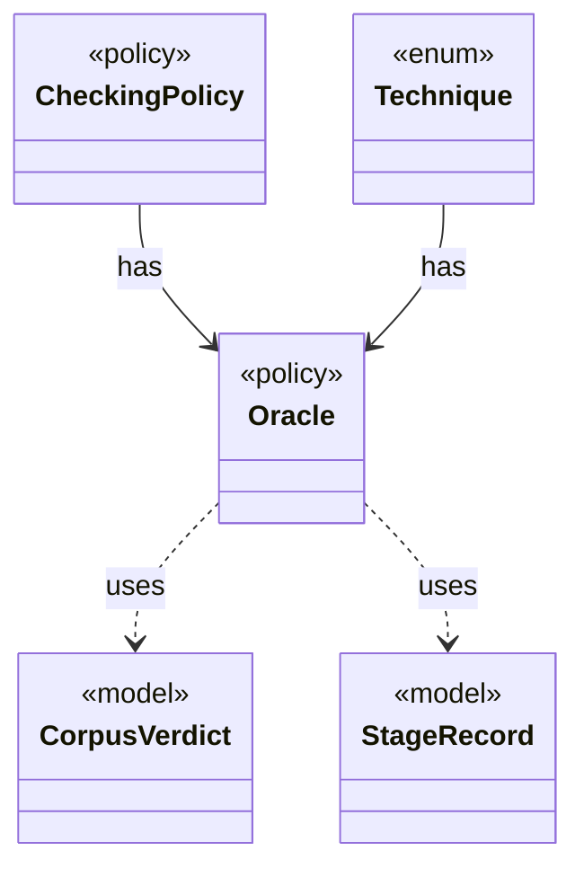

# `Oracle`

`io.github.tlaplus.hardening.corpus` · enum · policy · key · [source](https://github.com/tlaplus/model-checker-hardening/blob/ed5c97e61582ad2ff90b4ea4209355aa0d555717/src/main/java/io/github/tlaplus/hardening/corpus/Oracle.java#L19) · module [corpus](../modules/corpus.md)

How the aggregator judges the checker results of one entry (fuzzing-workflows.md §1.3, ADR 0016 §4, ADR 0019).

**Decisions:** [ADR 0016: Metamorphic testing](https://github.com/tlaplus/model-checker-hardening/blob/ed5c97e61582ad2ff90b4ea4209355aa0d555717/docs/decisions/0016-metamorphic-testing.md), [ADR 0019: State-count agreement of completed searches](https://github.com/tlaplus/model-checker-hardening/blob/ed5c97e61582ad2ff90b4ea4209355aa0d555717/docs/decisions/0019-state-count-agreement.md)

The diagram draws 4 of 8 relations; the table lists them all.

| Direction | Relation | Type | Summary |
|---|---|---|---|
| ← | has | [CheckingPolicy](io.github.tlaplus.hardening.corpus.CheckingPolicy.md) | Which checkers a workflow run feeds and how the aggregator judges their verdicts. |
| ← | has | [Technique](io.github.tlaplus.hardening.corpus.Technique.md) | The fuzzing technique a corpus runs (`fuzztla run --how`). |
| → | uses | [CorpusVerdict](io.github.tlaplus.hardening.corpus.CorpusVerdict.md) | A verdict supported by the implemented corpus stages. |
| → | uses | [StageRecord](io.github.tlaplus.hardening.corpus.StageRecord.md) | What a stage records about one input: its verdict, when it worked on the input, its failure classification when it classifies failures, and what it explored when it measures exploration. |
| → | depends | [ExplorationCount](io.github.tlaplus.hardening.checker.ExplorationCount.md) | A counted exploration metric. |
| → | depends | [ExplorationMetrics](io.github.tlaplus.hardening.checker.ExplorationMetrics.md) | What a model checker explored to reach its verdict, as ADR 0008 defines it. |
| → | depends | [ExplorationPhase](io.github.tlaplus.hardening.checker.ExplorationPhase.md) | How far a model checker got before its verdict was fixed. |
| ← | depends | [AggregationInput](io.github.tlaplus.hardening.corpus.AggregationInput.md) | A logical corpus entry whose non-crash checker results are ready for aggregation. |
