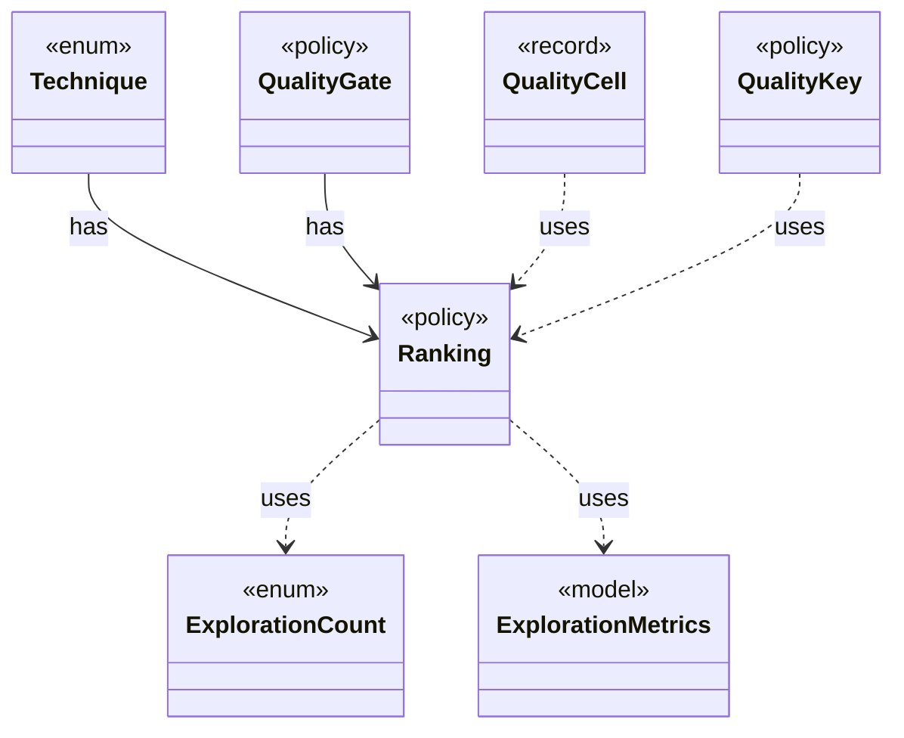

# `Ranking`

`io.github.tlaplus.hardening.corpus` · enum · policy · [source](https://github.com/tlaplus/model-checker-hardening/blob/21262d9d0cc07b5ae4c47c4ee511217c9b88b561/src/main/java/io/github/tlaplus/hardening/corpus/Ranking.java#L16) · module [corpus](../modules/corpus.md)

How the quality gate ranks the admissible entries of a generation, best first: the components of its key, compared lexicographically, higher first.

**Decisions:** [ADR 0013: Behaviour archive and operator-edge coverage](https://github.com/tlaplus/model-checker-hardening/blob/21262d9d0cc07b5ae4c47c4ee511217c9b88b561/docs/decisions/0013-behaviour-archive-and-operator-coverage.md)

The diagram draws 6 of 7 relations; the table lists them all.

| Direction | Relation | Type | Summary |
|---|---|---|---|
| ← | has | [Technique](io.github.tlaplus.hardening.corpus.Technique.md) | The fuzzing technique a corpus runs: `[workflow] technique`, which `fuzztla init --how` sets (ADR 0025 §1), so every run and every replay decodes and judges its entries the same way. |
| ← | has | [QualityGate](io.github.tlaplus.hardening.workflow.quality.QualityGate.md) | Selects the parents of the next generation from one settled generation (ADR 0010, ADR 0013). |
| → | uses | [ExplorationCount](io.github.tlaplus.hardening.checker.ExplorationCount.md) | A counted exploration metric. |
| → | uses | [ExplorationMetrics](io.github.tlaplus.hardening.checker.ExplorationMetrics.md) | What a model checker explored to reach its verdict, as ADR 0008 defines it. |
| ← | uses | [QualityCell](io.github.tlaplus.hardening.workflow.quality.QualityCell.md) | The behaviour cell of an admissible entry (ADR 0013): its TLC verdict and the components of the gate's `Ranking`, each after its bucket. |
| ← | uses | [QualityKey](io.github.tlaplus.hardening.workflow.quality.QualityKey.md) | The order in which the quality gate ranks admissible entries, best first (ADR 0010, ADR 0024 §2). |
| ← | depends | [GenerationLoop](io.github.tlaplus.hardening.workflow.GenerationLoop.md) | Runs the generations of one workflow invocation over a single stage graph (ADR 0010). |
