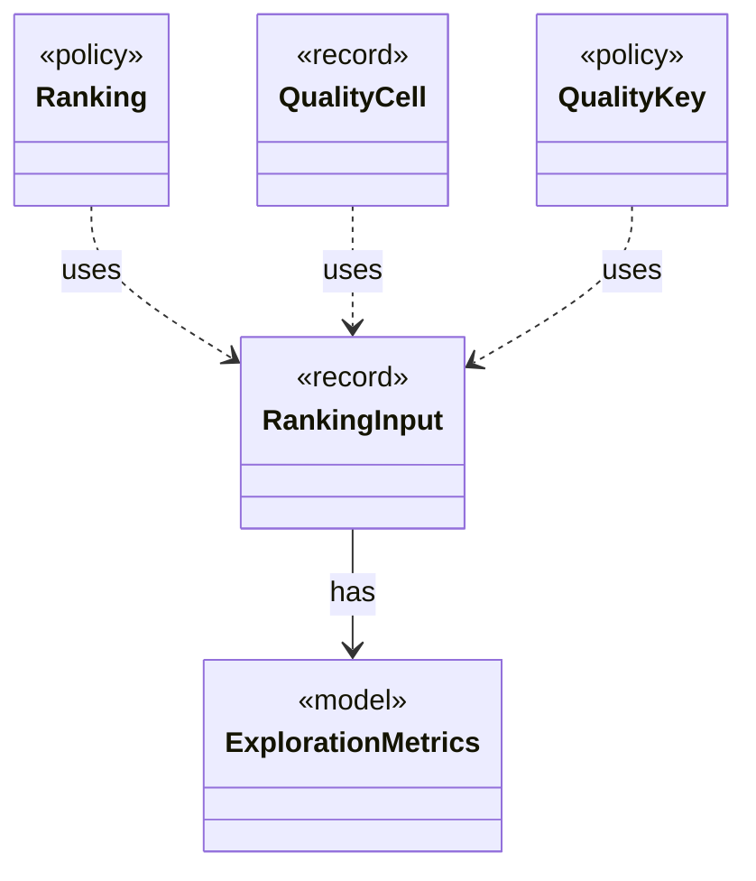

# `RankingInput`

`io.github.tlaplus.hardening.corpus` · record · other · [source](https://github.com/tlaplus/model-checker-hardening/blob/63cd44067a101bcc7b39ec4d8176d39ae569b650/src/main/java/io/github/tlaplus/hardening/corpus/RankingInput.java#L15) · module [corpus](../modules/corpus.md)

What a `Ranking` reads of one entry: TLC's exploration metrics and the counts that replaying the input yields.

The diagram draws 4 of 6 relations; the table lists them all.

| Direction | Relation | Type | Summary |
|---|---|---|---|
| → | has | [ExplorationMetrics](io.github.tlaplus.hardening.checker.ExplorationMetrics.md) | What a model checker explored to reach its verdict, as ADR 0008 defines it. |
| ← | uses | [Ranking](io.github.tlaplus.hardening.corpus.Ranking.md) | How the quality gate ranks the admissible entries of a generation, best first: the components of its key, compared lexicographically, higher first. |
| ← | uses | [QualityCell](io.github.tlaplus.hardening.workflow.quality.QualityCell.md) | The behaviour cell of an admissible entry (ADR 0013): its TLC verdict and the components of the gate's `Ranking`, each after its bucket. |
| ← | uses | [QualityKey](io.github.tlaplus.hardening.workflow.quality.QualityKey.md) | The order in which the quality gate ranks admissible entries, best first (ADR 0010, ADR 0024 §2). |
| → | depends | [Preconditions](io.github.tlaplus.hardening.common.Preconditions.md) | Shared validation of method and constructor arguments. |
| ← | depends | [QualityGate](io.github.tlaplus.hardening.workflow.quality.QualityGate.md) | Selects the parents of the next generation from one settled generation (ADR 0010, ADR 0013). |
