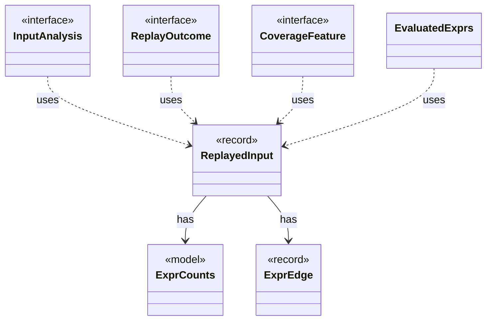

# `ReplayedInput`

`io.github.tlaplus.hardening.corpus` · record · other · [source](https://github.com/tlaplus/model-checker-hardening/blob/d5dcbcb332600c9312f00550a0131fd51a164e9f/src/main/java/io/github/tlaplus/hardening/corpus/ReplayedInput.java#L20) · module [corpus](../modules/corpus.md)

What replaying one stored input shows beyond its envelope.

The diagram draws 6 of 10 relations; the table lists them all.

| Direction | Relation | Type | Summary |
|---|---|---|---|
| → | has | [ExprCounts](io.github.tlaplus.hardening.common.ExprCounts.md) | The size of a piece of TLA+ code, the occurrences of each expression construct in it, and the occurrences of each edge between constructs. |
| → | has | [ExprEdge](io.github.tlaplus.hardening.common.ExprEdge.md) | An edge of an expression tree between two constructs: `parent` applied to, or binding, an immediate subexpression that is the construct `child`. |
| ← | uses | [InputAnalysis](io.github.tlaplus.hardening.corpus.InputAnalysis.md) | Counts the evaluated nodes, expression constructs and construct edges of one stored input, and names the rewrite rules it applied, typically by replaying it through the generator. |
| ← | uses | [ReplayOutcome](io.github.tlaplus.hardening.database.ReplayOutcome.md) | The result of analysing one input: what its replay shows, or why it could not be replayed. |
| ← | uses | [CoverageFeature](io.github.tlaplus.hardening.workflow.quality.CoverageFeature.md) | One coverage feature of an entry, with the hit-count bucket of its occurrences: a construct or an edge between constructs of its evaluated code (ADR 0013), or a temporal shape of its property (ADR 0028 §3). |
| ← | uses | [EvaluatedExprs](io.github.tlaplus.hardening.workflow.spec.EvaluatedExprs.md) | Replays a stored input and counts the expression constructs of the code the checkers evaluate: the definitions reachable from `SpecArtifact.entryPoints`. |
| ← | depends | [ExportDbCommand](io.github.tlaplus.hardening.cli.ExportDbCommand.md) | `fuzztla export-db`: exports a corpus with `CorpusExport` (ADR 0009). |
| ← | depends | [EntryRows](io.github.tlaplus.hardening.database.EntryRows.md) | The rows that one decoded corpus entry contributes: its `entry` row, followed by the rows that reference it: one `knownDefect` row per signature, one `mutationOperator` row per operator, one `stage` row per stage record, one `expr` row per expression construct of its replayed input and one `exprEdge` row per edge between constructs. |
| ← | depends | [GenerationLoop](io.github.tlaplus.hardening.workflow.GenerationLoop.md) | Runs the generations of one workflow invocation over a single stage graph (ADR 0010). |
| ← | depends | [EntryReplays](io.github.tlaplus.hardening.workflow.quality.EntryReplays.md) | What one run of the quality gate learns by replaying its entries: their coverage features (ADR 0013) and the number of distinct temporal shapes of their properties (ADR 0028). |
