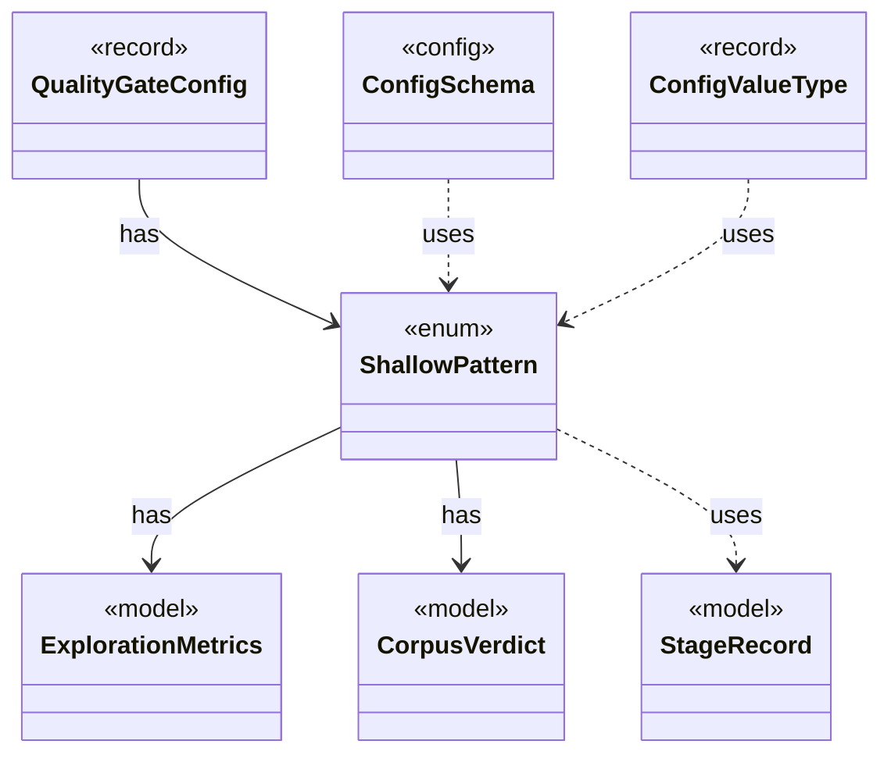

# `ShallowPattern`

`io.github.tlaplus.hardening.corpus` · enum · other · [source](https://github.com/tlaplus/model-checker-hardening/blob/918f7db91890f302587d25c76dc7ac189db3d023/src/main/java/io/github/tlaplus/hardening/corpus/ShallowPattern.java#L18) · module [corpus](../modules/corpus.md)

A way in which a TLC run explored almost nothing, as the calibration table of ADR 0008 defines it.

**Decisions:** [ADR 0008: Exploration metrics](https://github.com/tlaplus/model-checker-hardening/blob/918f7db91890f302587d25c76dc7ac189db3d023/docs/decisions/0008-exploration-metrics.md)

The diagram draws 6 of 9 relations; the table lists them all.

| Direction | Relation | Type | Summary |
|---|---|---|---|
| → | has | [ExplorationMetrics](io.github.tlaplus.hardening.checker.ExplorationMetrics.md) | What a model checker explored to reach its verdict, as ADR 0008 defines it. |
| → | has | [CorpusVerdict](io.github.tlaplus.hardening.corpus.CorpusVerdict.md) | A verdict supported by the implemented corpus stages. |
| ← | has | [QualityGateConfig](io.github.tlaplus.hardening.config.QualityGateConfig.md) | What the quality gate keeps of a settled generation (ADR 0010, ADR 0013). |
| → | uses | [StageRecord](io.github.tlaplus.hardening.corpus.StageRecord.md) | What a stage records about one input: its verdict, when it worked on the input, its failure classification when it classifies failures, and what it explored when it measures exploration. |
| ← | uses | [ConfigSchema](io.github.tlaplus.hardening.config.ConfigSchema.md) | The declaration of every key in `config.toml`: where it lives, what it means, how its value is read, and how it is written back. |
| ← | uses | [ConfigValueType](io.github.tlaplus.hardening.config.ConfigValueType.md) | How the value of one configuration key is read from TOML and written back as TOML syntax. |
| → | depends | [ExplorationCount](io.github.tlaplus.hardening.checker.ExplorationCount.md) | A counted exploration metric. |
| → | depends | [ExplorationPhase](io.github.tlaplus.hardening.checker.ExplorationPhase.md) | How far a model checker got before its verdict was fixed. |
| ← | depends | [QualityGate](io.github.tlaplus.hardening.workflow.quality.QualityGate.md) | Selects the parents of the next generation from one settled generation (ADR 0010, ADR 0013). |
