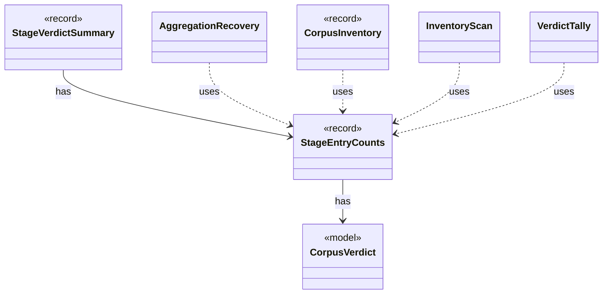

# `StageEntryCounts`

`io.github.tlaplus.hardening.corpus` · record · other · [source](https://github.com/tlaplus/model-checker-hardening/blob/4206d99417cbe58b5b339e189936abe305c56cca/src/main/java/io/github/tlaplus/hardening/corpus/StageEntryCounts.java#L10) · module [corpus](../modules/corpus.md)

How many entries one stage has produced under each verdict.

The diagram draws 6 of 8 relations; the table lists them all.

| Direction | Relation | Type | Summary |
|---|---|---|---|
| → | has | [CorpusVerdict](io.github.tlaplus.hardening.corpus.CorpusVerdict.md) | A verdict supported by the implemented corpus stages. |
| ← | has | [StageVerdictSummary](io.github.tlaplus.hardening.workflow.execution.StageVerdictSummary.md) | Cumulative verdict counters and summed worker elapsed time for one stage. |
| ← | uses | [AggregationRecovery](io.github.tlaplus.hardening.corpus.AggregationRecovery.md) | Recovers aggregate commits and inventories the aggregator's result directories. |
| ← | uses | [CorpusInventory](io.github.tlaplus.hardening.corpus.CorpusInventory.md) | Immutable startup inventory used to seed stage queues and capacities. |
| ← | uses | [InventoryScan](io.github.tlaplus.hardening.corpus.InventoryScan.md) | The second pass of startup recovery: validates every entry of a corpus in which no transition is half-finished, and reports what it holds. |
| ← | uses | [VerdictTally](io.github.tlaplus.hardening.corpus.VerdictTally.md) | A mutable per-verdict count, built up while scanning a corpus and read as `StageEntryCounts`. |
| ← | depends | [StageGraph](io.github.tlaplus.hardening.workflow.StageGraph.md) | The stages that run one workflow invocation, wired to their queues, result capacities, and shared collaborators, and the order in which they start and stop. |
| ← | depends | [StageCounters](io.github.tlaplus.hardening.workflow.execution.StageCounters.md) | Verdict counters for one stage, seeded from the corpus and updated by its workers. |
