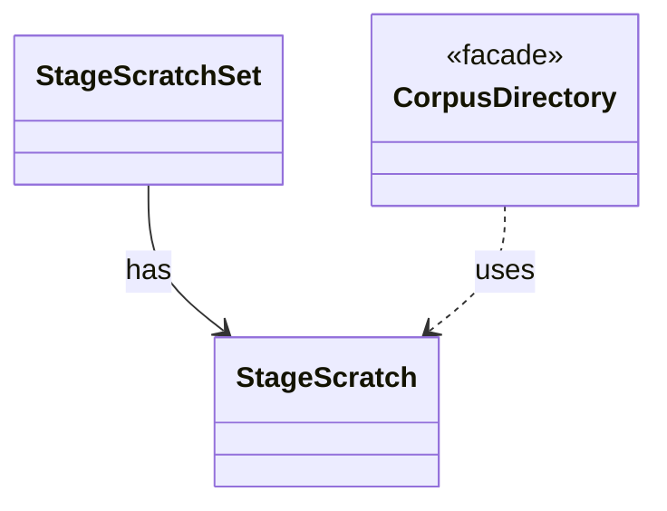

# `StageScratch`

`io.github.tlaplus.hardening.corpus` · class · other · [source](https://github.com/tlaplus/model-checker-hardening/blob/21262d9d0cc07b5ae4c47c4ee511217c9b88b561/src/main/java/io/github/tlaplus/hardening/corpus/StageScratch.java#L10) · module [corpus](../modules/corpus.md)

Corpus-owned transient storage for one stage during one workflow invocation.

The diagram draws 2 of 5 relations; the table lists them all.

| Direction | Relation | Type | Summary |
|---|---|---|---|
| ← | has | [StageScratchSet](io.github.tlaplus.hardening.corpus.StageScratchSet.md) | The transient scratch directories of every stage that needs one, created and removed together. |
| ← | uses | [CorpusDirectory](io.github.tlaplus.hardening.corpus.CorpusDirectory.md) | Owns the on-disk layout and integrity checks for one FuzzTLA corpus. |
| → | depends | [Cleanup](io.github.tlaplus.hardening.common.Cleanup.md) | Best-effort I/O cleanup that retains the original failure and its suppressed diagnostics. |
| → | depends | [FileTrees](io.github.tlaplus.hardening.common.FileTrees.md) | File-tree operations shared by the corpus and by isolated worker processes. |
| → | depends | [ThrowingRunnable](io.github.tlaplus.hardening.common.ThrowingRunnable.md) | An operation that takes no value and may fail with a checked exception. |
