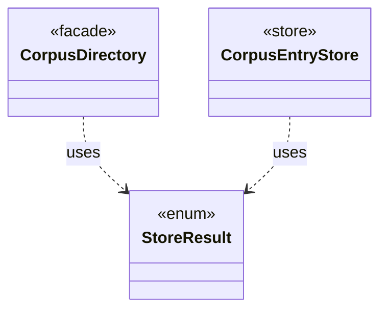

# `StoreResult`

`io.github.tlaplus.hardening.corpus` · enum · other · [source](https://github.com/tlaplus/model-checker-hardening/blob/0b7c167b636088dd43d36713d157e22f7ebd4f79/src/main/java/io/github/tlaplus/hardening/corpus/StoreResult.java#L4) · module [corpus](../modules/corpus.md)

Result of attempting to add an input to a corpus.

The diagram draws 2 of 4 relations; the table lists them all.

| Direction | Relation | Type | Summary |
|---|---|---|---|
| ← | uses | [CorpusDirectory](io.github.tlaplus.hardening.corpus.CorpusDirectory.md) | Owns the on-disk layout and integrity checks for one FuzzTLA corpus. |
| ← | uses | [CorpusEntryStore](io.github.tlaplus.hardening.corpus.CorpusEntryStore.md) | Admits generated payloads to the input stage and preserves the ones that broke the generator. |
| ← | depends | [InputStage](io.github.tlaplus.hardening.workflow.input.InputStage.md) | Concurrent input stage: admits reserved target ranges from adjacent generations. |
| ← | depends | [KnownDefectQuarantine](io.github.tlaplus.hardening.workflow.input.KnownDefectQuarantine.md) | Keeps at most a fixed number of quarantined candidates per primary known-defect signature in `00-known-defects`; past the cap, a match is counted by the caller and discarded here. |
