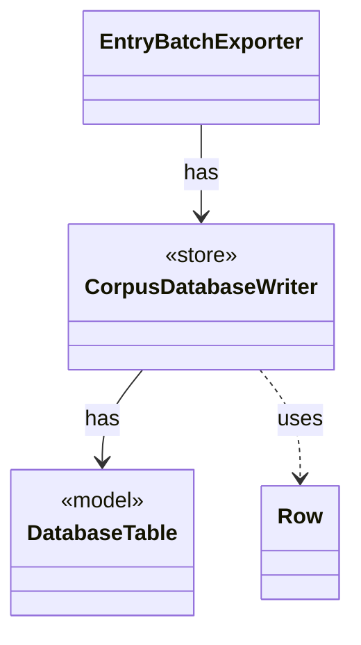

# `CorpusDatabaseWriter`

`io.github.tlaplus.hardening.database` · class · store · key · [source](https://github.com/tlaplus/model-checker-hardening/blob/6bd7d927f1cffd7642029a3d925dff47091ddde9/src/main/java/io/github/tlaplus/hardening/database/CorpusDatabaseWriter.java#L23) · module [database](../modules/database.md)

Writes the rows of one export into a new SQLite file, in a single transaction.

The diagram draws 3 of 7 relations; the table lists them all.

| Direction | Relation | Type | Summary |
|---|---|---|---|
| → | has | [DatabaseTable](io.github.tlaplus.hardening.database.DatabaseTable.md) | A table of the corpus database: its name, columns and keys. |
| ← | has | [EntryBatchExporter](io.github.tlaplus.hardening.database.EntryBatchExporter.md) | Exports listed entry files in chunks. |
| → | uses | [Row](io.github.tlaplus.hardening.database.Row.md) | The values of one row, set by column. |
| → | depends | [Column](io.github.tlaplus.hardening.database.Column.md) | A column of a database table. |
| → | depends | [CorpusDatabaseSchema](io.github.tlaplus.hardening.database.CorpusDatabaseSchema.md) | The schema of the corpus database, as the corpus-database manual documents it. |
| → | depends | [SqlType](io.github.tlaplus.hardening.database.SqlType.md) | A SQLite storage class, with the Java type a row stores for it. |
| ← | depends | [CorpusExport](io.github.tlaplus.hardening.database.CorpusExport.md) | Exports a corpus to a new SQLite database, as ADR 0009 defines it. |
