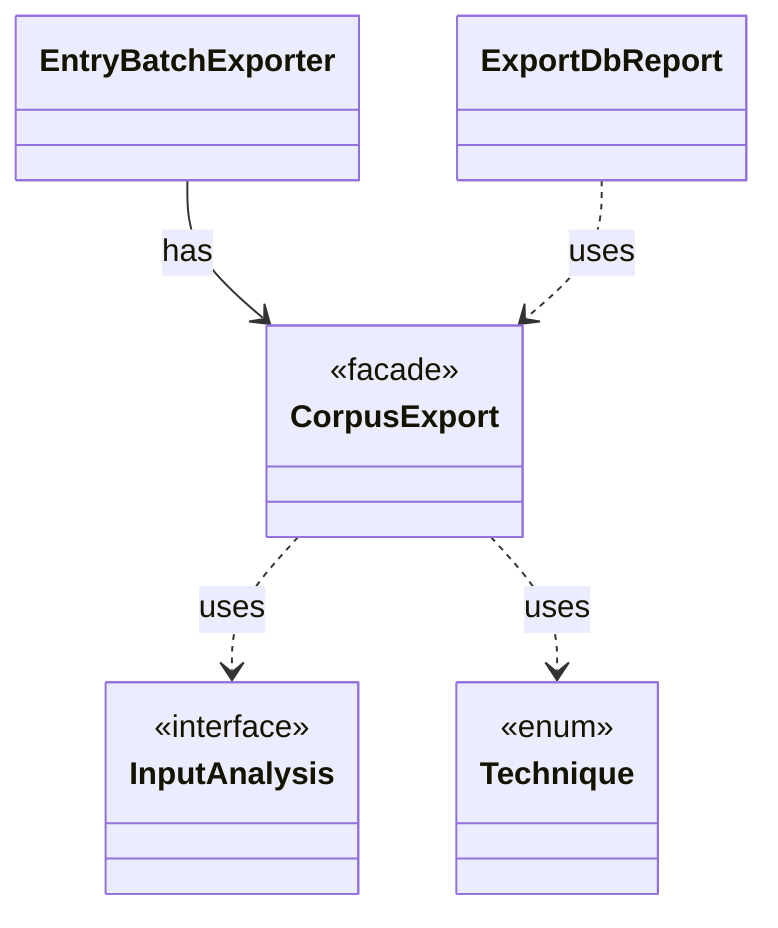

# `CorpusExport`

`io.github.tlaplus.hardening.database` · class · facade · key · [source](https://github.com/tlaplus/model-checker-hardening/blob/ed5c97e61582ad2ff90b4ea4209355aa0d555717/src/main/java/io/github/tlaplus/hardening/database/CorpusExport.java#L37) · module [database](../modules/database.md)

Exports a corpus to a new SQLite database, as ADR 0009 defines it.

**Decisions:** [ADR 0009: Corpus database](https://github.com/tlaplus/model-checker-hardening/blob/ed5c97e61582ad2ff90b4ea4209355aa0d555717/docs/decisions/0009-corpus-database.md)

The diagram draws 4 of 20 relations; the table lists them all.

| Direction | Relation | Type | Summary |
|---|---|---|---|
| ← | has | [EntryBatchExporter](io.github.tlaplus.hardening.database.EntryBatchExporter.md) | Exports listed entry files in chunks. |
| → | uses | [InputAnalysis](io.github.tlaplus.hardening.corpus.InputAnalysis.md) | Counts the evaluated nodes, expression constructs and construct edges of one stored input, and names the rewrite rules it applied, typically by replaying it through the generator. |
| → | uses | [Technique](io.github.tlaplus.hardening.corpus.Technique.md) | The fuzzing technique a corpus runs (`fuzztla run --how`). |
| ← | uses | [ExportDbReport](io.github.tlaplus.hardening.cli.ExportDbReport.md) | Renders the outcome of a corpus export. |
| → | depends | [Cleanup](io.github.tlaplus.hardening.common.Cleanup.md) | Best-effort I/O cleanup that retains the original failure and its suppressed diagnostics. |
| → | depends | [Diagnostics](io.github.tlaplus.hardening.common.Diagnostics.md) | Human-readable diagnostic formatting for failures. |
| → | depends | [Preconditions](io.github.tlaplus.hardening.common.Preconditions.md) | Shared validation of method and constructor arguments. |
| → | depends | [ThrowingRunnable](io.github.tlaplus.hardening.common.ThrowingRunnable.md) | An operation that takes no value and may fail with a checked exception. |
| → | depends | [CorpusDirectory](io.github.tlaplus.hardening.corpus.CorpusDirectory.md) | Owns the on-disk layout and integrity checks for one FuzzTLA corpus. |
| → | depends | [CorpusException](io.github.tlaplus.hardening.corpus.CorpusException.md) | Reports an invalid corpus layout or corpus entry. |
| → | depends | [CorpusLock](io.github.tlaplus.hardening.corpus.CorpusLock.md) | An exclusive corpus lock and its backing file channel, released together. |
| → | depends | [CorpusPath](io.github.tlaplus.hardening.corpus.CorpusPath.md) | A fixed path in the on-disk corpus layout. |
| → | depends | [Column](io.github.tlaplus.hardening.database.Column.md) | A column of a database table. |
| → | depends | [CorpusDatabaseException](io.github.tlaplus.hardening.database.CorpusDatabaseException.md) | Reports that the corpus database cannot be written. |
| → | depends | [CorpusDatabaseWriter](io.github.tlaplus.hardening.database.CorpusDatabaseWriter.md) | Writes the rows of one export into a new SQLite file, in a single transaction. |
| → | depends | [DatabaseColumns](io.github.tlaplus.hardening.database.DatabaseColumns.md) | The columns of the database tables. |
| → | depends | [DatabaseTable](io.github.tlaplus.hardening.database.DatabaseTable.md) | A table of the corpus database: its name, columns and keys. |
| → | depends | [EntryBatchExporter](io.github.tlaplus.hardening.database.EntryBatchExporter.md) | Exports listed entry files in chunks. |
| → | depends | [Row](io.github.tlaplus.hardening.database.Row.md) | The values of one row, set by column. |
| ← | depends | [ExportDbCommand](io.github.tlaplus.hardening.cli.ExportDbCommand.md) | `fuzztla export-db`: exports a corpus with `CorpusExport` (ADR 0009). |
