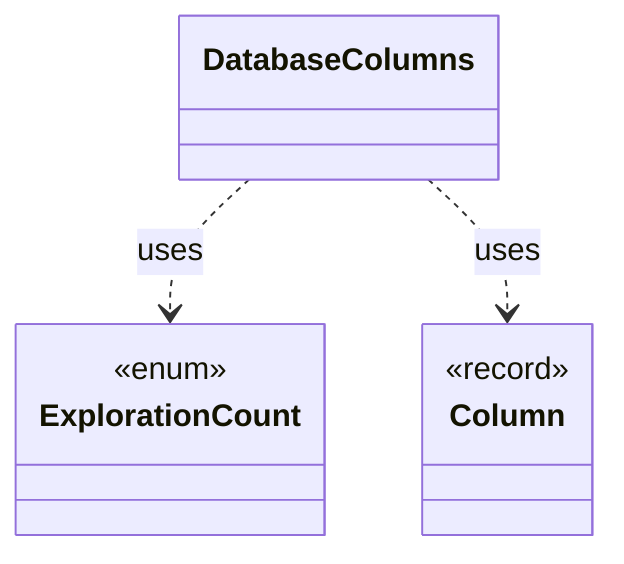

# `DatabaseColumns`

`io.github.tlaplus.hardening.database` · class · other · [source](https://github.com/tlaplus/model-checker-hardening/blob/4f182776ab66c4f93ff45cb83dfcd11e34fa32d1/src/main/java/io/github/tlaplus/hardening/database/DatabaseColumns.java#L15) · module [database](../modules/database.md)

The columns of the database tables.

The diagram draws 2 of 7 relations; the table lists them all.

| Direction | Relation | Type | Summary |
|---|---|---|---|
| → | uses | [ExplorationCount](io.github.tlaplus.hardening.checker.ExplorationCount.md) | A counted exploration metric. |
| → | uses | [Column](io.github.tlaplus.hardening.database.Column.md) | A column of a database table. |
| → | depends | [SqlType](io.github.tlaplus.hardening.database.SqlType.md) | A SQLite storage class, with the Java type a row stores for it. |
| ← | depends | [CorpusDatabaseSchema](io.github.tlaplus.hardening.database.CorpusDatabaseSchema.md) | The schema of the corpus database, as the corpus-database manual documents it. |
| ← | depends | [CorpusExport](io.github.tlaplus.hardening.database.CorpusExport.md) | Exports a corpus to a new SQLite database, as ADR 0009 defines it. |
| ← | depends | [DatabaseTable](io.github.tlaplus.hardening.database.DatabaseTable.md) | A table of the corpus database: its name, columns and keys. |
| ← | depends | [EntryRows](io.github.tlaplus.hardening.database.EntryRows.md) | The rows that one decoded corpus entry contributes: its `entry` row, followed by the rows that reference it: one `knownDefect` row per signature, one `mutationOperator` row per operator, one `stage` row per stage record, one `expr` row per expression construct of its replayed input and one `exprEdge` row per edge between constructs. |
