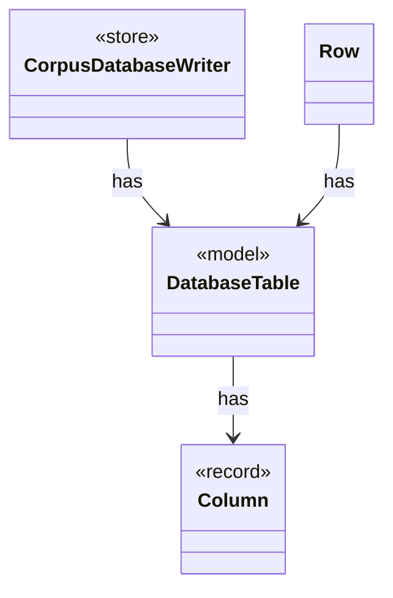

# `DatabaseTable`

`io.github.tlaplus.hardening.database` · enum · model · key · [source](https://github.com/tlaplus/model-checker-hardening/blob/47a7fcfd71d20c6a404ebf5a8a3e7d9a0e250e9b/src/main/java/io/github/tlaplus/hardening/database/DatabaseTable.java#L16) · module [database](../modules/database.md)

A table of the corpus database: its name, columns and keys.

The diagram draws 3 of 7 relations; the table lists them all.

| Direction | Relation | Type | Summary |
|---|---|---|---|
| → | has | [Column](io.github.tlaplus.hardening.database.Column.md) | A column of a database table. |
| ← | has | [CorpusDatabaseWriter](io.github.tlaplus.hardening.database.CorpusDatabaseWriter.md) | Writes the rows of one export into a new SQLite file, in a single transaction. |
| ← | has | [Row](io.github.tlaplus.hardening.database.Row.md) | The values of one row, set by column. |
| → | depends | [DatabaseColumns](io.github.tlaplus.hardening.database.DatabaseColumns.md) | The columns of the database tables. |
| ← | depends | [CorpusDatabaseSchema](io.github.tlaplus.hardening.database.CorpusDatabaseSchema.md) | The schema of the corpus database, as the corpus-database manual documents it. |
| ← | depends | [CorpusExport](io.github.tlaplus.hardening.database.CorpusExport.md) | Exports a corpus to a new SQLite database, as ADR 0009 defines it. |
| ← | depends | [EntryRows](io.github.tlaplus.hardening.database.EntryRows.md) | The rows that one decoded corpus entry contributes: its `entry` row, followed by the rows that reference it: one `knownDefect` row per signature, one `mutationOperator` row per operator, one `stage` row per stage record, one `expr` row per expression construct of its replayed input and one `exprEdge` row per edge between constructs. |
