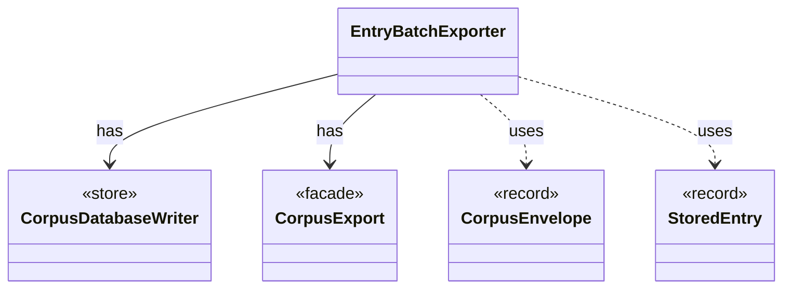

# `EntryBatchExporter`

`io.github.tlaplus.hardening.database` · class · other · [source](https://github.com/tlaplus/model-checker-hardening/blob/12d0a3fd62c72add470e6ee06490c4e3591f490e/src/main/java/io/github/tlaplus/hardening/database/EntryBatchExporter.java#L28) · module [database](../modules/database.md)

Exports listed entry files in chunks.

The diagram draws 4 of 14 relations; the table lists them all.

| Direction | Relation | Type | Summary |
|---|---|---|---|
| → | has | [CorpusDatabaseWriter](io.github.tlaplus.hardening.database.CorpusDatabaseWriter.md) | Writes the rows of one export into a new SQLite file, in a single transaction. |
| → | has | [CorpusExport](io.github.tlaplus.hardening.database.CorpusExport.md) | Exports a corpus to a new SQLite database, as ADR 0009 defines it. |
| → | uses | [CorpusEnvelope](io.github.tlaplus.hardening.corpus.CorpusEnvelope.md) | Supported fields decoded from one corpus input envelope. |
| → | uses | [StoredEntry](io.github.tlaplus.hardening.corpus.StoredEntry.md) | An entry file in one of the corpus's entry directories, listed but not read. |
| → | depends | [Diagnostics](io.github.tlaplus.hardening.common.Diagnostics.md) | Human-readable diagnostic formatting for failures. |
| → | depends | [CorpusEnvelopeCodec](io.github.tlaplus.hardening.corpus.CorpusEnvelopeCodec.md) | Reads and rewrites the `stages` metadata of a corpus envelope. |
| → | depends | [CorpusException](io.github.tlaplus.hardening.corpus.CorpusException.md) | Reports an invalid corpus layout or corpus entry. |
| → | depends | [CorpusFormatException](io.github.tlaplus.hardening.corpus.CorpusFormatException.md) | Reports stored corpus data that does not follow the documented CBOR format. |
| → | depends | [CorpusInput](io.github.tlaplus.hardening.corpus.CorpusInput.md) | The required fields of one encoded corpus input. |
| → | depends | [InputAnalysis](io.github.tlaplus.hardening.corpus.InputAnalysis.md) | Counts the evaluated nodes, expression constructs and construct edges of one stored input, and names the rewrite rules it applied, typically by replaying it through the generator. |
| → | depends | [EntryRows](io.github.tlaplus.hardening.database.EntryRows.md) | The rows that one decoded corpus entry contributes: its `entry` row, followed by the rows that reference it: one `knownDefect` row per signature, one `mutationOperator` row per operator, one `stage` row per stage record, one `expr` row per expression construct of its replayed input and one `exprEdge` row per edge between constructs. |
| → | depends | [ReplayOutcome](io.github.tlaplus.hardening.database.ReplayOutcome.md) | The result of analysing one input: what its replay shows, or why it could not be replayed. |
| → | depends | [Row](io.github.tlaplus.hardening.database.Row.md) | The values of one row, set by column. |
| ← | depends | [CorpusExport](io.github.tlaplus.hardening.database.CorpusExport.md) | Exports a corpus to a new SQLite database, as ADR 0009 defines it. |
