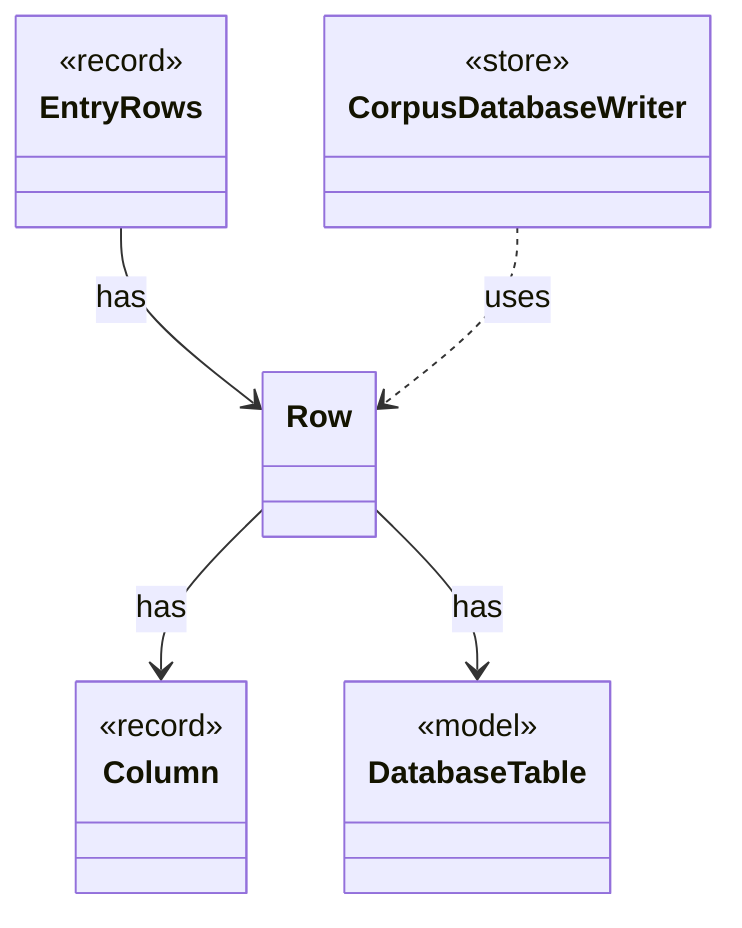

# `Row`

`io.github.tlaplus.hardening.database` · class · other · [source](https://github.com/tlaplus/model-checker-hardening/blob/a304ba37155136c3ba79e4f2fb414cbb47d01606/src/main/java/io/github/tlaplus/hardening/database/Row.java#L14) · module [database](../modules/database.md)

The values of one row, set by column.

The diagram draws 4 of 7 relations; the table lists them all.

| Direction | Relation | Type | Summary |
|---|---|---|---|
| → | has | [Column](io.github.tlaplus.hardening.database.Column.md) | A column of a database table. |
| → | has | [DatabaseTable](io.github.tlaplus.hardening.database.DatabaseTable.md) | A table of the corpus database: its name, columns and keys. |
| ← | has | [EntryRows](io.github.tlaplus.hardening.database.EntryRows.md) | The rows that one decoded corpus entry contributes: its `entry` row, followed by the rows that reference it: one `knownDefect` row per signature, one `mutationOperator` row per operator, one `stage` row per stage record, one `expr` row per expression construct of its replayed input and one `exprEdge` row per edge between constructs. |
| ← | uses | [CorpusDatabaseWriter](io.github.tlaplus.hardening.database.CorpusDatabaseWriter.md) | Writes the rows of one export into a new SQLite file, in a single transaction. |
| → | depends | [SqlType](io.github.tlaplus.hardening.database.SqlType.md) | A SQLite storage class, with the Java type a row stores for it. |
| ← | depends | [CorpusExport](io.github.tlaplus.hardening.database.CorpusExport.md) | Exports a corpus to a new SQLite database, as ADR 0009 defines it. |
| ← | depends | [EntryBatchExporter](io.github.tlaplus.hardening.database.EntryBatchExporter.md) | Exports listed entry files in chunks. |
