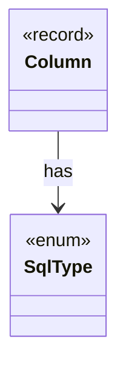

# `SqlType`

`io.github.tlaplus.hardening.database` · enum · other · [source](https://github.com/tlaplus/model-checker-hardening/blob/b96eff75a5bbf8a60b15ad020d6e84735c75a47c/src/main/java/io/github/tlaplus/hardening/database/SqlType.java#L8) · module [database](../modules/database.md)

A SQLite storage class, with the Java type a row stores for it.

The diagram draws 1 of 4 relations; the table lists them all.

| Direction | Relation | Type | Summary |
|---|---|---|---|
| ← | has | [Column](io.github.tlaplus.hardening.database.Column.md) | A column of a database table. |
| ← | depends | [CorpusDatabaseWriter](io.github.tlaplus.hardening.database.CorpusDatabaseWriter.md) | Writes the rows of one export into a new SQLite file, in a single transaction. |
| ← | depends | [DatabaseColumns](io.github.tlaplus.hardening.database.DatabaseColumns.md) | The columns of the database tables. |
| ← | depends | [Row](io.github.tlaplus.hardening.database.Row.md) | The values of one row, set by column. |
