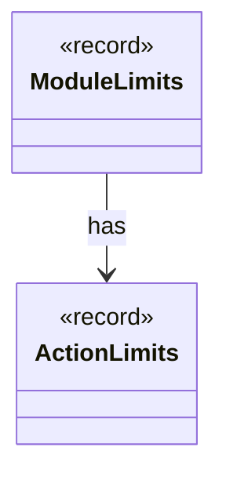

# `ActionLimits`

`io.github.tlaplus.hardening.gen` · record · other · [source](https://github.com/tlaplus/model-checker-hardening/blob/4c5cb469fa5cdcada2cd5740bce130b825b35343/src/main/java/io/github/tlaplus/hardening/gen/ActionLimits.java#L13) · module [gen](../modules/gen.md)

Bounds on action definitions and next-state disjuncts, independent of expression limits.

The diagram draws 1 of 4 relations; the table lists them all.

| Direction | Relation | Type | Summary |
|---|---|---|---|
| ← | has | [ModuleLimits](io.github.tlaplus.hardening.gen.ModuleLimits.md) | Declaration, action and exploration bounds on one module. |
| → | depends | [Preconditions](io.github.tlaplus.hardening.common.Preconditions.md) | Shared validation of method and constructor arguments. |
| ← | depends | [GeneratorLimitSchema](io.github.tlaplus.hardening.config.GeneratorLimitSchema.md) | Declares and assembles the expression and module limit keys in the generator table. |
| ← | depends | [ActionGenFactory](io.github.tlaplus.hardening.gen.engine.ActionGenFactory.md) | Module-level action assembly: Init, operator definitions, bounded parameters, guards, Next and the unconditional step update. |
