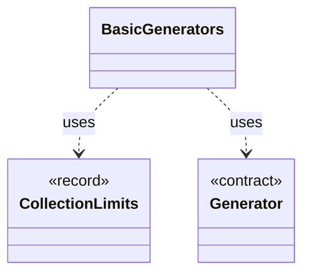

# `BasicGenerators`

`io.github.tlaplus.hardening.gen` · class · other · [source](https://github.com/tlaplus/model-checker-hardening/blob/e180a3892e661e5d7ba7636c4f24a6fca66ded14/src/main/java/io/github/tlaplus/hardening/gen/BasicGenerators.java#L12) · module [gen](../modules/gen.md)

Factory methods for basic generators that compose through a shared `Draw`.

The diagram draws 2 of 14 relations; the table lists them all.

| Direction | Relation | Type | Summary |
|---|---|---|---|
| → | uses | [CollectionLimits](io.github.tlaplus.hardening.gen.CollectionLimits.md) | Sizes of generated collection values (ADR 0011). |
| → | uses | [Generator](io.github.tlaplus.hardening.gen.Generator.md) | A composable recipe for decoding a value from a shared `Draw` cursor. |
| → | depends | [Preconditions](io.github.tlaplus.hardening.common.Preconditions.md) | Shared validation of method and constructor arguments. |
| → | depends | [Draw](io.github.tlaplus.hardening.gen.Draw.md) | A forward-only deterministic cursor that decodes structured choices from an unstructured byte array. |
| ← | depends | [AbstractExprGenFactory](io.github.tlaplus.hardening.gen.engine.AbstractExprGenFactory.md) | Shared access to the state and recursive factories used by expression generator families. |
| ← | depends | [ActionGenFactory](io.github.tlaplus.hardening.gen.engine.ActionGenFactory.md) | Module-level action assembly: Init, operator definitions, bounded parameters, guards, Next and the unconditional step update. |
| ← | depends | [GeneralExprGenFactory](io.github.tlaplus.hardening.gen.engine.GeneralExprGenFactory.md) | Constructs terminal and type-polymorphic expression generators. |
| ← | depends | [IntegerExprGenFactory](io.github.tlaplus.hardening.gen.engine.IntegerExprGenFactory.md) | Constructs integer-valued expression generators. |
| ← | depends | [IrGraphGeneratorEngine](io.github.tlaplus.hardening.gen.engine.IrGraphGeneratorEngine.md) | Reusable decoder of graph inputs (ADR 0023 §2, §3): a control graph whose nodes carry assignment-only actions, tracked by the variable `pc`, and the invariant `pc /= k`. |
| ← | depends | [IrTypeGenFactory](io.github.tlaplus.hardening.gen.engine.IrTypeGenFactory.md) | Factory for deferred generators of internal types within the configured remaining-depth budget. |
| ← | depends | [ModulePrelude](io.github.tlaplus.hardening.gen.engine.ModulePrelude.md) | The declarations every generated module begins with: its state variables and its state-free auxiliary definitions. |
| ← | depends | [OtherExprGenFactory](io.github.tlaplus.hardening.gen.engine.OtherExprGenFactory.md) | Constructs expression generators not covered by the dedicated form families. |
| ← | depends | [PropertyGenFactory](io.github.tlaplus.hardening.gen.engine.PropertyGenFactory.md) | Module-level temporal property: the property formula and its fairness conditions. |
| ← | depends | [SetExprGenFactory](io.github.tlaplus.hardening.gen.engine.SetExprGenFactory.md) | Constructs set-valued expression generators. |
