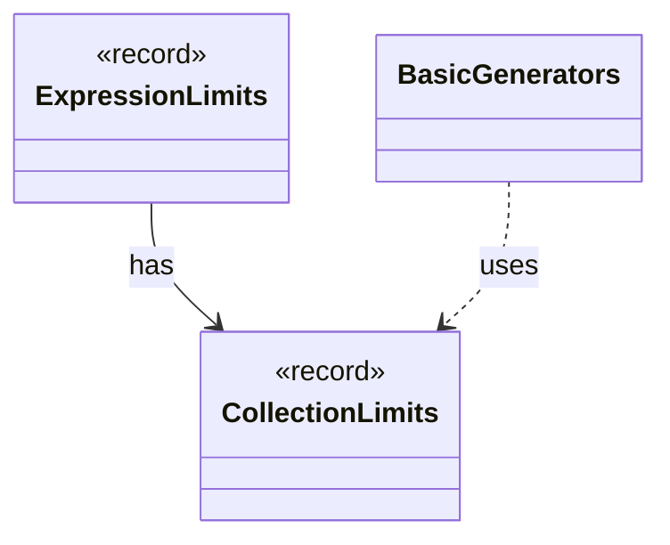

# `CollectionLimits`

`io.github.tlaplus.hardening.gen` · record · other · [source](https://github.com/tlaplus/model-checker-hardening/blob/e180a3892e661e5d7ba7636c4f24a6fca66ded14/src/main/java/io/github/tlaplus/hardening/gen/CollectionLimits.java#L19) · module [gen](../modules/gen.md)

Sizes of generated collection values (ADR 0011).

**Decisions:** [ADR 0011: Collection base size](https://github.com/tlaplus/model-checker-hardening/blob/e180a3892e661e5d7ba7636c4f24a6fca66ded14/docs/decisions/0011-collection-base-size.md)

The diagram draws 2 of 14 relations; the table lists them all.

| Direction | Relation | Type | Summary |
|---|---|---|---|
| ← | has | [ExpressionLimits](io.github.tlaplus.hardening.gen.ExpressionLimits.md) | Bounds on recursive construction and variable-size payloads within one expression. |
| ← | uses | [BasicGenerators](io.github.tlaplus.hardening.gen.BasicGenerators.md) | Factory methods for basic generators that compose through a shared `Draw`. |
| → | depends | [Preconditions](io.github.tlaplus.hardening.common.Preconditions.md) | Shared validation of method and constructor arguments. |
| ← | depends | [GeneratorLimitSchema](io.github.tlaplus.hardening.config.GeneratorLimitSchema.md) | Declares and assembles the expression and module limit keys in the generator table. |
| ← | depends | [IntegerLimits](io.github.tlaplus.hardening.gen.IntegerLimits.md) | Integer literals and the closed integer terminal. |
| ← | depends | [AbstractExprGenFactory](io.github.tlaplus.hardening.gen.engine.AbstractExprGenFactory.md) | Shared access to the state and recursive factories used by expression generator families. |
| ← | depends | [ActionGenFactory](io.github.tlaplus.hardening.gen.engine.ActionGenFactory.md) | Module-level action assembly: Init, operator definitions, bounded parameters, guards, Next and the unconditional step update. |
| ← | depends | [ApplicativeExprGenFactory](io.github.tlaplus.hardening.gen.engine.ApplicativeExprGenFactory.md) | Constructs reads, updates and domains of records, tuples and sequences. |
| ← | depends | [GeneralExprGenFactory](io.github.tlaplus.hardening.gen.engine.GeneralExprGenFactory.md) | Constructs terminal and type-polymorphic expression generators. |
| ← | depends | [GenerationContext](io.github.tlaplus.hardening.gen.engine.GenerationContext.md) | Mutable semantic state shared by every component of one generation run. |
| ← | depends | [IrTypeGenFactory](io.github.tlaplus.hardening.gen.engine.IrTypeGenFactory.md) | Factory for deferred generators of internal types within the configured remaining-depth budget. |
| ← | depends | [OtherExprGenFactory](io.github.tlaplus.hardening.gen.engine.OtherExprGenFactory.md) | Constructs expression generators not covered by the dedicated form families. |
| ← | depends | [SetExprGenFactory](io.github.tlaplus.hardening.gen.engine.SetExprGenFactory.md) | Constructs set-valued expression generators. |
| ← | depends | [TypeInstantiation](io.github.tlaplus.hardening.gen.engine.TypeInstantiation.md) | Byte-free feasibility analysis followed by bounded, deferred completion of a type term. |
