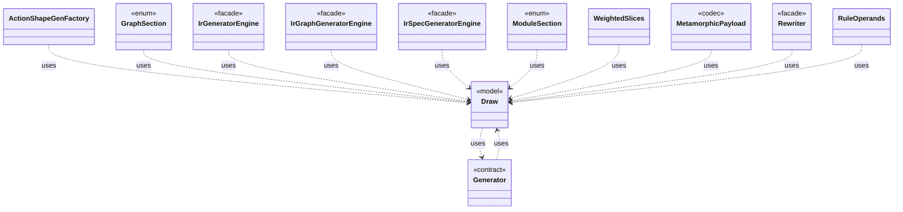

# `Draw`

`io.github.tlaplus.hardening.gen` · class · model · key · [source](https://github.com/tlaplus/model-checker-hardening/blob/af09a9e32eb710979ef0c76f29507ce1ffe85a15/src/main/java/io/github/tlaplus/hardening/gen/Draw.java#L37) · module [gen](../modules/gen.md)

A forward-only deterministic cursor that decodes structured choices from an unstructured byte array.

The diagram draws 12 of 33 relations; the table lists them all.

| Direction | Relation | Type | Summary |
|---|---|---|---|
| → | uses | [Generator](io.github.tlaplus.hardening.gen.Generator.md) | A composable recipe for decoding a value from a shared `Draw` cursor. |
| ← | uses | [Generator](io.github.tlaplus.hardening.gen.Generator.md) | A composable recipe for decoding a value from a shared `Draw` cursor. |
| ← | uses | [ActionShapeGenFactory](io.github.tlaplus.hardening.gen.engine.ActionShapeGenFactory.md) | Recursive, complete action shapes. |
| ← | uses | [GraphSection](io.github.tlaplus.hardening.gen.engine.GraphSection.md) | The independent parts of a graph input after its header, each decoded from its own contiguous range of bytes (ADR 0023 §3), as `ModuleSection` does for a module input. |
| ← | uses | [IrGeneratorEngine](io.github.tlaplus.hardening.gen.engine.IrGeneratorEngine.md) | Reusable coordinator for type-directed IR-expression generation. |
| ← | uses | [IrGraphGeneratorEngine](io.github.tlaplus.hardening.gen.engine.IrGraphGeneratorEngine.md) | Reusable decoder of graph inputs (ADR 0023 §2, §3): a control graph whose nodes carry assignment-only actions, tracked by the variable `pc`, and the invariant `pc /= k`. |
| ← | uses | [IrSpecGeneratorEngine](io.github.tlaplus.hardening.gen.engine.IrSpecGeneratorEngine.md) | Reusable coordinator for generating the declarations of one TLA+ module. |
| ← | uses | [ModuleSection](io.github.tlaplus.hardening.gen.engine.ModuleSection.md) | The independent parts of a module input, each decoded from its own contiguous range of bytes. |
| ← | uses | [WeightedSlices](io.github.tlaplus.hardening.gen.engine.WeightedSlices.md) | Divides the remaining bytes of a cursor into contiguous slices of proportional length. |
| ← | uses | [MetamorphicPayload](io.github.tlaplus.hardening.gen.rewrite.MetamorphicPayload.md) | The layout of a metamorphic input (ADR 0016 §1): |
| ← | uses | [Rewriter](io.github.tlaplus.hardening.gen.rewrite.Rewriter.md) | Decodes a rewrite payload into a rewrite of a base (ADR 0016 §2). |
| ← | uses | [RuleOperands](io.github.tlaplus.hardening.gen.rewrite.RuleOperands.md) | Draws what instantiating a rule needs beyond a match (ADR 0017 §3): a concrete type for every type variable the match leaves open, then a value for each drawn parameter at its type. |
| → | depends | [Preconditions](io.github.tlaplus.hardening.common.Preconditions.md) | Shared validation of method and constructor arguments. |
| ← | depends | [BasicGenerators](io.github.tlaplus.hardening.gen.BasicGenerators.md) | Factory methods for basic generators that compose through a shared `Draw`. |
| ← | depends | [IrGenerators](io.github.tlaplus.hardening.gen.IrGenerators.md) | Factory methods for deterministic generators of type-checked Apalache IR expressions. |
| ← | depends | [AbstractExprGenFactory](io.github.tlaplus.hardening.gen.engine.AbstractExprGenFactory.md) | Shared access to the state and recursive factories used by expression generator families. |
| ← | depends | [ActionGenFactory](io.github.tlaplus.hardening.gen.engine.ActionGenFactory.md) | Module-level action assembly: Init, operator definitions, bounded parameters, guards, Next and the unconditional step update. |
| ← | depends | [ApplicativeExprGenFactory](io.github.tlaplus.hardening.gen.engine.ApplicativeExprGenFactory.md) | Constructs reads, updates and domains of records, tuples and sequences. |
| ← | depends | [BooleanExprGenFactory](io.github.tlaplus.hardening.gen.engine.BooleanExprGenFactory.md) | Constructs Boolean-valued expression generators. |
| ← | depends | [GeneralExprGenFactory](io.github.tlaplus.hardening.gen.engine.GeneralExprGenFactory.md) | Constructs terminal and type-polymorphic expression generators. |
| ← | depends | [GenerationContext](io.github.tlaplus.hardening.gen.engine.GenerationContext.md) | Mutable semantic state shared by every component of one generation run. |
| ← | depends | [IntegerExprGenFactory](io.github.tlaplus.hardening.gen.engine.IntegerExprGenFactory.md) | Constructs integer-valued expression generators. |
| ← | depends | [IrExprGenFactory](io.github.tlaplus.hardening.gen.engine.IrExprGenFactory.md) | Factory for deferred, type-directed expression generators within one generation run. |
| ← | depends | [IrTypeGenFactory](io.github.tlaplus.hardening.gen.engine.IrTypeGenFactory.md) | Factory for deferred generators of internal types within the configured remaining-depth budget. |
| ← | depends | [ModulePrelude](io.github.tlaplus.hardening.gen.engine.ModulePrelude.md) | The declarations every generated module begins with: its state variables and its state-free auxiliary definitions. |
| ← | depends | [OtherExprGenFactory](io.github.tlaplus.hardening.gen.engine.OtherExprGenFactory.md) | Constructs expression generators not covered by the dedicated form families. |
| ← | depends | [PropertyGenFactory](io.github.tlaplus.hardening.gen.engine.PropertyGenFactory.md) | Module-level temporal property: the property formula and its fairness conditions. |
| ← | depends | [SequenceExprGenFactory](io.github.tlaplus.hardening.gen.engine.SequenceExprGenFactory.md) | Constructs sequence-valued expression generators. |
| ← | depends | [SetExprGenFactory](io.github.tlaplus.hardening.gen.engine.SetExprGenFactory.md) | Constructs set-valued expression generators. |
| ← | depends | [TypeInstantiation](io.github.tlaplus.hardening.gen.engine.TypeInstantiation.md) | Byte-free feasibility analysis followed by bounded, deferred completion of a type term. |
| ← | depends | [ValueAtomBudget](io.github.tlaplus.hardening.gen.engine.ValueAtomBudget.md) | Bounds the elements of one generated collection value over all nesting levels (ADR 0011). |
| ← | depends | [Tautologies](io.github.tlaplus.hardening.gen.rewrite.Tautologies.md) | Draws edge guards of a graph module from a rule library (ADR 0023 §6): a guard is the formula `A = B` or `A &lt;=&gt; B` of a rule, with every parameter drawn at its type. |
| ← | depends | [SpecDecoders](io.github.tlaplus.hardening.workflow.spec.SpecDecoders.md) | Immutable registry of the decoders that turn stored payloads into checkable modules. |
