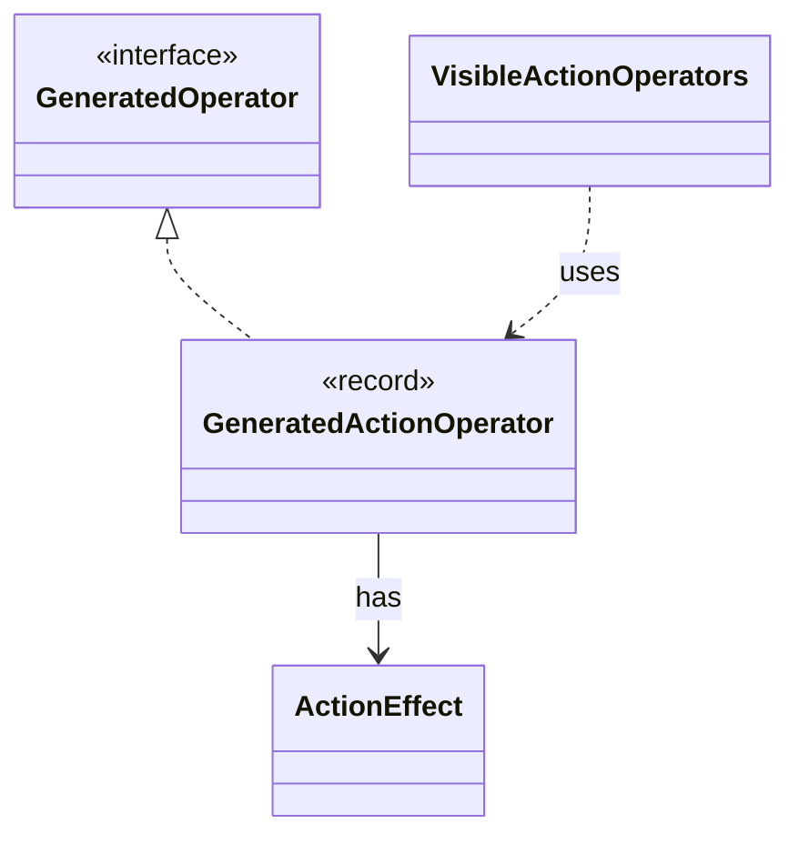

# `GeneratedActionOperator`

`io.github.tlaplus.hardening.gen` · record · other · [source](https://github.com/tlaplus/model-checker-hardening/blob/b96eff75a5bbf8a60b15ad020d6e84735c75a47c/src/main/java/io/github/tlaplus/hardening/gen/GeneratedActionOperator.java#L18) · module [gen](../modules/gen.md)

One generated action operator: a definition the next-state action may apply.

The diagram draws 3 of 10 relations; the table lists them all.

| Direction | Relation | Type | Summary |
|---|---|---|---|
| → | implements | [GeneratedOperator](io.github.tlaplus.hardening.gen.GeneratedOperator.md) | A generated definition, stored once in module declaration order. |
| → | has | [ActionEffect](io.github.tlaplus.hardening.gen.ActionEffect.md) | Nonempty, duplicate-free effect in variable declaration order, with set-style identity. |
| ← | uses | [VisibleActionOperators](io.github.tlaplus.hardening.gen.engine.VisibleActionOperators.md) | Immutable operator prefix; candidates retain declaration order for byte selection. |
| ← | depends | [GeneratedOperator](io.github.tlaplus.hardening.gen.GeneratedOperator.md) | A generated definition, stored once in module declaration order. |
| ← | depends | [GeneratedSpec](io.github.tlaplus.hardening.gen.GeneratedSpec.md) | The declarations one generated module consists of. |
| ← | depends | [ActionGenFactory](io.github.tlaplus.hardening.gen.engine.ActionGenFactory.md) | Module-level action assembly: Init, operator definitions, bounded parameters, guards, Next and the unconditional step update. |
| ← | depends | [ActionShapeGenFactory](io.github.tlaplus.hardening.gen.engine.ActionShapeGenFactory.md) | Recursive, complete action shapes. |
| ← | depends | [IrGraphGeneratorEngine](io.github.tlaplus.hardening.gen.engine.IrGraphGeneratorEngine.md) | Reusable decoder of graph inputs (ADR 0023 §2, §3): a control graph whose nodes carry assignment-only actions, tracked by the variable `pc`, and the invariant `pc /= k`. |
| ← | depends | [IrSpecGeneratorEngine](io.github.tlaplus.hardening.gen.engine.IrSpecGeneratorEngine.md) | Reusable coordinator for generating the declarations of one TLA+ module. |
| ← | depends | [Rewriter](io.github.tlaplus.hardening.gen.rewrite.Rewriter.md) | Decodes a rewrite payload into a rewrite of a base (ADR 0016 §2). |
