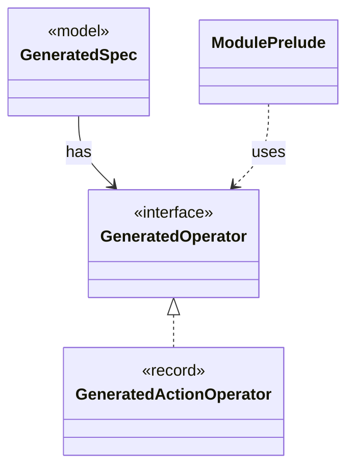

# `GeneratedOperator`

`io.github.tlaplus.hardening.gen` · interface · other · [source](https://github.com/tlaplus/model-checker-hardening/blob/5b16596dd480095d323ac67ff0f85eb85227b4b5/src/main/java/io/github/tlaplus/hardening/gen/GeneratedOperator.java#L7) · module [gen](../modules/gen.md)

A generated definition, stored once in module declaration order.

The diagram draws 3 of 8 relations; the table lists them all.

| Direction | Relation | Type | Summary |
|---|---|---|---|
| ← | implements | [GeneratedActionOperator](io.github.tlaplus.hardening.gen.GeneratedActionOperator.md) | One generated action operator: a definition the next-state action may apply. |
| ← | has | [GeneratedSpec](io.github.tlaplus.hardening.gen.GeneratedSpec.md) | The declarations one generated module consists of. |
| ← | uses | [ModulePrelude](io.github.tlaplus.hardening.gen.engine.ModulePrelude.md) | The declarations every generated module begins with: its state variables and its state-free auxiliary definitions. |
| → | depends | [GeneratedActionOperator](io.github.tlaplus.hardening.gen.GeneratedActionOperator.md) | One generated action operator: a definition the next-state action may apply. |
| ← | depends | [IrGraphGeneratorEngine](io.github.tlaplus.hardening.gen.engine.IrGraphGeneratorEngine.md) | Reusable decoder of graph inputs (ADR 0023 §2, §3): a control graph whose nodes carry assignment-only actions, tracked by the variable `pc`, and the invariant `pc /= k`. |
| ← | depends | [IrSpecGeneratorEngine](io.github.tlaplus.hardening.gen.engine.IrSpecGeneratorEngine.md) | Reusable coordinator for generating the declarations of one TLA+ module. |
| ← | depends | [Rewriter](io.github.tlaplus.hardening.gen.rewrite.Rewriter.md) | Decodes a rewrite payload into a rewrite of a base (ADR 0016 §2). |
| ← | depends | [FuzzInputModule](io.github.tlaplus.hardening.workflow.spec.FuzzInputModule.md) | Assembles the module checked by the parser and model-checker stages. |
