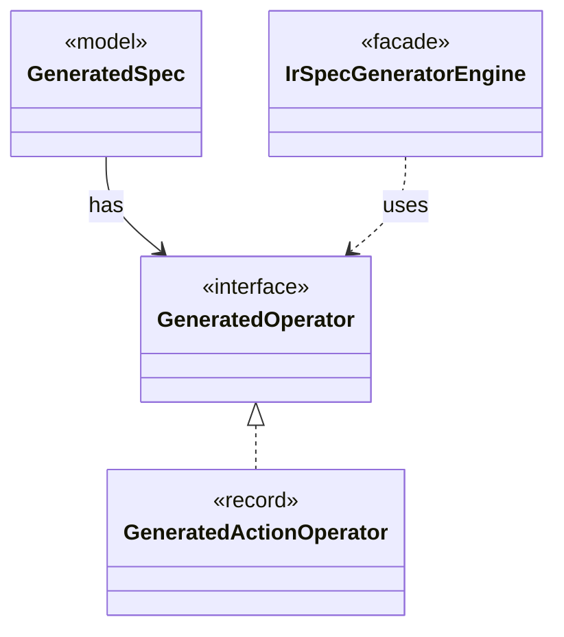

# `GeneratedOperator`

`io.github.tlaplus.hardening.gen` · interface · other · [source](https://github.com/tlaplus/model-checker-hardening/blob/a304ba37155136c3ba79e4f2fb414cbb47d01606/src/main/java/io/github/tlaplus/hardening/gen/GeneratedOperator.java#L7) · module [gen](../modules/gen.md)

A generated definition, stored once in module declaration order.

The diagram draws 3 of 6 relations; the table lists them all.

| Direction | Relation | Type | Summary |
|---|---|---|---|
| ← | implements | [GeneratedActionOperator](io.github.tlaplus.hardening.gen.GeneratedActionOperator.md) | One generated action operator: a definition the next-state action may apply. |
| ← | has | [GeneratedSpec](io.github.tlaplus.hardening.gen.GeneratedSpec.md) | The declarations one generated module consists of. |
| ← | uses | [IrSpecGeneratorEngine](io.github.tlaplus.hardening.gen.engine.IrSpecGeneratorEngine.md) | Reusable coordinator for generating the declarations of one TLA+ module. |
| → | depends | [GeneratedActionOperator](io.github.tlaplus.hardening.gen.GeneratedActionOperator.md) | One generated action operator: a definition the next-state action may apply. |
| ← | depends | [Rewriter](io.github.tlaplus.hardening.gen.rewrite.Rewriter.md) | Decodes a rewrite payload into a rewrite of a base (ADR 0016 §2). |
| ← | depends | [FuzzInputModule](io.github.tlaplus.hardening.workflow.spec.FuzzInputModule.md) | Assembles the module checked by the parser and model-checker stages. |
