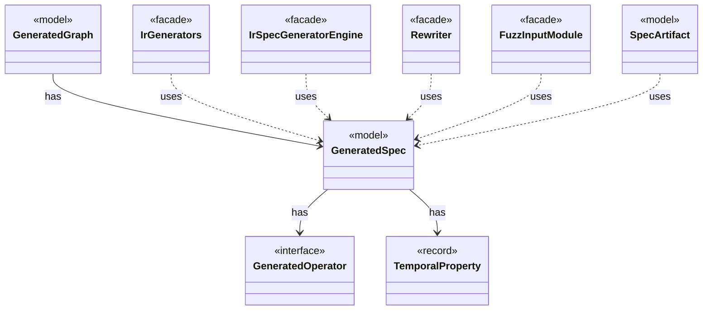

# `GeneratedSpec`

`io.github.tlaplus.hardening.gen` · record · model · key · [source](https://github.com/tlaplus/model-checker-hardening/blob/12d0a3fd62c72add470e6ee06490c4e3591f490e/src/main/java/io/github/tlaplus/hardening/gen/GeneratedSpec.java#L44) · module [gen](../modules/gen.md)

The declarations one generated module consists of.

The diagram draws 8 of 17 relations; the table lists them all.

| Direction | Relation | Type | Summary |
|---|---|---|---|
| → | has | [GeneratedOperator](io.github.tlaplus.hardening.gen.GeneratedOperator.md) | A generated definition, stored once in module declaration order. |
| → | has | [TemporalProperty](io.github.tlaplus.hardening.gen.TemporalProperty.md) | The temporal property of a generated module and the fairness that constrains it. |
| ← | has | [GeneratedGraph](io.github.tlaplus.hardening.gen.graph.GeneratedGraph.md) | A module decoded from a graph input (ADR 0023 §2), with the graph it encodes and the target its invariant `pc /= target` names. |
| ← | uses | [IrGenerators](io.github.tlaplus.hardening.gen.IrGenerators.md) | Factory methods for deterministic generators of type-checked Apalache IR expressions. |
| ← | uses | [IrSpecGeneratorEngine](io.github.tlaplus.hardening.gen.engine.IrSpecGeneratorEngine.md) | Reusable coordinator for generating the declarations of one TLA+ module. |
| ← | uses | [Rewriter](io.github.tlaplus.hardening.gen.rewrite.Rewriter.md) | Decodes a rewrite payload into a rewrite of a base (ADR 0016 §2). |
| ← | uses | [FuzzInputModule](io.github.tlaplus.hardening.workflow.spec.FuzzInputModule.md) | Assembles the module checked by the parser and model-checker stages. |
| ← | uses | [SpecArtifact](io.github.tlaplus.hardening.workflow.spec.SpecArtifact.md) | One assembled module, what its checkers are asked about it, and what its decoder produced. |
| → | depends | [Preconditions](io.github.tlaplus.hardening.common.Preconditions.md) | Shared validation of method and constructor arguments. |
| → | depends | [ActionEffect](io.github.tlaplus.hardening.gen.ActionEffect.md) | Nonempty, duplicate-free effect in variable declaration order, with set-style identity. |
| → | depends | [GeneratedActionOperator](io.github.tlaplus.hardening.gen.GeneratedActionOperator.md) | One generated action operator: a definition the next-state action may apply. |
| ← | depends | [GraphReport](io.github.tlaplus.hardening.cli.GraphReport.md) | Renders a graph module for triage (ADR 0023): the control graph, the target, the outcome the graph predicts, and the module the checkers see. |
| ← | depends | [RewriteReport](io.github.tlaplus.hardening.cli.RewriteReport.md) | Renders a metamorphic pair for triage (ADR 0016 §8): which side the checkers explore, the rules applied in order, and both sides. |
| ← | depends | [IrGraphGeneratorEngine](io.github.tlaplus.hardening.gen.engine.IrGraphGeneratorEngine.md) | Reusable decoder of graph inputs (ADR 0023 §2, §3): a control graph whose nodes carry assignment-only actions, tracked by the variable `pc`, and the invariant `pc /= k`. |
| ← | depends | [ModulePrelude](io.github.tlaplus.hardening.gen.engine.ModulePrelude.md) | The declarations every generated module begins with: its state variables and its state-free auxiliary definitions. |
| ← | depends | [SpecDecoders](io.github.tlaplus.hardening.workflow.spec.SpecDecoders.md) | Immutable registry of the decoders that turn stored payloads into checkable modules. |
| ← | depends | [CheckRequest](io.github.tlaplus.hardening.workflow.worker.CheckRequest.md) | What a checker is asked about one assembled module. |
