# `Generator`

`io.github.tlaplus.hardening.gen` · interface · contract · key · [source](https://github.com/tlaplus/model-checker-hardening/blob/e180a3892e661e5d7ba7636c4f24a6fca66ded14/src/main/java/io/github/tlaplus/hardening/gen/Generator.java#L39) · module [gen](../modules/gen.md)

A composable recipe for decoding a value from a shared `Draw` cursor.

```mermaid
classDiagram
  class Generator {
    <<contract>>
  }
  class MutantCandidates {
    <<policy>>
  }
  class SpecDecoders {
    <<facade>>
  }
  class Draw {
    <<model>>
  }
  class BasicGenerators
  class IrGenerators {
    <<facade>>
  }
  class AbstractExprGenFactory {
    <<contract>>
  }
  class ActionGenFactory
  class ActionShapeGenFactory
  class ApplicativeExprGenFactory
  class BooleanExprGenFactory
  class EdgeGuards {
    <<contract>>
  }
  class GeneralExprGenFactory
  class GenerationContext {
    <<model>>
  }
  class IntegerExprGenFactory
  class IrExprGenFactory
  class IrTypeGenFactory
  class ModulePrelude
  class OperandGenerator
  class OtherExprGenFactory
  class PropertyGenFactory
  class SequenceExprGenFactory
  class SetExprGenFactory
  class TypeInstantiation {
    <<record>>
  }
  class ValueAtomBudget
  class RuleOperands
  class Tautologies {
    <<facade>>
  }
  class ParentPool
  MutantCandidates --> Generator : has
  SpecDecoders --> Generator : has
  Generator ..> Draw : uses
  BasicGenerators ..> Generator : uses
  Draw ..> Generator : uses
  IrGenerators ..> Generator : uses
  AbstractExprGenFactory ..> Generator : uses
  ActionGenFactory ..> Generator : uses
  ActionShapeGenFactory ..> Generator : uses
  ApplicativeExprGenFactory ..> Generator : uses
  BooleanExprGenFactory ..> Generator : uses
  EdgeGuards ..> Generator : uses
  GeneralExprGenFactory ..> Generator : uses
  GenerationContext ..> Generator : uses
  IntegerExprGenFactory ..> Generator : uses
  IrExprGenFactory ..> Generator : uses
  IrTypeGenFactory ..> Generator : uses
  ModulePrelude ..> Generator : uses
  OperandGenerator ..> Generator : uses
  OtherExprGenFactory ..> Generator : uses
  PropertyGenFactory ..> Generator : uses
  SequenceExprGenFactory ..> Generator : uses
  SetExprGenFactory ..> Generator : uses
  TypeInstantiation ..> Generator : uses
  ValueAtomBudget ..> Generator : uses
  RuleOperands ..> Generator : uses
  Tautologies ..> Generator : uses
  ParentPool ..> Generator : uses
```

The diagram draws 28 of 33 relations; the table lists them all.

| Direction | Relation | Type | Summary |
|---|---|---|---|
| ← | has | [MutantCandidates](io.github.tlaplus.hardening.workflow.input.MutantCandidates.md) | Mutants of the parent pool (ADR 0010): every candidate mutates a uniformly drawn parent, keeps its cohort, and is rejected as a clone when it renders to the parent's module. |
| ← | has | [SpecDecoders](io.github.tlaplus.hardening.workflow.spec.SpecDecoders.md) | Immutable registry of the decoders that turn stored payloads into checkable modules. |
| → | uses | [Draw](io.github.tlaplus.hardening.gen.Draw.md) | A forward-only deterministic cursor that decodes structured choices from an unstructured byte array. |
| ← | uses | [BasicGenerators](io.github.tlaplus.hardening.gen.BasicGenerators.md) | Factory methods for basic generators that compose through a shared `Draw`. |
| ← | uses | [Draw](io.github.tlaplus.hardening.gen.Draw.md) | A forward-only deterministic cursor that decodes structured choices from an unstructured byte array. |
| ← | uses | [IrGenerators](io.github.tlaplus.hardening.gen.IrGenerators.md) | Factory methods for deterministic generators of type-checked Apalache IR expressions. |
| ← | uses | [AbstractExprGenFactory](io.github.tlaplus.hardening.gen.engine.AbstractExprGenFactory.md) | Shared access to the state and recursive factories used by expression generator families. |
| ← | uses | [ActionGenFactory](io.github.tlaplus.hardening.gen.engine.ActionGenFactory.md) | Module-level action assembly: Init, operator definitions, bounded parameters, guards, Next and the unconditional step update. |
| ← | uses | [ActionShapeGenFactory](io.github.tlaplus.hardening.gen.engine.ActionShapeGenFactory.md) | Recursive, complete action shapes. |
| ← | uses | [ApplicativeExprGenFactory](io.github.tlaplus.hardening.gen.engine.ApplicativeExprGenFactory.md) | Constructs reads, updates and domains of records, tuples and sequences. |
| ← | uses | [BooleanExprGenFactory](io.github.tlaplus.hardening.gen.engine.BooleanExprGenFactory.md) | Constructs Boolean-valued expression generators. |
| ← | uses | [EdgeGuards](io.github.tlaplus.hardening.gen.engine.EdgeGuards.md) | Draws the tautological guards that a graph module conjoins to its edges (ADR 0023 §6). |
| ← | uses | [GeneralExprGenFactory](io.github.tlaplus.hardening.gen.engine.GeneralExprGenFactory.md) | Constructs terminal and type-polymorphic expression generators. |
| ← | uses | [GenerationContext](io.github.tlaplus.hardening.gen.engine.GenerationContext.md) | Mutable semantic state shared by every component of one generation run. |
| ← | uses | [IntegerExprGenFactory](io.github.tlaplus.hardening.gen.engine.IntegerExprGenFactory.md) | Constructs integer-valued expression generators. |
| ← | uses | [IrExprGenFactory](io.github.tlaplus.hardening.gen.engine.IrExprGenFactory.md) | Factory for deferred, type-directed expression generators within one generation run. |
| ← | uses | [IrTypeGenFactory](io.github.tlaplus.hardening.gen.engine.IrTypeGenFactory.md) | Factory for deferred generators of internal types within the configured remaining-depth budget. |
| ← | uses | [ModulePrelude](io.github.tlaplus.hardening.gen.engine.ModulePrelude.md) | The declarations every generated module begins with: its state variables and its state-free auxiliary definitions. |
| ← | uses | [OperandGenerator](io.github.tlaplus.hardening.gen.engine.OperandGenerator.md) | Draws expressions for a rewrite that leaves an operand open (ADR 0017 §3), and for the parameters of an edge guard of a graph module (ADR 0023 §6): an operand is drawn by the ordinary expression factory, at its type, in the lexical scope of the rewritten node or the edge, and in the state-level context, so an operand adds no prime. |
| ← | uses | [OtherExprGenFactory](io.github.tlaplus.hardening.gen.engine.OtherExprGenFactory.md) | Constructs expression generators not covered by the dedicated form families. |
| ← | uses | [PropertyGenFactory](io.github.tlaplus.hardening.gen.engine.PropertyGenFactory.md) | Module-level temporal property: the property formula and its fairness conditions. |
| ← | uses | [SequenceExprGenFactory](io.github.tlaplus.hardening.gen.engine.SequenceExprGenFactory.md) | Constructs sequence-valued expression generators. |
| ← | uses | [SetExprGenFactory](io.github.tlaplus.hardening.gen.engine.SetExprGenFactory.md) | Constructs set-valued expression generators. |
| ← | uses | [TypeInstantiation](io.github.tlaplus.hardening.gen.engine.TypeInstantiation.md) | Byte-free feasibility analysis followed by bounded, deferred completion of a type term. |
| ← | uses | [ValueAtomBudget](io.github.tlaplus.hardening.gen.engine.ValueAtomBudget.md) | Bounds the elements of one generated collection value over all nesting levels (ADR 0011). |
| ← | uses | [RuleOperands](io.github.tlaplus.hardening.gen.rewrite.RuleOperands.md) | Draws what instantiating a rule needs beyond a match (ADR 0017 §3): a concrete type for every type variable the match leaves open, then a value for each drawn parameter at its type. |
| ← | uses | [Tautologies](io.github.tlaplus.hardening.gen.rewrite.Tautologies.md) | Draws edge guards of a graph module from a rule library (ADR 0023 §6): a guard is the formula `A = B` or `A &lt;=&gt; B` of a rule, with every parameter drawn at its type. |
| ← | uses | [ParentPool](io.github.tlaplus.hardening.workflow.input.ParentPool.md) | The entries of `04quality-pass` that a generation mutates or adopts: those of the kind the run generates, read once when the generation starts. |
| ← | depends | [IrGeneratorEngine](io.github.tlaplus.hardening.gen.engine.IrGeneratorEngine.md) | Reusable coordinator for type-directed IR-expression generation. |
| ← | depends | [IrGraphGeneratorEngine](io.github.tlaplus.hardening.gen.engine.IrGraphGeneratorEngine.md) | Reusable decoder of graph inputs (ADR 0023 §2, §3): a control graph whose nodes carry assignment-only actions, tracked by the variable `pc`, and the invariant `pc /= k`. |
| ← | depends | [IrSpecGeneratorEngine](io.github.tlaplus.hardening.gen.engine.IrSpecGeneratorEngine.md) | Reusable coordinator for generating the declarations of one TLA+ module. |
| ← | depends | [GenerationLoop](io.github.tlaplus.hardening.workflow.GenerationLoop.md) | Runs the generations of one workflow invocation over a single stage graph (ADR 0010). |
| ← | depends | [InputStage](io.github.tlaplus.hardening.workflow.input.InputStage.md) | Concurrent input stage: admits reserved target ranges from adjacent generations. |
