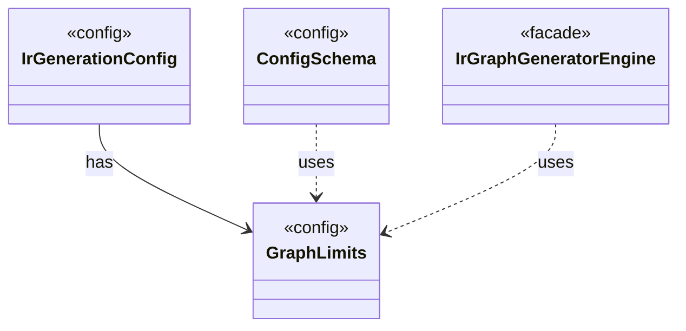

# `GraphLimits`

`io.github.tlaplus.hardening.gen` · record · config · [source](https://github.com/tlaplus/model-checker-hardening/blob/ad025d7ad6f7113910ce3a79cf6e18839b06eb5a/src/main/java/io/github/tlaplus/hardening/gen/GraphLimits.java#L19) · module [gen](../modules/gen.md)

Bounds on the control graph of one graph input (ADR 0023 §3).

**Decisions:** [ADR 0023: Graph-based testing](https://github.com/tlaplus/model-checker-hardening/blob/ad025d7ad6f7113910ce3a79cf6e18839b06eb5a/docs/decisions/0023-graph-based-testing.md)

The diagram draws 3 of 5 relations; the table lists them all.

| Direction | Relation | Type | Summary |
|---|---|---|---|
| ← | has | [IrGenerationConfig](io.github.tlaplus.hardening.gen.IrGenerationConfig.md) | Settings for generated TLA+ expressions and modules. |
| ← | uses | [ConfigSchema](io.github.tlaplus.hardening.config.ConfigSchema.md) | The declaration of every key in `config.toml`: where it lives, what it means, how its value is read, and how it is written back. |
| ← | uses | [IrGraphGeneratorEngine](io.github.tlaplus.hardening.gen.engine.IrGraphGeneratorEngine.md) | Reusable decoder of graph inputs (ADR 0023 §2, §3): a control graph whose nodes carry assignment-only actions, tracked by the variable `pc`, and the invariant `pc /= k`. |
| → | depends | [Preconditions](io.github.tlaplus.hardening.common.Preconditions.md) | Shared validation of method and constructor arguments. |
| ← | depends | [TomlConfig](io.github.tlaplus.hardening.config.TomlConfig.md) | Reads and writes the strict `config.toml` format used by a corpus. |
