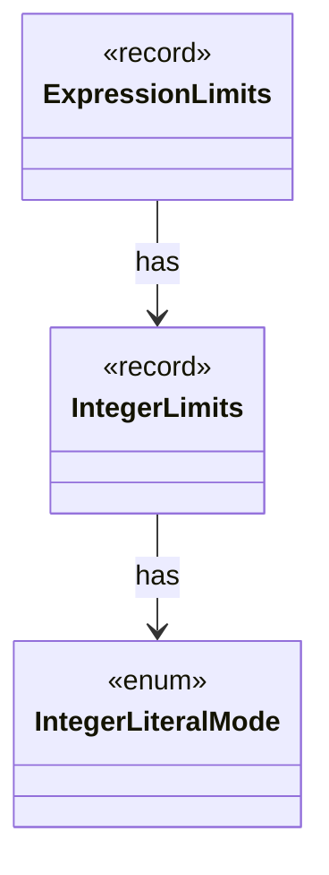

# `IntegerLimits`

`io.github.tlaplus.hardening.gen` · record · other · [source](https://github.com/tlaplus/model-checker-hardening/blob/0b7c167b636088dd43d36713d157e22f7ebd4f79/src/main/java/io/github/tlaplus/hardening/gen/IntegerLimits.java#L18) · module [gen](../modules/gen.md)

Integer literals and the closed integer terminal.

**Decisions:** [ADR 0011: Collection base size](https://github.com/tlaplus/model-checker-hardening/blob/0b7c167b636088dd43d36713d157e22f7ebd4f79/docs/decisions/0011-collection-base-size.md), [ADR 0012: Integer terminal and boundary literals](https://github.com/tlaplus/model-checker-hardening/blob/0b7c167b636088dd43d36713d157e22f7ebd4f79/docs/decisions/0012-integer-literals.md)

The diagram draws 2 of 7 relations; the table lists them all.

| Direction | Relation | Type | Summary |
|---|---|---|---|
| → | has | [IntegerLiteralMode](io.github.tlaplus.hardening.gen.IntegerLiteralMode.md) | How an integer literal decodes its value (ADR 0012). |
| ← | has | [ExpressionLimits](io.github.tlaplus.hardening.gen.ExpressionLimits.md) | Bounds on recursive construction and variable-size payloads within one expression. |
| → | depends | [Preconditions](io.github.tlaplus.hardening.common.Preconditions.md) | Shared validation of method and constructor arguments. |
| → | depends | [CollectionLimits](io.github.tlaplus.hardening.gen.CollectionLimits.md) | Sizes of generated collection values (ADR 0011). |
| ← | depends | [GeneratorLimitSchema](io.github.tlaplus.hardening.config.GeneratorLimitSchema.md) | Declares and assembles the expression and module limit keys in the generator table. |
| ← | depends | [GeneralExprGenFactory](io.github.tlaplus.hardening.gen.engine.GeneralExprGenFactory.md) | Constructs terminal and type-polymorphic expression generators. |
| ← | depends | [IntegerExprGenFactory](io.github.tlaplus.hardening.gen.engine.IntegerExprGenFactory.md) | Constructs integer-valued expression generators. |
