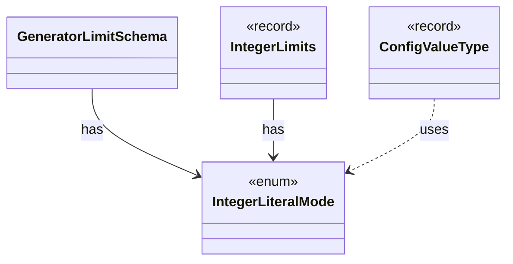

# `IntegerLiteralMode`

`io.github.tlaplus.hardening.gen` · enum · other · [source](https://github.com/tlaplus/model-checker-hardening/blob/4f182776ab66c4f93ff45cb83dfcd11e34fa32d1/src/main/java/io/github/tlaplus/hardening/gen/IntegerLiteralMode.java#L11) · module [gen](../modules/gen.md)

How an integer literal decodes its value (ADR 0012).

**Decisions:** [ADR 0012: Integer terminal and boundary literals](https://github.com/tlaplus/model-checker-hardening/blob/4f182776ab66c4f93ff45cb83dfcd11e34fa32d1/docs/decisions/0012-integer-literals.md)

The diagram draws 3 of 4 relations; the table lists them all.

| Direction | Relation | Type | Summary |
|---|---|---|---|
| ← | has | [GeneratorLimitSchema](io.github.tlaplus.hardening.config.GeneratorLimitSchema.md) | Declares and assembles the expression and module limit keys in the generator table. |
| ← | has | [IntegerLimits](io.github.tlaplus.hardening.gen.IntegerLimits.md) | Integer literals and the closed integer terminal. |
| ← | uses | [ConfigValueType](io.github.tlaplus.hardening.config.ConfigValueType.md) | How the value of one configuration key is read from TOML and written back as TOML syntax. |
| ← | depends | [IntegerExprGenFactory](io.github.tlaplus.hardening.gen.engine.IntegerExprGenFactory.md) | Constructs integer-valued expression generators. |
