# `IrGenerationConfig`

`io.github.tlaplus.hardening.gen` · record · config · key · [source](https://github.com/tlaplus/model-checker-hardening/blob/4df6a11e5b4bf93609393935c4cbeceec08cce0c/src/main/java/io/github/tlaplus/hardening/gen/IrGenerationConfig.java#L28) · module [gen](../modules/gen.md)

Settings for generated TLA+ expressions and modules.

```mermaid
classDiagram
  class IrGenerationConfig {
    <<config>>
  }
  class ExpressionCategory {
    <<enum>>
  }
  class ExpressionLimits {
    <<record>>
  }
  class GraphLimits {
    <<config>>
  }
  class ModuleLimits {
    <<record>>
  }
  class ExpressionKind {
    <<interface>>
  }
  class OperatorLibrary {
    <<facade>>
  }
  class FuzzTlaConfig {
    <<config>>
  }
  class GenerationContext {
    <<model>>
  }
  class IrGeneratorEngine {
    <<facade>>
  }
  class IrGraphGeneratorEngine {
    <<facade>>
  }
  class IrSpecGeneratorEngine {
    <<facade>>
  }
  class Rewriter {
    <<facade>>
  }
  class ConfigSchema {
    <<config>>
  }
  class GeneratorLimitSchema
  class IrGenerators {
    <<facade>>
  }
  class CustomExpressionKind {
    <<record>>
  }
  class ExpressionKindCatalog {
    <<model>>
  }
  class ModuleSection {
    <<enum>>
  }
  class OperandGenerator
  class TypeInstantiation {
    <<record>>
  }
  class AdoptableBase
  class LibraryPreparation {
    <<facade>>
  }
  class SpecDecoders {
    <<facade>>
  }
  IrGenerationConfig --> ExpressionCategory : has
  IrGenerationConfig --> ExpressionLimits : has
  IrGenerationConfig --> GraphLimits : has
  IrGenerationConfig --> ModuleLimits : has
  IrGenerationConfig --> ExpressionKind : has
  IrGenerationConfig --> OperatorLibrary : has
  FuzzTlaConfig --> IrGenerationConfig : has
  GenerationContext --> IrGenerationConfig : has
  IrGeneratorEngine --> IrGenerationConfig : has
  IrGraphGeneratorEngine --> IrGenerationConfig : has
  IrSpecGeneratorEngine --> IrGenerationConfig : has
  Rewriter --> IrGenerationConfig : has
  ConfigSchema ..> IrGenerationConfig : uses
  GeneratorLimitSchema ..> IrGenerationConfig : uses
  IrGenerators ..> IrGenerationConfig : uses
  CustomExpressionKind ..> IrGenerationConfig : uses
  ExpressionKind ..> IrGenerationConfig : uses
  ExpressionKindCatalog ..> IrGenerationConfig : uses
  ModuleSection ..> IrGenerationConfig : uses
  OperandGenerator ..> IrGenerationConfig : uses
  TypeInstantiation ..> IrGenerationConfig : uses
  AdoptableBase ..> IrGenerationConfig : uses
  LibraryPreparation ..> IrGenerationConfig : uses
  SpecDecoders ..> IrGenerationConfig : uses
```

The diagram draws 24 of 43 relations; the table lists them all.

| Direction | Relation | Type | Summary |
|---|---|---|---|
| → | has | [ExpressionCategory](io.github.tlaplus.hardening.gen.ExpressionCategory.md) | A user-facing category assigned to generated expression forms. |
| → | has | [ExpressionLimits](io.github.tlaplus.hardening.gen.ExpressionLimits.md) | Bounds on recursive construction and variable-size payloads within one expression. |
| → | has | [GraphLimits](io.github.tlaplus.hardening.gen.GraphLimits.md) | Bounds on the control graph of one graph input (ADR 0023 §3). |
| → | has | [ModuleLimits](io.github.tlaplus.hardening.gen.ModuleLimits.md) | Declaration, action and exploration bounds on one module. |
| → | has | [ExpressionKind](io.github.tlaplus.hardening.gen.engine.ExpressionKind.md) | A selectable expression form grouped by the component that constructs it. |
| → | has | [OperatorLibrary](io.github.tlaplus.hardening.gen.library.OperatorLibrary.md) | Immutable prepared library. |
| ← | has | [FuzzTlaConfig](io.github.tlaplus.hardening.config.FuzzTlaConfig.md) | Complete configuration of input generation and workflow execution. |
| ← | has | [GenerationContext](io.github.tlaplus.hardening.gen.engine.GenerationContext.md) | Mutable semantic state shared by every component of one generation run. |
| ← | has | [IrGeneratorEngine](io.github.tlaplus.hardening.gen.engine.IrGeneratorEngine.md) | Reusable coordinator for type-directed IR-expression generation. |
| ← | has | [IrGraphGeneratorEngine](io.github.tlaplus.hardening.gen.engine.IrGraphGeneratorEngine.md) | Reusable decoder of graph inputs (ADR 0023 §2, §3): a control graph whose nodes carry assignment-only actions, tracked by the variable `pc`, and the invariant `pc /= k`. |
| ← | has | [IrSpecGeneratorEngine](io.github.tlaplus.hardening.gen.engine.IrSpecGeneratorEngine.md) | Reusable coordinator for generating the declarations of one TLA+ module. |
| ← | has | [Rewriter](io.github.tlaplus.hardening.gen.rewrite.Rewriter.md) | Decodes a rewrite payload into a rewrite of a base (ADR 0016 §2). |
| ← | uses | [ConfigSchema](io.github.tlaplus.hardening.config.ConfigSchema.md) | The declaration of every key in `config.toml`: where it lives, what it means, how its value is read, and how it is written back. |
| ← | uses | [GeneratorLimitSchema](io.github.tlaplus.hardening.config.GeneratorLimitSchema.md) | Declares and assembles the expression and module limit keys in the generator table. |
| ← | uses | [IrGenerators](io.github.tlaplus.hardening.gen.IrGenerators.md) | Factory methods for deterministic generators of type-checked Apalache IR expressions. |
| ← | uses | [CustomExpressionKind](io.github.tlaplus.hardening.gen.engine.CustomExpressionKind.md) | One configured operator kind; its type scheme comes from the immutable prepared library. |
| ← | uses | [ExpressionKind](io.github.tlaplus.hardening.gen.engine.ExpressionKind.md) | A selectable expression form grouped by the component that constructs it. |
| ← | uses | [ExpressionKindCatalog](io.github.tlaplus.hardening.gen.engine.ExpressionKindCatalog.md) | The catalog of every expression form, in decoder order. |
| ← | uses | [ModuleSection](io.github.tlaplus.hardening.gen.engine.ModuleSection.md) | The independent parts of a module input, each decoded from its own contiguous range of bytes. |
| ← | uses | [OperandGenerator](io.github.tlaplus.hardening.gen.engine.OperandGenerator.md) | Draws expressions for a rewrite that leaves an operand open (ADR 0017 §3), and for the parameters of an edge guard of a graph module (ADR 0023 §6): an operand is drawn by the ordinary expression factory, at its type, in the lexical scope of the rewritten node or the edge, and in the state-level context, so an operand adds no prime. |
| ← | uses | [TypeInstantiation](io.github.tlaplus.hardening.gen.engine.TypeInstantiation.md) | Byte-free feasibility analysis followed by bounded, deferred completion of a type term. |
| ← | uses | [AdoptableBase](io.github.tlaplus.hardening.workflow.AdoptableBase.md) | The base corpus of a metamorphic run (ADR 0016 §6). |
| ← | uses | [LibraryPreparation](io.github.tlaplus.hardening.workflow.library.LibraryPreparation.md) | Prepares custom libraries once before decoding; no importer/typechecker Maven dependency. |
| ← | uses | [SpecDecoders](io.github.tlaplus.hardening.workflow.spec.SpecDecoders.md) | Immutable registry of the decoders that turn stored payloads into checkable modules. |
| → | depends | [CustomExpressionKind](io.github.tlaplus.hardening.gen.engine.CustomExpressionKind.md) | One configured operator kind; its type scheme comes from the immutable prepared library. |
| → | depends | [GeneralExpressionKind](io.github.tlaplus.hardening.gen.engine.GeneralExpressionKind.md) | Type-polymorphic and terminal expression forms. |
| → | depends | [SetExpressionKind](io.github.tlaplus.hardening.gen.engine.SetExpressionKind.md) | Set-valued expression forms. |
| ← | depends | [TomlConfig](io.github.tlaplus.hardening.config.TomlConfig.md) | Reads and writes the strict `config.toml` format used by a corpus. |
| ← | depends | [AbstractExprGenFactory](io.github.tlaplus.hardening.gen.engine.AbstractExprGenFactory.md) | Shared access to the state and recursive factories used by expression generator families. |
| ← | depends | [ActionGenFactory](io.github.tlaplus.hardening.gen.engine.ActionGenFactory.md) | Module-level action assembly: Init, operator definitions, bounded parameters, guards, Next and the unconditional step update. |
| ← | depends | [ApplicativeExprGenFactory](io.github.tlaplus.hardening.gen.engine.ApplicativeExprGenFactory.md) | Constructs reads, updates and domains of records, tuples and sequences. |
| ← | depends | [BooleanExpressionKind](io.github.tlaplus.hardening.gen.engine.BooleanExpressionKind.md) | Boolean-valued expression forms. |
| ← | depends | [GeneralExprGenFactory](io.github.tlaplus.hardening.gen.engine.GeneralExprGenFactory.md) | Constructs terminal and type-polymorphic expression generators. |
| ← | depends | [GeneralExpressionKind](io.github.tlaplus.hardening.gen.engine.GeneralExpressionKind.md) | Type-polymorphic and terminal expression forms. |
| ← | depends | [IntegerExprGenFactory](io.github.tlaplus.hardening.gen.engine.IntegerExprGenFactory.md) | Constructs integer-valued expression generators. |
| ← | depends | [IrExprGenFactory](io.github.tlaplus.hardening.gen.engine.IrExprGenFactory.md) | Factory for deferred, type-directed expression generators within one generation run. |
| ← | depends | [IrTypeGenFactory](io.github.tlaplus.hardening.gen.engine.IrTypeGenFactory.md) | Factory for deferred generators of internal types within the configured remaining-depth budget. |
| ← | depends | [ModulePrelude](io.github.tlaplus.hardening.gen.engine.ModulePrelude.md) | The declarations every generated module begins with: its state variables and its state-free auxiliary definitions. |
| ← | depends | [OtherExprGenFactory](io.github.tlaplus.hardening.gen.engine.OtherExprGenFactory.md) | Constructs expression generators not covered by the dedicated form families. |
| ← | depends | [PropertyGenFactory](io.github.tlaplus.hardening.gen.engine.PropertyGenFactory.md) | Module-level temporal property: the property formula and its fairness conditions. |
| ← | depends | [SetExprGenFactory](io.github.tlaplus.hardening.gen.engine.SetExprGenFactory.md) | Constructs set-valued expression generators. |
| ← | depends | [RewriteLibrary](io.github.tlaplus.hardening.gen.rewrite.RewriteLibrary.md) | The rules of one rule module, in declaration order (ADR 0017 §1). |
| ← | depends | [WorkflowRunner](io.github.tlaplus.hardening.workflow.WorkflowRunner.md) | Runs generation, parsing, TLC, Apalache, conformance aggregation and the quality gate under one CPU budget. |
