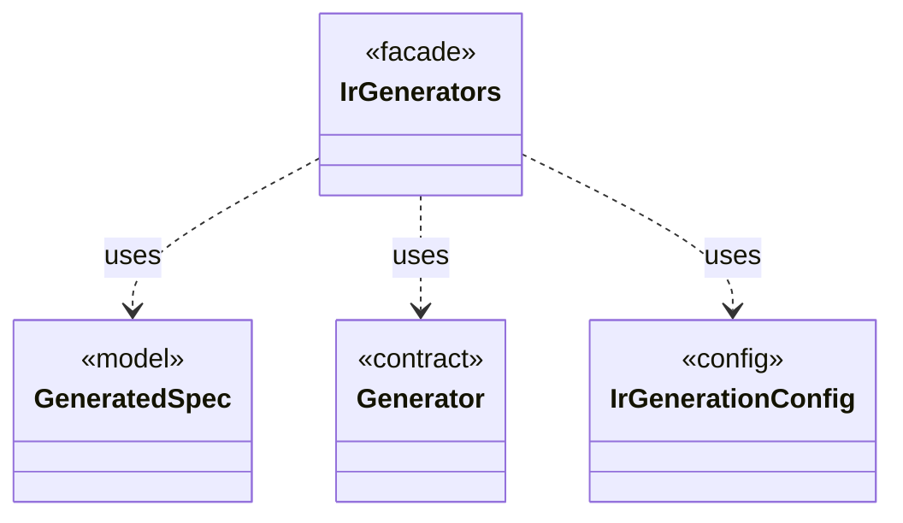

# `IrGenerators`

`io.github.tlaplus.hardening.gen` · class · facade · key · [source](https://github.com/tlaplus/model-checker-hardening/blob/4f182776ab66c4f93ff45cb83dfcd11e34fa32d1/src/main/java/io/github/tlaplus/hardening/gen/IrGenerators.java#L66) · module [gen](../modules/gen.md)

Factory methods for deterministic generators of type-checked Apalache IR expressions.

The diagram draws 3 of 7 relations; the table lists them all.

| Direction | Relation | Type | Summary |
|---|---|---|---|
| → | uses | [GeneratedSpec](io.github.tlaplus.hardening.gen.GeneratedSpec.md) | The declarations one generated module consists of. |
| → | uses | [Generator](io.github.tlaplus.hardening.gen.Generator.md) | A composable recipe for decoding a value from a shared `Draw` cursor. |
| → | uses | [IrGenerationConfig](io.github.tlaplus.hardening.gen.IrGenerationConfig.md) | Settings for generated TLA+ expressions and modules. |
| → | depends | [Draw](io.github.tlaplus.hardening.gen.Draw.md) | A forward-only deterministic cursor that decodes structured choices from an unstructured byte array. |
| → | depends | [IrGeneratorEngine](io.github.tlaplus.hardening.gen.engine.IrGeneratorEngine.md) | Reusable coordinator for type-directed IR-expression generation. |
| → | depends | [IrSpecGeneratorEngine](io.github.tlaplus.hardening.gen.engine.IrSpecGeneratorEngine.md) | Reusable coordinator for generating the declarations of one TLA+ module. |
| ← | depends | [SpecDecoders](io.github.tlaplus.hardening.workflow.spec.SpecDecoders.md) | Immutable registry of the decoders that turn stored payloads into checkable modules. |
