# `AbstractExprGenFactory`

`io.github.tlaplus.hardening.gen.engine` · class · contract · key · [source](https://github.com/tlaplus/model-checker-hardening/blob/6bd7d927f1cffd7642029a3d925dff47091ddde9/src/main/java/io/github/tlaplus/hardening/gen/engine/AbstractExprGenFactory.java#L20) · module [gen](../modules/gen.md)

Shared access to the state and recursive factories used by expression generator families.

```mermaid
classDiagram
  class AbstractExprGenFactory {
    <<contract>>
  }
  class ActionGenFactory
  class ActionShapeGenFactory
  class ApplicativeExprGenFactory
  class BooleanExprGenFactory
  class GeneralExprGenFactory
  class IntegerExprGenFactory
  class OtherExprGenFactory
  class PropertyGenFactory
  class SequenceExprGenFactory
  class SetExprGenFactory
  class GenerationContext {
    <<model>>
  }
  class IrExprGenFactory
  class IrTypeGenFactory
  class Generator {
    <<contract>>
  }
  class IrType {
    <<model>>
  }
  class LevelContext {
    <<enum>>
  }
  class RecordType {
    <<record>>
  }
  class ScopedName {
    <<record>>
  }
  class TupleType {
    <<record>>
  }
  AbstractExprGenFactory <|-- ActionGenFactory
  AbstractExprGenFactory <|-- ActionShapeGenFactory
  AbstractExprGenFactory <|-- ApplicativeExprGenFactory
  AbstractExprGenFactory <|-- BooleanExprGenFactory
  AbstractExprGenFactory <|-- GeneralExprGenFactory
  AbstractExprGenFactory <|-- IntegerExprGenFactory
  AbstractExprGenFactory <|-- OtherExprGenFactory
  AbstractExprGenFactory <|-- PropertyGenFactory
  AbstractExprGenFactory <|-- SequenceExprGenFactory
  AbstractExprGenFactory <|-- SetExprGenFactory
  AbstractExprGenFactory --> GenerationContext : has
  AbstractExprGenFactory --> IrExprGenFactory : has
  AbstractExprGenFactory --> IrTypeGenFactory : has
  AbstractExprGenFactory ..> Generator : uses
  AbstractExprGenFactory ..> IrType : uses
  AbstractExprGenFactory ..> LevelContext : uses
  AbstractExprGenFactory ..> RecordType : uses
  AbstractExprGenFactory ..> ScopedName : uses
  AbstractExprGenFactory ..> TupleType : uses
```

The diagram draws 19 of 29 relations; the table lists them all.

| Direction | Relation | Type | Summary |
|---|---|---|---|
| ← | extends | [ActionGenFactory](io.github.tlaplus.hardening.gen.engine.ActionGenFactory.md) | Module-level action assembly: Init, operator definitions, bounded parameters, guards, Next and the unconditional step update. |
| ← | extends | [ActionShapeGenFactory](io.github.tlaplus.hardening.gen.engine.ActionShapeGenFactory.md) | Recursive, complete action shapes. |
| ← | extends | [ApplicativeExprGenFactory](io.github.tlaplus.hardening.gen.engine.ApplicativeExprGenFactory.md) | Constructs reads, updates and domains of records, tuples and sequences. |
| ← | extends | [BooleanExprGenFactory](io.github.tlaplus.hardening.gen.engine.BooleanExprGenFactory.md) | Constructs Boolean-valued expression generators. |
| ← | extends | [GeneralExprGenFactory](io.github.tlaplus.hardening.gen.engine.GeneralExprGenFactory.md) | Constructs terminal and type-polymorphic expression generators. |
| ← | extends | [IntegerExprGenFactory](io.github.tlaplus.hardening.gen.engine.IntegerExprGenFactory.md) | Constructs integer-valued expression generators. |
| ← | extends | [OtherExprGenFactory](io.github.tlaplus.hardening.gen.engine.OtherExprGenFactory.md) | Constructs expression generators not covered by the dedicated form families. |
| ← | extends | [PropertyGenFactory](io.github.tlaplus.hardening.gen.engine.PropertyGenFactory.md) | Module-level temporal property: the property formula and its fairness conditions. |
| ← | extends | [SequenceExprGenFactory](io.github.tlaplus.hardening.gen.engine.SequenceExprGenFactory.md) | Constructs sequence-valued expression generators. |
| ← | extends | [SetExprGenFactory](io.github.tlaplus.hardening.gen.engine.SetExprGenFactory.md) | Constructs set-valued expression generators. |
| → | has | [GenerationContext](io.github.tlaplus.hardening.gen.engine.GenerationContext.md) | Mutable semantic state shared by every component of one generation run. |
| → | has | [IrExprGenFactory](io.github.tlaplus.hardening.gen.engine.IrExprGenFactory.md) | Factory for deferred, type-directed expression generators within one generation run. |
| → | has | [IrTypeGenFactory](io.github.tlaplus.hardening.gen.engine.IrTypeGenFactory.md) | Factory for deferred generators of internal types within the configured remaining-depth budget. |
| → | uses | [Generator](io.github.tlaplus.hardening.gen.Generator.md) | A composable recipe for decoding a value from a shared `Draw` cursor. |
| → | uses | [IrType](io.github.tlaplus.hardening.gen.engine.IrType.md) | Internal type model used to direct checked expression construction. |
| → | uses | [LevelContext](io.github.tlaplus.hardening.gen.engine.LevelContext.md) | The levels an expression request may produce, which `GenerationContext` keeps as a dynamic ceiling while a body is drawn. |
| → | uses | [RecordType](io.github.tlaplus.hardening.gen.engine.RecordType.md) | Record type. |
| → | uses | [ScopedName](io.github.tlaplus.hardening.gen.engine.ScopedName.md) | A typed name visible while recursively generating a lexical body. |
| → | uses | [TupleType](io.github.tlaplus.hardening.gen.engine.TupleType.md) | Tuple type. |
| → | depends | [BasicGenerators](io.github.tlaplus.hardening.gen.BasicGenerators.md) | Factory methods for basic generators that compose through a shared `Draw`. |
| → | depends | [CollectionLimits](io.github.tlaplus.hardening.gen.CollectionLimits.md) | Sizes of generated collection values (ADR 0011). |
| → | depends | [Draw](io.github.tlaplus.hardening.gen.Draw.md) | A forward-only deterministic cursor that decodes structured choices from an unstructured byte array. |
| → | depends | [ExpressionLimits](io.github.tlaplus.hardening.gen.ExpressionLimits.md) | Bounds on recursive construction and variable-size payloads within one expression. |
| → | depends | [IrGenerationConfig](io.github.tlaplus.hardening.gen.IrGenerationConfig.md) | Settings for generated TLA+ expressions and modules. |
| → | depends | [BuilderArrays](io.github.tlaplus.hardening.gen.engine.BuilderArrays.md) | Array conversions for the builder's generic varargs APIs. |
| → | depends | [Field](io.github.tlaplus.hardening.gen.engine.Field.md) | Named component of a record or variant type. |
| → | depends | [PrimitiveType](io.github.tlaplus.hardening.gen.engine.PrimitiveType.md) | Primitive expression result types. |
| → | depends | [SetType](io.github.tlaplus.hardening.gen.engine.SetType.md) | Set type. |
| → | depends | [ValueAtomBudget](io.github.tlaplus.hardening.gen.engine.ValueAtomBudget.md) | Bounds the elements of one generated collection value over all nesting levels (ADR 0011). |
