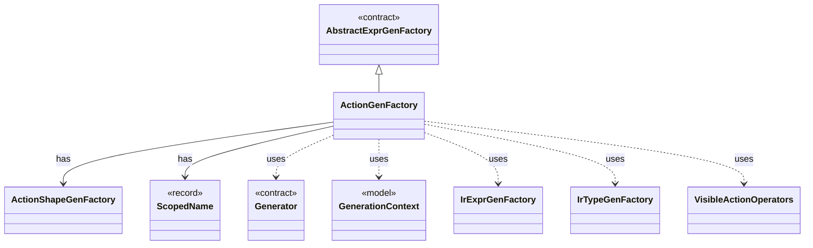

# `ActionGenFactory`

`io.github.tlaplus.hardening.gen.engine` · class · other · [source](https://github.com/tlaplus/model-checker-hardening/blob/6bbf8b66c375696d1798f7b7a061b81573a3f42a/src/main/java/io/github/tlaplus/hardening/gen/engine/ActionGenFactory.java#L21) · module [gen](../modules/gen.md)

Module-level action assembly: Init, operator definitions, bounded parameters, guards, Next and the unconditional step update.

The diagram draws 8 of 26 relations; the table lists them all.

| Direction | Relation | Type | Summary |
|---|---|---|---|
| → | extends | [AbstractExprGenFactory](io.github.tlaplus.hardening.gen.engine.AbstractExprGenFactory.md) | Shared access to the state and recursive factories used by expression generator families. |
| → | has | [ActionShapeGenFactory](io.github.tlaplus.hardening.gen.engine.ActionShapeGenFactory.md) | Recursive, complete action shapes. |
| → | has | [ScopedName](io.github.tlaplus.hardening.gen.engine.ScopedName.md) | A typed name visible while recursively generating a lexical body. |
| → | uses | [Generator](io.github.tlaplus.hardening.gen.Generator.md) | A composable recipe for decoding a value from a shared `Draw` cursor. |
| → | uses | [GenerationContext](io.github.tlaplus.hardening.gen.engine.GenerationContext.md) | Mutable semantic state shared by every component of one generation run. |
| → | uses | [IrExprGenFactory](io.github.tlaplus.hardening.gen.engine.IrExprGenFactory.md) | Factory for deferred, type-directed expression generators within one generation run. |
| → | uses | [IrTypeGenFactory](io.github.tlaplus.hardening.gen.engine.IrTypeGenFactory.md) | Factory for deferred generators of internal types within the configured remaining-depth budget. |
| → | uses | [VisibleActionOperators](io.github.tlaplus.hardening.gen.engine.VisibleActionOperators.md) | Immutable operator prefix; candidates retain declaration order for byte selection. |
| → | depends | [ActionEffect](io.github.tlaplus.hardening.gen.ActionEffect.md) | Nonempty, duplicate-free effect in variable declaration order, with set-style identity. |
| → | depends | [ActionLimits](io.github.tlaplus.hardening.gen.ActionLimits.md) | Bounds on action definitions and next-state disjuncts, independent of expression limits. |
| → | depends | [BasicGenerators](io.github.tlaplus.hardening.gen.BasicGenerators.md) | Factory methods for basic generators that compose through a shared `Draw`. |
| → | depends | [CollectionLimits](io.github.tlaplus.hardening.gen.CollectionLimits.md) | Sizes of generated collection values (ADR 0011). |
| → | depends | [Draw](io.github.tlaplus.hardening.gen.Draw.md) | A forward-only deterministic cursor that decodes structured choices from an unstructured byte array. |
| → | depends | [ExpressionCategory](io.github.tlaplus.hardening.gen.ExpressionCategory.md) | A user-facing category assigned to generated expression forms. |
| → | depends | [ExpressionLimits](io.github.tlaplus.hardening.gen.ExpressionLimits.md) | Bounds on recursive construction and variable-size payloads within one expression. |
| → | depends | [GeneratedActionOperator](io.github.tlaplus.hardening.gen.GeneratedActionOperator.md) | One generated action operator: a definition the next-state action may apply. |
| → | depends | [IrGenerationConfig](io.github.tlaplus.hardening.gen.IrGenerationConfig.md) | Settings for generated TLA+ expressions and modules. |
| → | depends | [ModuleLimits](io.github.tlaplus.hardening.gen.ModuleLimits.md) | Declaration, action and exploration bounds on one module. |
| → | depends | [BuilderArrays](io.github.tlaplus.hardening.gen.engine.BuilderArrays.md) | Array conversions for the builder's generic varargs APIs. |
| → | depends | [IrType](io.github.tlaplus.hardening.gen.engine.IrType.md) | Internal type model used to direct checked expression construction. |
| → | depends | [LevelContext](io.github.tlaplus.hardening.gen.engine.LevelContext.md) | The levels an expression request may produce, which `GenerationContext` keeps as a dynamic ceiling while a body is drawn. |
| → | depends | [OperatorType](io.github.tlaplus.hardening.gen.engine.OperatorType.md) | Operator type. |
| → | depends | [PrimitiveType](io.github.tlaplus.hardening.gen.engine.PrimitiveType.md) | Primitive expression result types. |
| → | depends | [SetType](io.github.tlaplus.hardening.gen.engine.SetType.md) | Set type. |
| ← | depends | [IrGraphGeneratorEngine](io.github.tlaplus.hardening.gen.engine.IrGraphGeneratorEngine.md) | Reusable decoder of graph inputs (ADR 0023 §2, §3): a control graph whose nodes carry assignment-only actions, tracked by the variable `pc`, and the invariant `pc /= k`. |
| ← | depends | [IrSpecGeneratorEngine](io.github.tlaplus.hardening.gen.engine.IrSpecGeneratorEngine.md) | Reusable coordinator for generating the declarations of one TLA+ module. |
