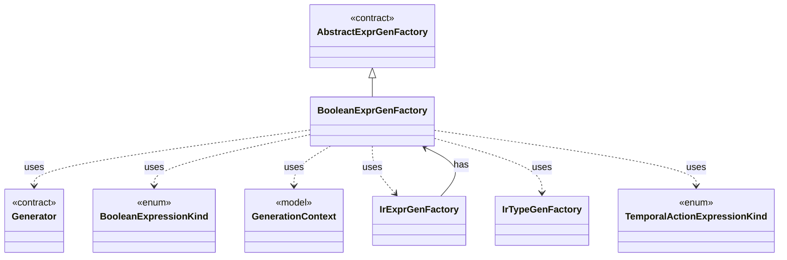

# `BooleanExprGenFactory`

`io.github.tlaplus.hardening.gen.engine` · class · other · [source](https://github.com/tlaplus/model-checker-hardening/blob/e180a3892e661e5d7ba7636c4f24a6fca66ded14/src/main/java/io/github/tlaplus/hardening/gen/engine/BooleanExprGenFactory.java#L7) · module [gen](../modules/gen.md)

Constructs Boolean-valued expression generators.

The diagram draws 8 of 14 relations; the table lists them all.

| Direction | Relation | Type | Summary |
|---|---|---|---|
| → | extends | [AbstractExprGenFactory](io.github.tlaplus.hardening.gen.engine.AbstractExprGenFactory.md) | Shared access to the state and recursive factories used by expression generator families. |
| ← | has | [IrExprGenFactory](io.github.tlaplus.hardening.gen.engine.IrExprGenFactory.md) | Factory for deferred, type-directed expression generators within one generation run. |
| → | uses | [Generator](io.github.tlaplus.hardening.gen.Generator.md) | A composable recipe for decoding a value from a shared `Draw` cursor. |
| → | uses | [BooleanExpressionKind](io.github.tlaplus.hardening.gen.engine.BooleanExpressionKind.md) | Boolean-valued expression forms. |
| → | uses | [GenerationContext](io.github.tlaplus.hardening.gen.engine.GenerationContext.md) | Mutable semantic state shared by every component of one generation run. |
| → | uses | [IrExprGenFactory](io.github.tlaplus.hardening.gen.engine.IrExprGenFactory.md) | Factory for deferred, type-directed expression generators within one generation run. |
| → | uses | [IrTypeGenFactory](io.github.tlaplus.hardening.gen.engine.IrTypeGenFactory.md) | Factory for deferred generators of internal types within the configured remaining-depth budget. |
| → | uses | [TemporalActionExpressionKind](io.github.tlaplus.hardening.gen.engine.TemporalActionExpressionKind.md) | The temporal formulas over an action that Specifying Systems defines: an action occurs in a temporal formula only through them and through fairness. |
| → | depends | [Draw](io.github.tlaplus.hardening.gen.Draw.md) | A forward-only deterministic cursor that decodes structured choices from an unstructured byte array. |
| → | depends | [IrType](io.github.tlaplus.hardening.gen.engine.IrType.md) | Internal type model used to direct checked expression construction. |
| → | depends | [LevelContext](io.github.tlaplus.hardening.gen.engine.LevelContext.md) | The levels an expression request may produce, which `GenerationContext` keeps as a dynamic ceiling while a body is drawn. |
| → | depends | [PrimitiveType](io.github.tlaplus.hardening.gen.engine.PrimitiveType.md) | Primitive expression result types. |
| → | depends | [ScopedName](io.github.tlaplus.hardening.gen.engine.ScopedName.md) | A typed name visible while recursively generating a lexical body. |
| → | depends | [SetType](io.github.tlaplus.hardening.gen.engine.SetType.md) | Set type. |
