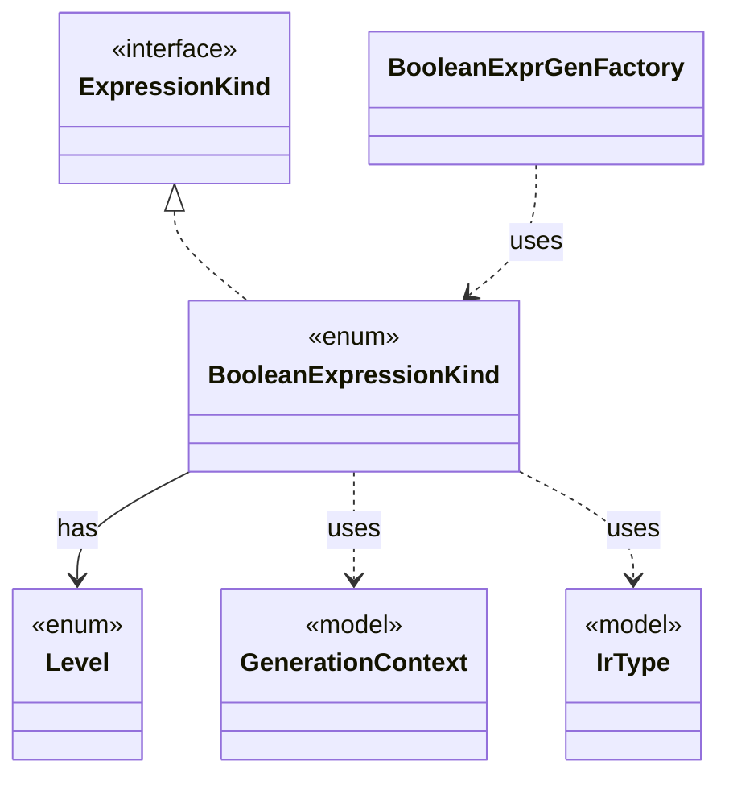

# `BooleanExpressionKind`

`io.github.tlaplus.hardening.gen.engine` · enum · other · [source](https://github.com/tlaplus/model-checker-hardening/blob/918f7db91890f302587d25c76dc7ac189db3d023/src/main/java/io/github/tlaplus/hardening/gen/engine/BooleanExpressionKind.java#L6) · module [gen](../modules/gen.md)

Boolean-valued expression forms.

The diagram draws 5 of 11 relations; the table lists them all.

| Direction | Relation | Type | Summary |
|---|---|---|---|
| → | implements | [ExpressionKind](io.github.tlaplus.hardening.gen.engine.ExpressionKind.md) | A selectable expression form grouped by the component that constructs it. |
| → | has | [Level](io.github.tlaplus.hardening.gen.engine.Level.md) | The TLA+ level of the formula an expression form builds, as Specifying Systems defines it and SANY checks it. |
| → | uses | [GenerationContext](io.github.tlaplus.hardening.gen.engine.GenerationContext.md) | Mutable semantic state shared by every component of one generation run. |
| → | uses | [IrType](io.github.tlaplus.hardening.gen.engine.IrType.md) | Internal type model used to direct checked expression construction. |
| ← | uses | [BooleanExprGenFactory](io.github.tlaplus.hardening.gen.engine.BooleanExprGenFactory.md) | Constructs Boolean-valued expression generators. |
| → | depends | [ExpressionCategory](io.github.tlaplus.hardening.gen.ExpressionCategory.md) | A user-facing category assigned to generated expression forms. |
| → | depends | [IrGenerationConfig](io.github.tlaplus.hardening.gen.IrGenerationConfig.md) | Settings for generated TLA+ expressions and modules. |
| → | depends | [PrimitiveType](io.github.tlaplus.hardening.gen.engine.PrimitiveType.md) | Primitive expression result types. |
| ← | depends | [ExpressionKind](io.github.tlaplus.hardening.gen.engine.ExpressionKind.md) | A selectable expression form grouped by the component that constructs it. |
| ← | depends | [ExpressionKindCatalog](io.github.tlaplus.hardening.gen.engine.ExpressionKindCatalog.md) | The catalog of every expression form, in decoder order. |
| ← | depends | [IrExprGenFactory](io.github.tlaplus.hardening.gen.engine.IrExprGenFactory.md) | Factory for deferred, type-directed expression generators within one generation run. |
