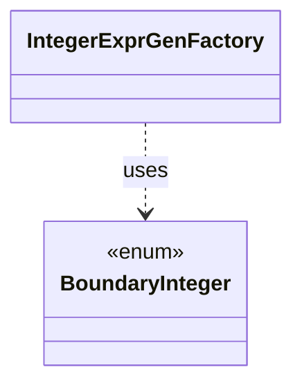

# `BoundaryInteger`

`io.github.tlaplus.hardening.gen.engine` · enum · other · [source](https://github.com/tlaplus/model-checker-hardening/blob/af09a9e32eb710979ef0c76f29507ce1ffe85a15/src/main/java/io/github/tlaplus/hardening/gen/engine/BoundaryInteger.java#L13) · module [gen](../modules/gen.md)

Integer values at which checker arithmetic changes behaviour (ADR 0012).

**Decisions:** [ADR 0012: Integer terminal and boundary literals](https://github.com/tlaplus/model-checker-hardening/blob/af09a9e32eb710979ef0c76f29507ce1ffe85a15/docs/decisions/0012-integer-literals.md)

| Direction | Relation | Type | Summary |
|---|---|---|---|
| ← | uses | [IntegerExprGenFactory](io.github.tlaplus.hardening.gen.engine.IntegerExprGenFactory.md) | Constructs integer-valued expression generators. |
