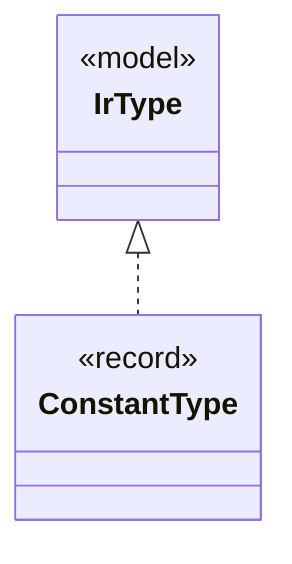

# `ConstantType`

`io.github.tlaplus.hardening.gen.engine` · record · other · [source](https://github.com/tlaplus/model-checker-hardening/blob/4df6a11e5b4bf93609393935c4cbeceec08cce0c/src/main/java/io/github/tlaplus/hardening/gen/engine/IrType.java#L61) · module [gen](../modules/gen.md)

Model-value type.

The diagram draws 1 of 8 relations; the table lists them all.

| Direction | Relation | Type | Summary |
|---|---|---|---|
| → | implements | [IrType](io.github.tlaplus.hardening.gen.engine.IrType.md) | Internal type model used to direct checked expression construction. |
| ← | depends | [GeneralExprGenFactory](io.github.tlaplus.hardening.gen.engine.GeneralExprGenFactory.md) | Constructs terminal and type-polymorphic expression generators. |
| ← | depends | [ImportedTypes](io.github.tlaplus.hardening.gen.engine.ImportedTypes.md) | Converts concrete imported type terms at the private generator boundary. |
| ← | depends | [IndexedValues](io.github.tlaplus.hardening.gen.engine.IndexedValues.md) | The byte-free k-th value of a value type, from which collection terminals take distinct elements (ADR 0011). |
| ← | depends | [IrType](io.github.tlaplus.hardening.gen.engine.IrType.md) | Internal type model used to direct checked expression construction. |
| ← | depends | [IrTypeGenFactory](io.github.tlaplus.hardening.gen.engine.IrTypeGenFactory.md) | Factory for deferred generators of internal types within the configured remaining-depth budget. |
| ← | depends | [OtherExprGenFactory](io.github.tlaplus.hardening.gen.engine.OtherExprGenFactory.md) | Constructs expression generators not covered by the dedicated form families. |
| ← | depends | [OtherExpressionKind](io.github.tlaplus.hardening.gen.engine.OtherExpressionKind.md) | Expression forms not covered by the dedicated type and general families. |
