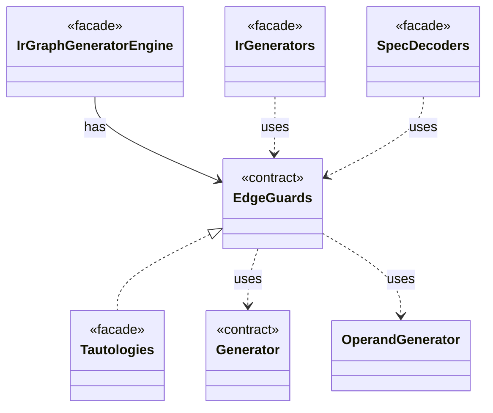

# `EdgeGuards`

`io.github.tlaplus.hardening.gen.engine` · interface · contract · [source](https://github.com/tlaplus/model-checker-hardening/blob/3b201567990514c2a43b90dca521dbe32af37023/src/main/java/io/github/tlaplus/hardening/gen/engine/EdgeGuards.java#L16) · module [gen](../modules/gen.md)

Draws the tautological guards that a graph module conjoins to its edges (ADR 0023 §6).

**Decisions:** [ADR 0023: Graph-based testing](https://github.com/tlaplus/model-checker-hardening/blob/3b201567990514c2a43b90dca521dbe32af37023/docs/decisions/0023-graph-based-testing.md)

| Direction | Relation | Type | Summary |
|---|---|---|---|
| ← | implements | [Tautologies](io.github.tlaplus.hardening.gen.rewrite.Tautologies.md) | Draws edge guards of a graph module from a rule library (ADR 0023 §6): a guard is the formula `A = B` or `A &lt;=&gt; B` of a rule, with every parameter drawn at its type. |
| ← | has | [IrGraphGeneratorEngine](io.github.tlaplus.hardening.gen.engine.IrGraphGeneratorEngine.md) | Reusable decoder of graph inputs (ADR 0023 §2, §3): a control graph whose nodes carry assignment-only actions, tracked by the variable `pc`, and the invariant `pc /= k`. |
| → | uses | [Generator](io.github.tlaplus.hardening.gen.Generator.md) | A composable recipe for decoding a value from a shared `Draw` cursor. |
| → | uses | [OperandGenerator](io.github.tlaplus.hardening.gen.engine.OperandGenerator.md) | Draws expressions for a rewrite that leaves an operand open (ADR 0017 §3), and for the parameters of an edge guard of a graph module (ADR 0023 §6): an operand is drawn by the ordinary expression factory, at its type, in the lexical scope of the rewritten node or the edge, and in the state-level context, so an operand adds no prime. |
| ← | uses | [IrGenerators](io.github.tlaplus.hardening.gen.IrGenerators.md) | Factory methods for deterministic generators of type-checked Apalache IR expressions. |
| ← | uses | [SpecDecoders](io.github.tlaplus.hardening.workflow.spec.SpecDecoders.md) | Immutable registry of the decoders that turn stored payloads into checkable modules. |
