# `ExpressionKind`

`io.github.tlaplus.hardening.gen.engine` · interface · other · [source](https://github.com/tlaplus/model-checker-hardening/blob/47a7fcfd71d20c6a404ebf5a8a3e7d9a0e250e9b/src/main/java/io/github/tlaplus/hardening/gen/engine/ExpressionKind.java#L12) · module [gen](../modules/gen.md)

A selectable expression form grouped by the component that constructs it.

```mermaid
classDiagram
  class ExpressionKind {
    <<interface>>
  }
  class ApplicativeExpressionKind {
    <<enum>>
  }
  class BooleanExpressionKind {
    <<enum>>
  }
  class CustomExpressionKind {
    <<record>>
  }
  class GeneralExpressionKind {
    <<enum>>
  }
  class IntegerExpressionKind {
    <<enum>>
  }
  class OtherExpressionKind {
    <<enum>>
  }
  class SequenceExpressionKind {
    <<enum>>
  }
  class SetExpressionKind {
    <<enum>>
  }
  class TemporalActionExpressionKind {
    <<enum>>
  }
  class IrGenerationConfig {
    <<config>>
  }
  class IrExprGenFactory
  class ExpressionCategory {
    <<enum>>
  }
  class GenerationContext {
    <<model>>
  }
  class IrType {
    <<model>>
  }
  class Level {
    <<enum>>
  }
  class ConfigSchema {
    <<config>>
  }
  class ConfigValueType {
    <<record>>
  }
  class ExpressionKindCatalog {
    <<model>>
  }
  ExpressionKind <|.. ApplicativeExpressionKind
  ExpressionKind <|.. BooleanExpressionKind
  ExpressionKind <|.. CustomExpressionKind
  ExpressionKind <|.. GeneralExpressionKind
  ExpressionKind <|.. IntegerExpressionKind
  ExpressionKind <|.. OtherExpressionKind
  ExpressionKind <|.. SequenceExpressionKind
  ExpressionKind <|.. SetExpressionKind
  ExpressionKind <|.. TemporalActionExpressionKind
  IrGenerationConfig --> ExpressionKind : has
  IrExprGenFactory --> ExpressionKind : has
  ExpressionKind ..> ExpressionCategory : uses
  ExpressionKind ..> IrGenerationConfig : uses
  ExpressionKind ..> GenerationContext : uses
  ExpressionKind ..> IrType : uses
  ExpressionKind ..> Level : uses
  ConfigSchema ..> ExpressionKind : uses
  ConfigValueType ..> ExpressionKind : uses
  ExpressionKindCatalog ..> ExpressionKind : uses
```

The diagram draws 19 of 31 relations; the table lists them all.

| Direction | Relation | Type | Summary |
|---|---|---|---|
| ← | implements | [ApplicativeExpressionKind](io.github.tlaplus.hardening.gen.engine.ApplicativeExpressionKind.md) | Reads, updates and domains of records, tuples and sequences. |
| ← | implements | [BooleanExpressionKind](io.github.tlaplus.hardening.gen.engine.BooleanExpressionKind.md) | Boolean-valued expression forms. |
| ← | implements | [CustomExpressionKind](io.github.tlaplus.hardening.gen.engine.CustomExpressionKind.md) | One configured operator kind; its type scheme comes from the immutable prepared library. |
| ← | implements | [GeneralExpressionKind](io.github.tlaplus.hardening.gen.engine.GeneralExpressionKind.md) | Type-polymorphic and terminal expression forms. |
| ← | implements | [IntegerExpressionKind](io.github.tlaplus.hardening.gen.engine.IntegerExpressionKind.md) | Integer-valued expression forms. |
| ← | implements | [OtherExpressionKind](io.github.tlaplus.hardening.gen.engine.OtherExpressionKind.md) | Expression forms not covered by the dedicated type and general families. |
| ← | implements | [SequenceExpressionKind](io.github.tlaplus.hardening.gen.engine.SequenceExpressionKind.md) | Sequence-valued expression forms. |
| ← | implements | [SetExpressionKind](io.github.tlaplus.hardening.gen.engine.SetExpressionKind.md) | Set-valued expression forms. |
| ← | implements | [TemporalActionExpressionKind](io.github.tlaplus.hardening.gen.engine.TemporalActionExpressionKind.md) | The temporal formulas over an action that Specifying Systems defines: an action occurs in a temporal formula only through them and through fairness. |
| ← | has | [IrGenerationConfig](io.github.tlaplus.hardening.gen.IrGenerationConfig.md) | Settings for generated TLA+ expressions and modules. |
| ← | has | [IrExprGenFactory](io.github.tlaplus.hardening.gen.engine.IrExprGenFactory.md) | Factory for deferred, type-directed expression generators within one generation run. |
| → | uses | [ExpressionCategory](io.github.tlaplus.hardening.gen.ExpressionCategory.md) | A user-facing category assigned to generated expression forms. |
| → | uses | [IrGenerationConfig](io.github.tlaplus.hardening.gen.IrGenerationConfig.md) | Settings for generated TLA+ expressions and modules. |
| → | uses | [GenerationContext](io.github.tlaplus.hardening.gen.engine.GenerationContext.md) | Mutable semantic state shared by every component of one generation run. |
| → | uses | [IrType](io.github.tlaplus.hardening.gen.engine.IrType.md) | Internal type model used to direct checked expression construction. |
| → | uses | [Level](io.github.tlaplus.hardening.gen.engine.Level.md) | The TLA+ level of the formula an expression form builds, as Specifying Systems defines it and SANY checks it. |
| ← | uses | [ConfigSchema](io.github.tlaplus.hardening.config.ConfigSchema.md) | The declaration of every key in `config.toml`: where it lives, what it means, how its value is read, and how it is written back. |
| ← | uses | [ConfigValueType](io.github.tlaplus.hardening.config.ConfigValueType.md) | How the value of one configuration key is read from TOML and written back as TOML syntax. |
| ← | uses | [ExpressionKindCatalog](io.github.tlaplus.hardening.gen.engine.ExpressionKindCatalog.md) | The catalog of every expression form, in decoder order. |
| → | depends | [ApplicativeExpressionKind](io.github.tlaplus.hardening.gen.engine.ApplicativeExpressionKind.md) | Reads, updates and domains of records, tuples and sequences. |
| → | depends | [BooleanExpressionKind](io.github.tlaplus.hardening.gen.engine.BooleanExpressionKind.md) | Boolean-valued expression forms. |
| → | depends | [CustomExpressionKind](io.github.tlaplus.hardening.gen.engine.CustomExpressionKind.md) | One configured operator kind; its type scheme comes from the immutable prepared library. |
| → | depends | [ExpressionKindCatalog](io.github.tlaplus.hardening.gen.engine.ExpressionKindCatalog.md) | The catalog of every expression form, in decoder order. |
| → | depends | [GeneralExpressionKind](io.github.tlaplus.hardening.gen.engine.GeneralExpressionKind.md) | Type-polymorphic and terminal expression forms. |
| → | depends | [IntegerExpressionKind](io.github.tlaplus.hardening.gen.engine.IntegerExpressionKind.md) | Integer-valued expression forms. |
| → | depends | [OtherExpressionKind](io.github.tlaplus.hardening.gen.engine.OtherExpressionKind.md) | Expression forms not covered by the dedicated type and general families. |
| → | depends | [SequenceExpressionKind](io.github.tlaplus.hardening.gen.engine.SequenceExpressionKind.md) | Sequence-valued expression forms. |
| → | depends | [SetExpressionKind](io.github.tlaplus.hardening.gen.engine.SetExpressionKind.md) | Set-valued expression forms. |
| → | depends | [TemporalActionExpressionKind](io.github.tlaplus.hardening.gen.engine.TemporalActionExpressionKind.md) | The temporal formulas over an action that Specifying Systems defines: an action occurs in a temporal formula only through them and through fairness. |
| ← | depends | [FuzzTlaConfig](io.github.tlaplus.hardening.config.FuzzTlaConfig.md) | Complete configuration of input generation and workflow execution. |
| ← | depends | [IrTypeGenFactory](io.github.tlaplus.hardening.gen.engine.IrTypeGenFactory.md) | Factory for deferred generators of internal types within the configured remaining-depth budget. |
